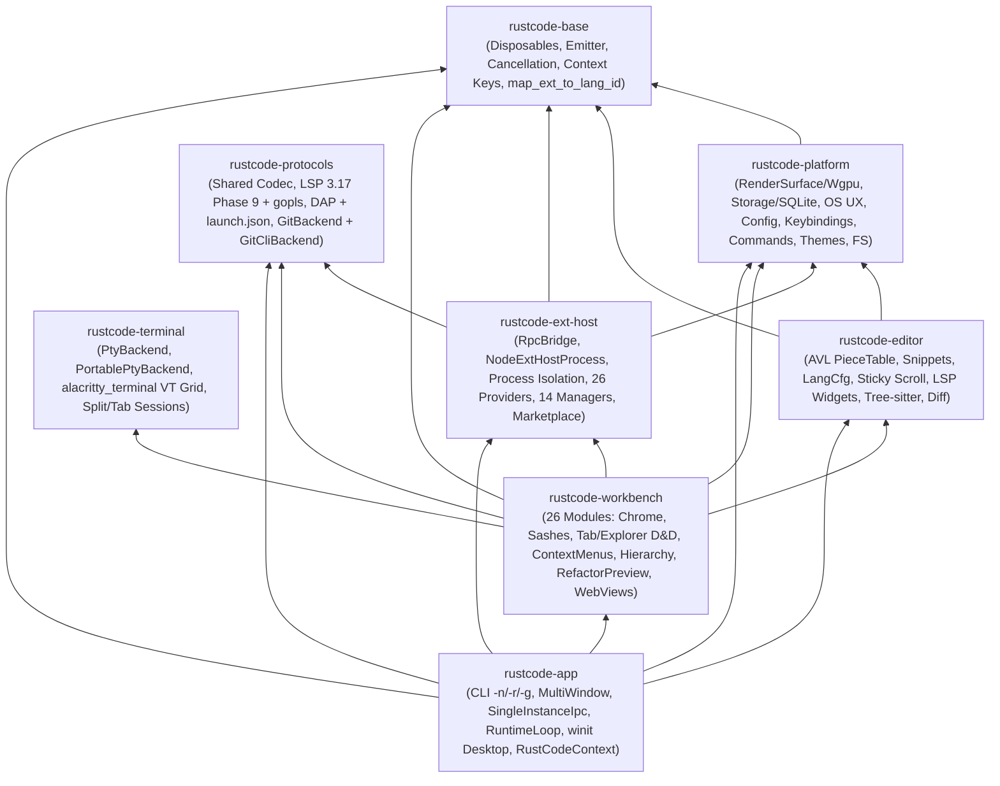

# RustCode Architecture

## Overview & Design Principles

RustCode is a Rust hybrid code editor and IDE workspace organized as an 8-crate Cargo workspace (`resolver = "2"`) plus a Node.js CommonJS extension host API layer (`ext-host-js/`, `vscode.version = '1.95.0'`). It targets both **Windows (`x86_64-pc-windows-gnu`)** and **Linux (`x86_64-unknown-linux-gnu`)** and separates deterministic headless CI/test execution (default features) from native desktop GPU/OS subsystems (`--features desktop`):

- **Scene Graph & Hardware GPU Rendering (`RenderSurface`)**: `rustcode-platform::render` provides `View`, `ViewContext`, `GpuiElement`, `Scene` (`Quad`, `GlyphRun`, `Shadow`, `PushClip`, `PopClip`), and the `RenderSurface` trait. Default headless builds use `MockRenderSurface`; `--features desktop` activates `WgpuRenderSurface` (`wgpu` + `cosmic-text` shaping with ligatures, CJK/emoji/fallback fonts, Codicons, glyph atlas caching, clip stacks, and HiDPI scaling) driven by `winit` in `rustcode-app::desktop`.
- **Live Node.js Extension Host RPC (`NodeExtHostProcess`)**: `rustcode-ext-host` coordinates extension state via `RpcBridge` (`ContentLengthJson`, `ContentLengthMsgPack`, `NewlineJson`), `NodeExtHostProcess` (live framed stdio child-process runner + `from_io` async streams, `IncomingNotifWork::Barrier` causal fence, `JoinSet` half-close EOF draining, Windows `CREATE_NO_WINDOW`, Unix `setsid`/`setpgid`/`killpg` process-group isolation), and `LanguageFeatureBridge` (`handle_rpc_message_result` with structured `RpcError`, plus `handle_rpc_message` wrapper retained for `tests/phase7-e2e/` compatibility), paired with `ext-host-js/rpc-bridge.js` (framed stdio transport, `globalThis` singleton, `installVscodeModuleHook`, and headless/Deno fallback).
- **Real PTY & VT100 Terminal (`rustcode-terminal`)**: `PtyBackend` isolates `HeadlessPtyBackend` (default/headless CI) from `PortablePtyBackend` (`portable-pty` ConPTY/Unix PTY) paired with `TerminalCellGrid` (`alacritty_terminal` VT100/xterm grid emulation, ANSI/256/truecolor, alternate screen, resize, signals, and scrollback) and multi-tab/split `TerminalManager` / `TerminalInstance`.
- **System WebViews (`WebviewBackend`)**: `rustcode-workbench::webview` isolates `HeadlessWebviewBackend` (default/headless CI + pure-Rust fallback) from `--features desktop` `WryWebviewBackend` (`wry` WebView2 / WebKitGTK / WKWebView) wired to `ExtHostWebviewManager` & `ExtHostCustomEditorManager` `postMessage` IPC channels.
- **Pure-Rust Marketplace & VSIX Installer**: `rustcode-ext-host::marketplace` queries Open VSX and unpacks `.vsix` archives using `zip` and `flate2`.

## Workspace Dependency Graph

The dependency edges below match `crates/*/Cargo.toml` directly (note that `rustcode-protocols` and `rustcode-terminal` have zero internal workspace crate dependencies, while `rustcode-editor` and `rustcode-ext-host` depend on `rustcode-base` for core primitives including canonical `map_ext_to_lang_id`):

*(Note: `rustcode-ext-host` declares `[dev-dependencies]` on `rustcode-editor` and `rustcode-workbench` for `tests/compat_suite.rs`, and `rustcode-app` declares `[dev-dependencies]` on `rustcode-terminal`. `rustcode-protocols` depends only on `serde`, `serde_json`, `tokio`, `parking_lot`, and `thiserror`; `rustcode-terminal` depends only on `alacritty_terminal`, `parking_lot`, `portable-pty`, and `serde`.)*

---

## Pre-Phase 8 Architecture Consolidations

Before Phase 8 M1–M6, duplicated helpers, legacy dual states, and unused dependencies were consolidated across the workspace:

- **Single Bounded `Content-Length` Codec (`rustcode_protocols::codec`)**: Removed the duplicate `crates/rustcode-protocols/src/lsp/codec.rs` (`LspCodecError`); `LspClient`, `DapClient`, and `NodeExtHostProcess` (`crates/rustcode-ext-host/src/rpc/mod.rs`) share linear O(N) `Content-Length` framing with strict `64 KiB` header and `64 MiB` frame limits.
- **Canonical Language ID Mapper (`rustcode_base::map_ext_to_lang_id`)**: Unified previously drifted extension-to-language mappings (`.hh`/`.hxx`, `.txt`/`.log`, `.sh`/`.bash`, etc.) into `rustcode-base`, shared by `rustcode-editor::document::TextDocument` and `rustcode-ext-host::provider::bridge`.
- **Shared JS Codecs (`ext-host-js/node-compat/buffer.js`)**: Centralized `base64ToBytes`, `bytesToBase64`, `utf8ToBytes`, `utf8EncodeInto`, and `bytesToUtf8` in `buffer.js` for reuse by `fs.js` and `util.js` (`TextEncoder`/`TextDecoder`).
- **Centralized Geometry, Scene, Fuzzy & Bench Helpers**: Replaced local duplicates across `rustcode-editor` and `rustcode-workbench` with `Rect::{is_finite, is_finite_positive, clamp_to_bounds}`, `FontMetrics::is_finite`, `Scene::{push_finite_quad, push_finite_text, push_finite_shadow}`, `rustcode_workbench::fuzzy_match`, and `rustcode_platform::bench_support::BenchmarkStats`.
- **Dead-Code, Dual-State & Dependency Pruning**: Deleted unused AVL rotations in `piece_table.rs`, removed unused `RustCodeContext::editor_area`, replaced no-op `gpui` Cargo features with `desktop`, removed legacy `FileExplorer::root` in favor of `roots: Vec<FileTreeNode>`, trimmed unused `[dependencies]` (`smallvec`, `thiserror`, `serde`, moving `rustcode-terminal` in `rustcode-app` to `[dev-dependencies]`), deduplicated `WorkbenchWindow::sync_*` / `sync_for_render` projections (`sync_window_overlays`, `sync_testing_view_from_bridge`), and kept `LanguageFeatureBridge::handle_rpc_message` cleanly delegating to `handle_rpc_message_result` for E2E compatibility.

---

## Subsystem Breakdown (Phases 0–9)

### 1. `crates/rustcode-base` (Layer 0)
Shared foundational primitives with zero internal workspace dependencies:
- **`cancellation` (`src/cancellation.rs`)**: `CancellationToken`, `CancellationTokenSource`.
- **`context_key` (`src/context_key.rs`)**: `ContextKeyExpr`, `ContextKeyError`, `ContextKeyService` (VS Code `when` clause boolean expression parser & evaluator, including `[^]/]` / `[]a]` character-class regex literal parsing).
- **`disposable` (`src/disposable.rs`)**: `Disposable`, `DisposableStore`, `ActionDisposable`, `ArcDisposable`, `to_disposable`.
- **`event` (`src/event.rs`)**: Generic thread-safe `Emitter<T>` and `Event<T>`.
- **`map_ext_to_lang_id` (`src/lib.rs`)**: Canonical case-insensitive file extension to VS Code language ID mapper shared by `rustcode-editor` and `rustcode-ext-host`.

### 2. `crates/rustcode-platform` (Layer 1)
Core platform services, UI scene graph, persistence, OS UX, and accessibility (`desktop` feature gates `wgpu`, `cosmic-text`, `bytemuck`, `raw-window-handle`, `rusqlite`, and `rfd`):
- **`accessibility` (`src/accessibility.rs`)**: `AccessibilityTree`, `AccessibleNode`, `AccessibleRole`, `AccessibleState`.
- **`commands` (`src/commands/mod.rs`)**: `CommandRegistry`, `CommandCallback`, token-checked `Disposable` entries, lock-free `execute()` invocation.
- **`configuration` (`src/configuration/mod.rs`)**: `ConfigurationService`, `ConfigurationInspection`, `ConfigurationChangeEvent`, `ConfigurationTarget` (defaults -> user -> workspace -> folder hierarchy, JSONC parsing, disk settings/keybindings loading, `inspect`, `get_for_resource`, `get_merged_for_resource`, `folder_settings_snapshot`, `affected_folders`, Windows `paths_equivalent` folder key resolution, live update/reset; includes `editor.wordWrap`, `editor.wordWrapColumn`, `editor.minimap.enabled`, `editor.formatOnSave`, `breadcrumbs.enabled`, `terminal.integrated.shell.{linux,windows}`, `files.autoSave`).
- **`fs` (`src/fs/mod.rs` & crate root)**: `FileSystemService`, `FileSystemWatcher` (powered by `notify`), `FileMetadata`, `FileChangeEvent`, `FileChangeType`, `FileConflict`, `FileSystemError`, `hash_content`, plus cross-platform URI/path helpers (`file_uri_to_path`, `path_to_file_uri`, `is_file_uri`, `path_starts_with`, `path_strip_prefix`, `paths_equivalent`, `strip_windows_verbatim_prefix`).
- **`keybindings` (`src/keybindings/mod.rs`)**: `KeybindingService`, `KeyChord`, `KeyCombo`, `Modifiers`, `ResolvedKeybinding` (multi-chord matching & `when` clause evaluation).
- **`os_ux` (`src/os_ux.rs`)**: `AppPaths` / `WorkspacePaths` (resolved via `dirs` with `--user-data-dir` / `--extensions-dir` overrides), `ClipboardBackend` (`ArboardClipboardBackend` via `arboard` + `InMemoryClipboardBackend`), and `FileDialogBackend` (`#[cfg(feature = "desktop")] RfdFileDialogBackend` via `rfd` + `MockFileDialogBackend`).
- **`storage` (`src/storage.rs`)**: `StorageBackend` trait (`InMemoryStorageBackend` default + `#[cfg(feature = "desktop")] SqliteStorageService` backed by bundled `rusqlite`) persisting recent workspaces, `PersistedWorkspaceState` / `PersistedTabState` (open tabs, cursor/scroll, layout, active theme), and extension `Memento` (`Global` / `Workspace` JSON state).
- **`render` (`src/render/{mod,color,event,font,geometry,scene,surface,theme_style,view,wgpu_surface}.rs`)**: `View`, `ViewContext`, `GpuiElement`, `Scene` (`push_finite_quad`, `push_finite_text`, `push_finite_shadow`), `SceneNode` (`Quad`, `GlyphRun`, `Shadow`, `PushClip`, `PopClip`), `RenderSurface`, `MockRenderSurface` (default), `WgpuRenderSurface` (`#[cfg(feature = "desktop")]`, `wgpu` + `cosmic-text` `TextShaper`, `ClipStack`, `GlyphAtlasAllocator`, `SceneBatchBuilder`, `clamp_corner_radii`, `sanitize_scale_factor`), `FontMetrics`, `WorkbenchThemeStyles`, `InputEvent`, `ClickTracker`, `KeyEvent`, `KeyCode`, `MouseEvent`, `MouseMoveEvent`, `MouseButton`, `ScrollEvent`, `EventResult`, `Rect`, `Point`, `Size`, `Edges`, `Corners`, `Rgba`, `Hsla`.
- **`theme` (`src/theme/mod.rs`)**: `ThemeService`, `ColorTheme`, `ThemeKind`, `TokenColorRule`.

### 3. `crates/rustcode-editor` (Layer 2)
Core text buffer, Unicode/encoding engine, daily-driver editing interactions, syntax, find/replace, folding, soft word-wrap, multi-cursor, and editor views (`desktop` feature enables `tree-sitter` + 5 bundled language parsers):
- **`model` (`src/model/{mod,piece_table,undo_redo}.rs`)**: O(log n) AVL-rebalanced `PieceTable` (`rotate_left`, `rotate_right`, `rebalance`), `Piece`, `PieceSource`, `TextEdit`, `UndoRedoStack`, `UndoElement`, `unicode-segmentation` grapheme-cluster navigation, `unicode-width` display column helpers (`grapheme_display_width`, `str_display_width`, `utf16_col_to_display_col`, `display_col_to_utf16_col`, `display_x_col_to_utf16_col`), and UTF-16 alignment (`byte_offset_to_utf16_col`, `utf16_col_to_byte_offset`).
- **`snippets` (`src/snippets/mod.rs`)**: VS Code TextMate snippet parser & expansion engine (`SnippetRegistry`, `SnippetSession`, `SnippetContext`, `expand_snippet_with_context`, nested tabstops, `${1|a,b,c|}` choices, regex transforms, linked mirrors, `$TM_*` / `$CURRENT_*` variables).
- **`language_config` (`src/language_config.rs`)**: VS Code `language-configuration.json` loader (`LanguageConfiguration`, `LanguageConfigurationRegistry`, auto-indent rules, on-enter rules, surrounding/auto-closing pairs, comments).
- **`cursor` (`src/cursor/mod.rs`)**: `Position`, `Range`, `RangeEdit`, `Selection`, `CursorState` (`clear_secondary_cursors`, `normalize_and_merge`).
- **`document` (`src/document/{mod,auto_save}.rs`)**: `TextDocument` delegating language ID resolution to `rustcode_base::map_ext_to_lang_id`, `TextEncoding` (`encoding_rs` load/save for UTF-8, UTF-8 BOM, UTF-16LE/BE, Windows-1252, Shift-JIS + binary detection), `AutoSaveService`, `AutoSaveConfig`, `AutoSaveMode`.
- **`folding` (`src/folding/mod.rs`)**: `FoldingModel`, `FoldingRange`, `FoldingRangeKind` (`Region`, `Comment`, `Imports`, `Brace`, `Indentation`) for brace/indent range detection and collapsible ranges.
- **`find_replace` (`src/find_replace.rs`)**: `FindReplaceWidget`, `FindReplaceFocus`, `FindMatch`, `FindReplaceClickTarget`, `FindReplaceLayout` — floating in-editor Find (`Ctrl+F`) & Replace (`Ctrl+H`) overlay with case-sensitive (`Aa`), whole-word (`ab`), and regex (`.*`) toggles, zero-width regex guard, invalid regex safety, UTF-16/CRLF offset mapping, fold auto-unfolding, single-undo atomic Replace All, and tiny-viewport rect clamping.
- **`syntax` (`src/syntax/{mod,highlighter,registry,scope,textmate,treesitter,rust,javascript,json,markdown,python,go,c,cpp,html,css,toml,yaml}.rs`)**: `SyntaxHighlighter`, `Grammar`, `GrammarRegistry`, `GrammarState` (including `RawString { delimiter }`, `HtmlInTag`, `HtmlScript`, `HtmlStyle`, `TextMateStackFrame`), `SyntaxScope`, `TokenMetadata`, `TokenSpan`, **TextMate `.tmLanguage` / `.tmLanguage.json` grammar loader** (`TextMateGrammar`, `load_textmate_contribution`, `map_tm_scope_to_syntax_scope` via `plist` + `fancy-regex` with bounded step/depth guards), **`tree-sitter` incremental engine** (`#[cfg(feature = "desktop")] TreeSitterEngine`, `TreeSitterDocument` for Rust, JS, TS/TSX, Python, JSON), and **14** built-in pure-Rust state-machine grammars registered in `GrammarRegistry::new()`:
  - `PlainTextGrammar` (`plaintext`: `.txt`, `.text`, `.log`)
  - `RustGrammar` (`rust`: `.rs`)
  - `JavaScriptGrammar` (`javascript`: `.js`, `.jsx`, `.mjs`, `.cjs`)
  - `TypeScriptGrammar` (`typescript`: `.ts`, `.tsx`, `.mts`, `.cts`)
  - `PythonGrammar` (`python`: `.py`, `.pyw`, `.pyi`)
  - `JsonGrammar` (`json`: `.json`, `.jsonc`)
  - `MarkdownGrammar` (`markdown`: `.md`, `.markdown`)
  - `GoGrammar` (`go`: `.go`)
  - `CGrammar` (`c`: `.c`, `.h`)
  - `CppGrammar` (`cpp` / C++: `.cpp`, `.cc`, `.cxx`, `.hpp`, `.hh`, `.hxx`)
  - `HtmlGrammar` (`html`: `.html`, `.htm`, with embedded `<script>`/`<style>` delegation)
  - `CssGrammar` (`css`: `.css`, `.scss`, `.less`)
  - `TomlGrammar` (`toml`: `.toml`)
  - `YamlGrammar` (`yaml`: `.yaml`, `.yml`)
- **`completion` (`src/completion/mod.rs`)**: `AutocompleteWidget`, `CompletionItem`, `CompletionItemKind`, `CompletionList`, `expand_snippet`, `fuzzy_match`.
- **`diff` (`src/diff/{mod,myers,view}.rs`)**: `DiffEditorView`, `DiffModel`, `DiffViewMode`, `DiffOpKind`, `DiffChange`, `InlineDiffRow`, `SideBySideDiffRow`, `DiffCell`, `EditOp`, `myers_diff`.
- **`viewmodel` (`src/viewmodel/mod.rs`)**: `DecorationModel`, `LineDecoration`, `DecorationKind`, `EditorDiagnostic`, `DiagnosticSeverity`.
- **`view` (`src/view/{mod,brackets,comments,context_menu,lsp_widgets,minimap,sticky_scroll}.rs`)**: Daily-driver `EditorView` (clipboard `Ctrl+C`/`X`/`V` incl. empty-selection line copy/cut, mouse drag & double/triple-click selection, scrollbar & Minimap dragging, `Ctrl+/` `CommentConfig` line/block comment toggling, `Alt+Up/Down` move & `Shift+Alt+Up/Down` duplicate lines, multi-line `Tab`/`Shift+Tab` indent/outdent, rainbow brackets & bracket-pair guides [`brackets.rs`], Sticky Scroll header overlay [`sticky_scroll.rs`], right-click `EditorContextMenu`, rich Markdown `LspHoverInfo` popover, Signature Help widget, Peek View, Inline Rename, Semantic Tokens layering, Inlay Hints, CodeLens, Document Links [`lsp_widgets.rs`], 4 MB / 50k-line virtualization guards + `benches/large_file.rs` for 100 MB+ buffers, `find_replace: FindReplaceWidget`, and atomic `apply_offset_edits`), `WordWrapMode`, `EditorGutterAction`, `MinimapState`, `MinimapLayout`, `get_builtin_completions`, plus `VisualLayout` & `WrapSegment`.

### 4. `crates/rustcode-terminal` (Terminal Subsystem)
PTY-backed terminal engine with zero internal workspace dependencies (`src/{lib,pty,grid}.rs`):
- Constants: `DEFAULT_MAX_SCROLLBACK = 2000`, `DEFAULT_COMMAND_TIMEOUT_MS = 5000`, `DEFAULT_TERMINAL_ROWS = 24`, `DEFAULT_TERMINAL_COLS = 80`.
- **`pty` (`src/pty.rs`)**: `PtyBackend` trait (`write_input`, `read_output`, `resize`, `send_signal`, `try_wait`, `is_alive`), `PtySpawnConfig`, `TerminalSignal`, `HeadlessPtyBackend` (deterministic in-memory test backend), and `PortablePtyBackend` (real ConPTY / Unix PTY via `portable-pty`).
- **`grid` (`src/grid.rs`)**: `TerminalCellGrid`, `TerminalGridSnapshot`, `TerminalCell` powered by `alacritty_terminal` VT100/xterm emulation (SGR 16/256/truecolor, cursor movement, alternate screen, scrollback, and resize propagation).
- **`TerminalInstance`**, **`TerminalTab`**, & **`TerminalManager`**: Multi-tab and split-pane session management (`create_terminal`, `close_terminal`, `split_active_terminal`, `set_active_tab`, `close_tab`, `set_active_pane`, `focus_next_pane`, `focus_prev_pane`, `close_active_terminal`), interactive PTY + grid attachment, and fallback command execution.

### 5. `crates/rustcode-protocols` (Layer 5)
Language, debug, and version-control protocol models and CLI backends (`Cargo.toml` has zero internal workspace crate dependencies):
- **`codec` (`src/codec.rs`)**: Shared bounded O(N) `Content-Length` stdio codec (`CodecError`, `encode_framed_message`, `decode_framed_message`, `read_framed_message`, `write_framed_message`, `MAX_HEADER_BYTES = 64 KiB`, `MAX_FRAME_BYTES = 64 MiB`).
- **`lsp` (`src/lsp/{mod,client,manager,types}.rs`)**: `LspClient`, `LspError`, `LspClientManager` (auto-attaches configured servers on file open with non-fatal missing-binary caching; default configs for `rust` [`rust-analyzer`], `typescript`/`javascript` [`typescript-language-server`], `python` [`pyright-langserver`], `json` [`vscode-json-language-server`], and `go` [`gopls`]), `LspServerConfig`, and Phase 9 LSP 3.17 DTOs (`LspPosition`, `LspRange`, `LspLocation`, `LspDiagnostic`, `LspCompletionItem`, `Hover`, `DocumentSymbol`, `SymbolInformation`, `CodeAction`, `WorkspaceEdit` + `DocumentChange::{CreateFile, RenameFile, DeleteFile}`, `LspTextEdit`, `FormattingOptions`, `SignatureHelp`, `SemanticTokens`, `decode_semantic_tokens`, `InlayHint`, `CodeLens`, `DocumentLink`, `CallHierarchyItem`, `TypeHierarchyItem`, etc.).
- **`dap` (`src/dap/{mod,client,launch,types}.rs`)**: `DapClient`, `DapError`, `DapEventListener`, `DapMessage`, `.vscode/launch.json` JSONC parser (`LaunchConfigFile`, `LaunchConfiguration`, `LaunchRequestKind`, `LaunchVariableContext`, `${workspaceFolder}` / `${file}` variable expansion), and DAP protocol types (`InitializeRequestArguments`, `Capabilities`, `Source`, `SourceBreakpoint`, `Breakpoint`, `Thread`, `StackFrame`, `Scope`, `Variable`, `StoppedEventBody`, `OutputEventBody`, `ContinuedEventBody`).
- **`git` (`src/git/mod.rs`)**: `GitBackend` trait (`InMemoryGitBackend` for deterministic tests + `GitCliBackend` invoking real `git` CLI `status --porcelain=v2 -b`, `diff`, `show HEAD:<path>`, `add`, `restore --staged`, `commit`, `log`), `GitStatusSnapshot`, `ScmRepository`, `GitStatusEntry`, `GitStatusKind`, `BranchInfo`, `CommitInfo`.

### 6. `crates/rustcode-ext-host` & `ext-host-js/` (Layer 4)
Extension runtime, manifest/marketplace services, and VS Code API shims:
- **`rpc` (`src/rpc/mod.rs`)**: `RpcBridge`, `RpcMessage` (`Request`, `Response`, `Notification`), `RpcError`, `RpcErrorPayload`, `RpcWireFormat` (`ContentLengthJson`, `ContentLengthMsgPack`, `NewlineJson`), `RpcRequestHandler`, `NodeExtHostConfig`, `NodeExtHostProcess` (`spawn`, `from_io`, `JoinSet` half-close EOF draining, Windows `CREATE_NO_WINDOW`, sequential FIFO incoming notification worker + `IncomingNotifWork::Barrier` causal fence, `reader_closed` fast-fail), `resolve_node_binary`, `resolve_ext_host_entry`, `PendingRequestGuard`, and shared bounded O(N) `Content-Length` framing aligned with `rustcode_protocols::codec` (`64 KiB` header / `64 MiB` frame limits).
- **`manifest` (`src/manifest/mod.rs`)**: `ExtensionManifest`, `Contributions` (**13** contribution fields including `customEditors` / `CustomEditorContribution::matches_path`, `snippets` / `SnippetContribution`, `menus` / `MenuContribution`), `CustomEditorSelector`, `DebuggerContribution`, `TaskDefinitionContribution`, `AuthenticationContribution`, `ViewContribution`, `GrammarContribution`, `ContributedCommand`, `LanguageContribution`, `ThemeContribution`, `KeybindingContribution`, `LoadedExtension`, `ExtensionLoader`, `ExtensionSnapshot`.
- **`marketplace` (`src/marketplace/{mod,catalog,client,downloader,installer,transport,types}.rs`)**: `MarketplaceClient`, `ExtensionDownloader` (pure-Rust VSIX unpacking via `zip`/`flate2` with path traversal protection), `ExtensionInstaller`, `HttpTransport`, `CurlHttpTransport`, `MockHttpTransport`, `curated_catalog` (8 extensions), `search_curated_catalog`.
- **`provider` (`src/provider/{mod,bridge}.rs`)**: `ProviderType` (**26** variants incl. Phase 9 SignatureHelp/Implementation/TypeDefinition/Rename/SemanticTokens/InlayHints/CodeLens/DocumentLink/CallHierarchy/TypeHierarchy; `TreeData` aliases `"TreeDataProvider"`), `ProviderRegistration`, `ProviderRegistry`, `TreeRefreshEvent`, `LanguageFeatureBridge` (using `rustcode_base::map_ext_to_lang_id`), `ExtWorkspaceFolder`, `OpenDocumentSnapshot`, `handle_rpc_message_result` (13+ namespaces including `process.*`, with `handle_rpc_message` retained for E2E backwards compatibility), `command_mutation_lock`, `MAX_JS_COMMAND_DEPTH = 8`, sandboxed `handle_fs_rpc` (symlink limit 40, Win/Unix `map_io_error`, `EISDIR` checks), synchronous document lifecycle bridge (`did_{open,change,save,close}_document_sync`), `DiagnosticCollectionManager`, `ExtStatusBarManager` (with `revision()` tracking), `TreeItem`, `TreeItemCollapsibleState`.
- **`process` (`src/process/mod.rs`)**: Cross-platform `handle_process_rpc` & `map_process_io_error` implementing `process.exec`, `process.spawn`, and `process.spawnSync` with `cwd` resolution (`fs_root` default, `file://` URI decoding), `env` overrides, `stdin` input, `maxBuffer` enforcement, bounded `tokio::time::timeout` + process-tree termination (`taskkill /PID <pid> /T /F` + `CREATE_NO_WINDOW` on Windows, `setsid`/`setpgid` + `killpg` group termination on Unix), and structured `RpcError` (`EINVAL`, `ENOENT`, `ENOTDIR`).
- **Domain Managers (14 total on `LanguageFeatureBridge`)**:
  - `DiagnosticCollectionManager` & `ExtStatusBarManager` (`src/provider/bridge.rs`)
  - `notebook` (`src/notebook/mod.rs`): `ExtHostNotebookManager`
  - `output` (`src/output/mod.rs`): `ExtHostOutputManager`
  - `terminal` (`src/terminal/mod.rs`): `ExtHostTerminalManager`
  - `scm` (`src/scm/mod.rs`): `ExtHostScmManager`
  - `debug` (`src/debug/mod.rs`): `ExtHostDebugManager`
  - `tasks` (`src/tasks/mod.rs`): `ExtHostTaskManager`
  - `testing` (`src/testing/mod.rs`): `ExtHostTestManager`
  - `auth` (`src/auth/mod.rs`): `ExtHostAuthManager`
  - `webview` (`src/webview/mod.rs`): `ExtHostWebviewManager` & `ExtHostCustomEditorManager`
  - `window` (`src/window/mod.rs`): `ExtHostWindowManager` (`NotificationResponder`, `PromptResponder`, `cancelPrompt` TOCTOU guard, `active_editor`, `visible_editors`, `showTextDocument`)
  - `env` (`src/env/mod.rs`): `ExtHostEnvManager` (`env.getOsInfo` / `ExtOsInfo` host metadata, `ClipboardBackend`: `OsClipboardBackend`/`InMemoryClipboardBackend`; `ExternalUriOpener`: `OsExternalUriOpener`/`RecordingExternalUriOpener`, `is_valid_external_uri`)
- **`ext-host-js/`**: `package.json`, `rpc-bridge.js` (framed stdio `content-length`/`newline-json`, `globalThis` singleton, `installVscodeModuleHook`, `createRpcError`, `registerInitHook`), **9** `node-compat/` modules (`events.js`, `fs.js`, `path.js`, `buffer.js`, `url.js`, `util.js`, `os.js`, `crypto.js`, `child_process.js` — pure-JS/RPC implementations sharing `buffer.js` Base64/UTF-8 helpers across `fs.js` & `util.js`, plus hardened `util.isDeepStrictEqual`), `vscode-api/index.js` (`version: '1.95.0'`) exporting 12 namespaces (`commands`, `window`, `workspace`, `languages`, `notebooks`, `scm`, `debug`, `tasks`, `tests`, `authentication`, `env`, `extensions`) + core types (`types.js`, including `EventEmitter`, `Uri`, `RelativePattern`, `FileSystemError`), and `test.js`.

### 7. `crates/rustcode-workbench` (Layer 3)
Workbench shell, sidebars, editor grid, overlays, and panels (`src/lib.rs` exports **26** modules and shared `fuzzy_match`; `desktop` feature enables `wry` + `raw-window-handle`):
- **Core Shell & Window**: `layout` (`WorkbenchLayout`, `SharedWorkbenchLayout`, `LayoutHandle`, `PanelPosition::{Bottom, Left, Right}`, `ZenModeSnapshot`, Secondary Sidebar state, `zoom_level`), `titlebar` (`TitleBarView` menus, layout/window controls), `context_menu` (`ContextMenuRegistry`, `WorkbenchContextMenu`, `MenuLocation` with `when` evaluation), `workbench_view` (`WorkbenchView`, `WorkbenchRegions`, `FocusedRegion`, `WorkbenchSash::{Sidebar, SecondarySidebar, Panel}` drags, Secondary Sidebar Outline/Hierarchy switcher, Explorer->Editor drop, `WorkbenchAction`), `window` (`WorkbenchWindow`, `WindowCommandSink`, `SuppressCommandGuard`, `sync_focus_context_keys` before keybinding dispatch, auto-LSP attachment incl. Phase 9 RPCs & `editor.formatOnSave` hook, live `DapClient` + `launch.json` session dispatch, `GitCliBackend` SCM + Status Bar branch readout, `PtyBackend` + `TerminalAction` sync, `WebviewBackend` `postMessage` sync, document lifecycle forwarding, `WorkspaceEdit` atomic undo, and shared UI sync hooks), `workspace`, `activitybar` (6 items), `statusbar`, `breadcrumbs`, `quickinput` (`CommandPalette`, `CommandPaletteView`, `QuickInputMode`, `nucleo-matcher`), `notifications`, `hierarchy` (`HierarchySidebarView` for Call/Type Hierarchy), `refactor_preview` (`RefactorPreviewOverlay` & `WorkspaceEditUndoStack` supporting edits + `CreateFile`/`RenameFile`/`DeleteFile`).
- **Editor Grid & Specialized Editors**:
  - `editor_area` (`src/editor_area/mod.rs`): `EditorArea`, `EditorAreaView` (`rename_tab`, `close_tabs_for_path`, `find_open_tab_uri_for_path`), `EditorGroup`, `EditorTab`, `EditorAreaAction`, `SplitDirection` (`Horizontal`, `Vertical`), `EditorGridNode` (`Leaf`, `Split`), `EditorSash` — recursive split editor grid and custom editor dispatch.
  - `webview` (`src/webview/mod.rs`): `WebviewBackend` trait (`HeadlessWebviewBackend` default/tests + `#[cfg(feature = "desktop")] WryWebviewBackend` via `wry` with `acquireVsCodeApi().postMessage` IPC shim), `WebviewEditorView`, `ParsedWebviewNode`, `WebviewElementKind`.
  - `notebook` (`src/notebook/mod.rs`): `NotebookEditorView`, `NotebookDocument`, `NotebookCell`, `NotebookKernel`, `KernelValue`, `CellKind`, `CellOutput`.
  - `settings_ui` (`src/settings_ui/mod.rs`): `SettingsUiView`, `SettingsUiState`, `SettingsCategory`, `SettingsItem`, `SettingsValueType`.
- **Sidebars**: `explorer` (`FileExplorer` using `roots: Vec<FileTreeNode>`, `FileExplorerView` — Windows drive-root / `/` `node_display_name` fallback, inline CRUD `"New File"`/`+F`, `"New Folder"`/`+D`, `F2` rename, confirmed `Delete`, `validate_entry_name`, keyboard navigation, and contributed `TreeDataProvider` views), `search` (`SearchView`, `SearchQuery`, `SearchResults`, `search::engine` powered by `ignore` + `grep-regex` + `grep-searcher` (`ripgrep`) workspace search/replace + `nucleo-matcher` file ranking), `scm` (`ScmView`, `ScmAction` wired to `GitBackend` / `GitCliBackend`, empty by default with no `sample_repository()` placeholder), `debug` (`DebugSidebarView`, `DebugToolbarView` hidden when idle `is_visible == false`, `DebugConsoleView`, `DebugToolbarAction`, `DebugViewAction` wired to `DapClient` + `launch.json`), `extensions_view` (`ExtensionsSidebarView`, `curated_marketplace_extensions`), `testing` (`TestingSidebarView`, `TestingAction`, `TestingTreeRow` — `workbench.view.testing`, disposed-controller filtering, durations/failures, `"Run All"` `tests.runTests` RPC dispatch, cross-platform `file://` URI click-to-open).
- **Bottom Panels**: `terminal_panel` (`TerminalPanelView`, `TerminalAction`, `TerminalClickTarget` rendering VT cell grids & cursor), `output_panel` (`OutputPanelView`, `OutputChannelData`, `OutputAction`, `OutputClickTarget`), `problems` (`ProblemsPanel`, `ProblemEntry`, `ProblemsAction`).

### 8. `crates/rustcode-app` (Layer 6)
Application CLI, live Tokio runtime loop, native `winit` desktop host, and end-to-end verification (`desktop` feature enables `winit`, `raw-window-handle`, `rustcode-workbench/desktop`, `rustcode-platform/desktop`):
- **`src/cli.rs`**: `CliOptions`, `CliAction`, `CliError`, `GotoTarget`, `StartupMode` — supports `[PATH...]`, `--headless`, `--gui`, `-n`/`--new-window`, `-r`/`--reuse-window`, `-g`/`--goto <FILE:LINE[:COL]>` (Windows drive-letter safe), `--user-data-dir <DIR>`, `--extensions-dir <DIR>`, `--disable-extensions`, `-V`/`--version`, `-h`/`--help`.
- **`src/multi_window.rs`**: `WindowManager`, `OpenRequest`, `SingleInstanceBind`, and cross-platform `SingleInstanceIpc` (`#[cfg(windows)]` `127.0.0.1:0` loopback TCP + token lockfile in `user_data_dir`, `#[cfg(unix)]` Unix domain socket) forwarding files/`--goto` requests to the active desktop instance.
- **`src/runtime.rs`**: `BootstrappedApp`, `RuntimeLoop`, `RuntimeLoopConfig` — resolves `AppPaths` (`dirs`), loads disk settings/keymaps/themes/snippets/language-configs/menus/extensions (`~/.rustcode/` & `.vscode/`), initializes `SqliteStorageService` (`desktop`) or `InMemoryStorageBackend` (headless), persists & restores extended `PersistedWorkspaceState` layout chrome, binds `ArboardClipboardBackend` & `RfdFileDialogBackend` (`desktop`) / `MockFileDialogBackend`, runs background Tokio runtime driving `FileSystemWatcher`, `AutoSaveService`, and live `NodeExtHostProcess` auto-activation & bounded crash recovery.
- **`src/desktop.rs` (`#[cfg(feature = "desktop")]`)**: Multi-window `winit` OS event loop (`DesktopApp` tracking `HashMap<WindowId, ManagedDesktopWindow>`, `ApplicationHandler`, `DesktopWakeEvent::RuntimeTick`) bridging keyboard, IME (`Preedit`/`Commit`), mouse (`ClickTracker` 1/2/3-click detection), scroll, resize (0x0 minimized guard), new-window spawn (`Ctrl+Shift+N`), and close events into `WorkbenchWindow` and `WgpuRenderSurface`.
- **`src/lib.rs`**: `RustCodeContext` (owns `ConfigurationService`, `CommandRegistry`, `KeybindingService`, `ContextKeyService`, `ThemeService`, `SharedWorkbenchLayout`, `FileExplorer`, `ExtensionLoader`, `Arc<FileSystemService>`, `Arc<LanguageFeatureBridge>`, `DisposableStore`, and `window_sinks`; `register_builtin_commands()` and `create_window()`).
- **`src/main.rs`**: Binary entry point (`rustcode`); routes zero-arg / `--headless` through `MockRenderSurface` (preserving `"Rendered GPUI Scene:"` & `"Bootstrap completed successfully."` stdout) or `--gui` / `[PATH...]` / `--goto` into `desktop::run_desktop_event_loop` when compiled with `--features desktop`.
- **`tests/integration_tests.rs`** & **`benches/`** (`startup_time.rs`, `memory_footprint.rs`, sharing `rustcode_platform::bench_support::BenchmarkStats` with `rustcode-editor/benches/editor_latency.rs`).

### 9. CI & Standalone E2E Suites (`.github/workflows/ci.yml`, `tests/phase7-e2e/`, `tests/phase8-e2e/`, `tests/phase9-e2e/`)
- **`.github/workflows/ci.yml`**: Matrix workflow on `windows-latest` and `ubuntu-latest` executing default + `--features desktop` workspace tests (`xvfb-run` on Linux), `compat_suite`, `ext-host-js/test.js`, `tests/phase7-e2e/`, `tests/phase8-e2e/`, `tests/phase9-e2e/`, `clippy -D warnings` (default, `--features desktop`, and Windows->Linux `x86_64-unknown-linux-gnu` cross-target), `cargo bench --workspace --no-run`, and `scripts/package.ps1` / `scripts/package.sh` packaging verification.
- **`tests/phase7-e2e/`, `tests/phase8-e2e/`, & `tests/phase9-e2e/`**: Isolated standalone Cargo workspaces outside root `Cargo.toml` providing opaque-box Tier 1–4 Rust + JS E2E suites.

---

## Key Cross-Cutting Flows

1. **Input & Command Dispatch**:
   `InputEvent` enters `WorkbenchWindow::dispatch_event` -> `KeybindingService::handle_key` resolves single- and multi-chord sequences against `ContextKeyService` `when` clauses -> matched command IDs invoke `CommandRegistry` and `WorkbenchWindow::handle_builtin_command_effects` -> unbound editor/panel key events route via `WorkbenchView` (`FocusedRegion::{Editor, Sidebar, Panel, CommandPalette}`) to `EditorAreaView`, `TerminalPanelView`, `OutputPanelView`, etc.

2. **Configuration & Live Sync**:
   `ConfigurationService` merges `defaults -> user -> workspace -> folder` layers (supporting JSONC, `inspect`, resource-scoped queries, `affected_folders`, Windows `paths_equivalent` folder keys, and live `update`/`reset`). `WorkbenchWindow::sync_configuration()` propagates live updates to all active editors and views (`editor.wordWrap`, `editor.wordWrapColumn`, `editor.minimap.enabled`, `breadcrumbs.enabled`, `terminal.integrated.shell.{windows,linux}`), including synchronization from `SettingsUiView`, and `LanguageFeatureBridge::attach_configuration_listener()` forwards `onDidChangeConfiguration` events to extensions.

3. **Extension Host RPC & Sync Loop**:
   - **Transport & Shims (`M1.1`, `M1.2`, `M5`):** `ext-host-js` (`rpc-bridge.js` + `vscode-api/*` + 9 `node-compat/{events,fs,path,buffer,url,util,os,crypto,child_process}.js` modules) communicates over `NodeExtHostProcess` framed stdio (`ContentLengthJson`, `ContentLengthMsgPack`, `NewlineJson`) and `RpcBridge` (`RpcMessage`, structured `RpcError`, sequential FIFO incoming notification worker + `IncomingNotifWork::Barrier` causal fence, `reader_closed` fast-fail) with `LanguageFeatureBridge` (`ProviderRegistry` + **14** managers + `LspClientManager` + `env.getOsInfo` / `process.{exec,spawn,spawnSync}` RPCs).
   - **Live App & Workbench Wiring (`M1.3`, `M3`, `M4`):** `RustCodeContext::create_window()` constructs and attaches a loader-hydrated `LanguageFeatureBridge` + shared `FileSystemService` + `WindowCommandSink` + `SharedWorkbenchLayout` to `WorkbenchWindow`, registers `contribs.custom_editors` and `contribs.views`, and wires builtin commands to immediate layout/window effects. `WorkbenchWindow` forwards document lifecycle (`did_{open,change,save,close}_document_sync`), drains output/terminal/custom-editor/webview updates, and runs `sync_status_bar()`, `sync_window_manager()` (`NotificationsOverlay` + `PromptOverlay` with `Escape`-sync safety), `sync_test_manager()` (`TestingSidebarView` + Activity Bar badge), and `sync_tree_views()` / `sync_contributed_views_state()` (contributed `TreeDataProvider` views).

4. **Split Editor & Shared Document Architecture**:
   `EditorArea` models splits as a recursive binary tree (`EditorGridNode::{Leaf(group_id), Split { direction, ratio, first, second }}` with `EditorSash` drag dividers). Multiple `EditorGroup` panes opening the same file share the underlying `Arc<RwLock<TextDocument>>` / `PieceTable` buffer while maintaining independent per-pane `EditorView` scroll/cursor/folding state or `WebviewEditorView` instances for custom editors.

---

## Phase 6 & Phase 7 Commands & Default Keybindings (`resources/default-keymaps/linux.json`)

| Milestone | Command ID | Default Keybinding | `when` Clause | Registered in `rustcode-app` | Handled in `WorkbenchWindow` |
|---|---|---|---|---|---|
| Phase 6 M1 (Terminal) | `workbench.action.terminal.toggleTerminal` | ``ctrl+` `` | — | Yes | Yes |
| Phase 6 M1 (Terminal) | `workbench.action.terminal.new` | ``ctrl+shift+` `` | — | Yes | Yes |
| Phase 6 M1 (Terminal) | `workbench.action.terminal.split` | `ctrl+shift+5` | `terminalFocus` | Yes | Yes |
| Phase 6 M1 (Terminal) | `workbench.action.terminal.kill` | *(none)* | — | Yes | Yes |
| Phase 6 M1 (Terminal) | `workbench.action.terminal.focus` | *(none)* | — | Yes | Yes |
| Phase 6 M1 (Output) | `workbench.action.output.toggleOutput` | `ctrl+shift+u` | — | Yes | Yes |
| Phase 6 M1 (Output) | `workbench.action.output.clearOutput` | *(none)* | — | Yes | Yes |
| Phase 6 M1 (Problems) | `workbench.action.problems.focus` | *(none)* | — | Yes | Yes |
| Phase 6 M3 (Multi-Cursor) | `editor.action.addSelectionToNextFindMatch` | `ctrl+d` | `editorTextFocus` | Yes | Yes |
| Phase 6 M3 (Multi-Cursor) | `editor.action.insertCursorAbove` | `ctrl+alt+up` | `editorTextFocus` | Yes | Yes |
| Phase 6 M3 (Multi-Cursor) | `editor.action.insertCursorBelow` | `ctrl+alt+down` | `editorTextFocus` | Yes | Yes |
| Phase 6 M3 (Multi-Cursor) | *(Escape collapse — direct key event)* | `Escape` | `has_multiple_cursors()` | N/A | Handled in `EditorView` (`clear_secondary_cursors()`) |
| Phase 6 M3 (Folding) | `editor.fold` | `ctrl+shift+[` | `editorTextFocus` | Yes | Yes |
| Phase 6 M3 (Folding) | `editor.unfold` | `ctrl+shift+]` | `editorTextFocus` | Yes | Yes |
| Phase 6 M3 (Folding) | `editor.foldAll` | `ctrl+k ctrl+0` | `editorTextFocus` | Yes | Yes |
| Phase 6 M3 (Folding) | `editor.unfoldAll` | `ctrl+k ctrl+j` | `editorTextFocus` | Yes | Yes |
| Phase 6 M4 (Split Grid) | `workbench.action.splitEditor` | `ctrl+\` | — | Yes | Yes |
| Phase 6 M4 (Split Grid) | `workbench.action.splitEditorDown` | `ctrl+k ctrl+\` | — | Yes | Yes |
| Phase 6 M4 (Split Grid) | `workbench.action.focusPreviousGroup` | `ctrl+k ctrl+left` | — | Yes | Yes |
| Phase 6 M4 (Split Grid) | `workbench.action.focusNextGroup` | `ctrl+k ctrl+right` | — | Yes | Yes |
| Phase 6 M4 (Split Grid) | `workbench.action.focusFirstEditorGroup` | `ctrl+1` | — | Yes | Yes |
| Phase 6 M4 (Split Grid) | `workbench.action.focusSecondEditorGroup` | `ctrl+2` | — | Yes | Yes |
| Phase 6 M4 (Split Grid) | `workbench.action.closeEditorsInGroup` | `ctrl+k w` | — | Yes | Yes |
| Phase 6 M4 (Custom Editor) | *(Manifest selector / `window.openCustomEditor` RPC)* | *(none)* | — | N/A | `find_matching_custom_editor`, `sync_custom_editors`, `sync_webviews` |
| Phase 7 M2 (Find) | `actions.find` | `ctrl+f` | — | Yes | Yes (`FindReplaceWidget`) |
| Phase 7 M2 (Find & Replace) | `editor.action.startFindReplaceAction` | `ctrl+h` | — | Yes | Yes (`FindReplaceWidget` replace mode) |
| Phase 7 M2 (QuickInput) | `workbench.action.gotoLine` | `ctrl+g` | — | Yes | Yes (`CommandPalette` `:line[:col]`) |
| Phase 7 M2 (QuickInput) | `workbench.action.gotoSymbol` | `ctrl+shift+o` | — | Yes | Yes (`CommandPalette` `@symbol`) |
| Phase 7 M3 (Testing) | `workbench.view.testing` | *(Activity Bar index 5)* | — | Yes | Yes (`TestingSidebarView`) |

*(Additional keybindings in `linux.json` such as `workbench.action.quickOpen` (`ctrl+p`), `workbench.action.closeActiveEditor` (`ctrl+w`), `undo` (`ctrl+z`), `redo` (`ctrl+y`), `workbench.action.files.save` (`ctrl+s`), and `editor.action.addCommentLine` (`ctrl+k ctrl+c`) are bound in `linux.json` and/or dispatched in `RustCodeContext` + `WorkbenchWindow::handle_builtin_command_effects`.)*

---

## Phase 7 Status & Verification

- **Implemented (`M1.1–M6`):**
  - **M1.1 & M1.2:** Live framed stdio RPC transport (`NodeExtHostProcess`), structured `RpcError` envelope, `node-compat/{fs,path}.js` parity, sequential FIFO incoming notification worker + `IncomingNotifWork::Barrier`, `command_mutation_lock`, Windows folder-config & `Uri` parity, `ExtHostWindowManager`/`ExtHostEnvManager`, and `TreeDataProvider`/`TreeData` synthetic handles.
  - **M1.3:** `RustCodeContext::create_window()` live `LanguageFeatureBridge` & `FileSystemService` wiring, `SharedWorkbenchLayout`/`LayoutHandle` & `WindowCommandSink`, real builtin command effects, synchronous document lifecycle forwarding, UI sync hooks (`Escape`-sync safety), and Windows drive-root / `/` Explorer name fallback.
  - **M2:** In-editor `FindReplaceWidget` (`Ctrl+F` / `Ctrl+H`), QuickInput `:line[:col]` (`Ctrl+G`) & `@symbol` (`Ctrl+Shift+O`) with dynamic `Ctrl+P` prefix switching, and `PaletteAction::OpenFile` cursor/URI preservation.
  - **M3:** `NotificationsOverlay` (toast stack + modal dialogs), `PromptOverlay` (`showQuickPick` / `showInputBox`), and `TestingSidebarView` (`workbench.view.testing` at Activity Bar index 5, failure badge, `"Run All"` RPC, `file://` click-to-open).
  - **M4:** Explorer inline CRUD (`"New File"`, `"New Folder"`, `F2` rename syncing open tabs, `Delete` confirm closing open tabs, cross-platform validation) and contributed `TreeDataProvider` views (`contributes.views`, `when`-clause evaluation, lazy `getChildren`, refresh & command dispatch).
  - **M5:** `env.getOsInfo` & `process.{exec,spawn,spawnSync}` RPCs, 6 new `ext-host-js/node-compat/{buffer,url,util,os,crypto,child_process}.js` modules (9 total), and 7 pure-Rust state-machine tokenizers (`go`, `c`, `cpp`, `html`, `css`, `toml`, `yaml` — 14 grammars total) + `TextDocument::map_ext_to_lang_id`.
  - **M6:** Documentation & trackers refreshed across `README.md`, `rustcode-implementation-plan.md`, `docs/architecture.md`, and `docs/extension-compat-matrix.md`.
  - **M7:** Full Stage 3 verification, Tier 5 adversarial hardening, and final doc count synchronization completed.
- **M7 Verified Totals:** **513/513** workspace tests passing across **8** crates (`rustcode-app` 27 [3 unit + 24 integration], `rustcode-base` 12, `rustcode-editor` 126, `rustcode-ext-host` 127 [86 unit + 41 `compat_suite`], `rustcode-platform` 40, `rustcode-protocols` 24, `rustcode-terminal` 9, `rustcode-workbench` 148), **31/31** `ext-host-js/test.js` sections (**404** `assert(...)` call sites), **8/8** `tests/phase7-e2e/runner.js --syntax-check`, **286/286** Windows (**287** Unix) `tests/phase7-e2e/runner.js --tier all` tests, **0** Windows & `x86_64-unknown-linux-gnu` `clippy` warnings (`-D warnings`), `cargo bench --workspace --no-run`, and `rustcode` startup smoke check.

---

## Implemented Phase 8 Architecture (1:1 VS Code Rust Hybrid, Stage 3 Verified)

Pre-Phase 8 Cleanup (`C1–C6`) and Phase 8 (`M1–M6`) upgrade RustCode to a native desktop & runtime parity architecture while preserving the 8-crate layered design, `Scene`-based view models, and deterministic headless CI/test fallbacks (**608/608** default / **617/617** `desktop` workspace tests, **41/41** `compat_suite`, **31/31** `ext-host-js/test.js`, **286/286** `tests/phase7-e2e/`, **30/30** `tests/phase8-e2e/`, **0** Win/Linux `clippy -D warnings`, `cargo bench --workspace --no-run -j 2`, and default/desktop CLI smoke verified):

| Subsystem | Phase 7 Baseline | Implemented Phase 8 Engine | Trait & Feature-Gate Isolation |
|---|---|---|---|
| **GUI & Text Rasterizer (`M1`)** | `Scene` (`Quad`/`GlyphRun`) + `MockRenderSurface` | **`winit` + `wgpu` + `cosmic-text`** (`WgpuRenderSurface`, `TextShaper`, `ClipStack`, `GlyphAtlasAllocator`, `SceneBatchBuilder`) | Behind `RenderSurface` trait; `MockRenderSurface` default, `WgpuRenderSurface` + `winit` gated by `#[cfg(feature = "desktop")]` |
| **CLI, Storage & OS UX (`M2`)** | Hardcoded startup, no DB, mock dialogs | **`rustcode-app::cli`**, **`rusqlite` (`SqliteStorageService`)**, **`rfd` (`RfdFileDialogBackend`)**, **`arboard` (`ArboardClipboardBackend`)**, **`dirs` (`AppPaths`)**, **`RuntimeLoop`** | `StorageBackend` (`InMemoryStorageBackend` default / `SqliteStorageService` `desktop`), `FileDialogBackend` (`MockFileDialogBackend` default / `RfdFileDialogBackend` `desktop`), `ClipboardBackend` (`InMemoryClipboardBackend` / `ArboardClipboardBackend`) |
| **Extension Host (`M2`, `M6`)** | Live `NodeExtHostProcess` + `ext-host-js` | Live **`NodeExtHostProcess`** auto-activation + crash recovery, shared `buffer.js` codecs, hardened `isDeepStrictEqual`, Unix `setsid`/`killpg` | Framed stdio RPC + `RuntimeLoop` auto-activation/bounded restart (`--disable-extensions` bypass) |
| **Text Model & Editor (`M3`)** | `PieceTable` (`UTF-8` + UTF-16 helpers) | **`unicode-segmentation`**, **`unicode-width`**, **`encoding_rs`**, daily-driver `EditorView` (clipboard, mouse/multi-click, scrollbar/minimap drag, `Ctrl+/`, move/dup, indent, brackets, context menu) | Pure-Rust in `rustcode-editor` (always enabled) |
| **Syntax Highlighting (`M3`)** | 14 built-in state-machine tokenizers (`GrammarRegistry`) | **TextMate `.tmLanguage`/`.tmLanguage.json` (`plist` + `fancy-regex`) + `tree-sitter`** incremental parser | TextMate loader always enabled; `tree-sitter` parsers gated by `#[cfg(feature = "desktop")]` layered atop the 14 built-in grammars |
| **Search & Fuzzy (`M3`)** | `std::fs` search + subsequence matcher | **`ripgrep` (`ignore` + `grep-regex` + `grep-searcher`)** + **`nucleo-matcher`** | Pure-Rust in `rustcode-workbench` (always enabled) |
| **Integrated Terminal (`M4`)** | One-shot `std::process::Command` runner | **`portable-pty` (`PortablePtyBackend`) + `alacritty_terminal` (`TerminalCellGrid`)** | Behind `PtyBackend` trait (`HeadlessPtyBackend` deterministic test default / `PortablePtyBackend` real ConPTY/Unix PTY) |
| **Extension WebViews (`M4`)** | Simplified HTML parser in `Scene` | **`wry` (`WryWebviewBackend`)** + `acquireVsCodeApi().postMessage` IPC bridge | Behind `WebviewBackend` trait (`HeadlessWebviewBackend` test fallback / `WryWebviewBackend` behind `#[cfg(feature = "desktop")]`) |
| **Git / SCM (`M5`)** | `ScmRepository::sample_repository()` | Real **`git` CLI (`GitCliBackend`)** (`status --porcelain=v2 -b`, `diff`, `show`, `add`, `restore`, `commit`, `log`) + Status Bar branch | Behind `GitBackend` trait (`InMemoryGitBackend` tests / `GitCliBackend` live repos; `ScmView::empty()` default) |
| **LSP & DAP (`M5`)** | Manual `LspClient` / `DebugSessionState::sample_session()` | Auto-attached **`LspClientManager`** (incl. `gopls`, hover, `F12`/`Ctrl+Click` def, completion, diagnostics, `editor.formatOnSave`) + **`.vscode/launch.json` + `DapClient`** | Non-fatal missing-server caching; `DebugToolbarView` hidden by default (`is_visible == false`) when idle |
| **Hardening, CI & E2E (`M6`)** | Windows host + Linux cross-clippy | `ContextKeyExpr` `[^]/]` fix, `.github/workflows/ci.yml` (`ubuntu-latest` + `windows-latest`), `package.ps1`/`package.sh`, `tests/phase8-e2e/` | CI builds & tests both default headless and `--features desktop` (`xvfb-run` on Linux) |

---

## Implemented Phase 9 Architecture (Deep Editing, Chrome & 100 MiB Buffer, Stage 3 Verified)

Phase 9 (`M1–M4`) completes daily-driver navigation, multi-file refactoring, TextMate snippets, language configurations, O(log n) 100 MiB+ buffer scalability, workbench chrome customization, and multi-window IPC without breaking headless CI/test isolation (**637/637** default / **646/646** `desktop` workspace tests, **41/41** `compat_suite`, **32/32** `ext-host-js/test.js`, **286/286** `tests/phase7-e2e/`, **30/30** `tests/phase8-e2e/`, **12** `tests/phase9-e2e/` checks across `5/5` targets, **0** Win/Linux `clippy -D warnings`, passing `editor_latency` [`36 ns`] & `large_file` [`111 ns` mid-file 100 MiB edit, `4.59 ms` virtualized frame] benchmarks, and CLI smoke checks):

| Milestone | Subsystem / Crates | Implemented Architecture & Isolation |
|---|---|---|
| **M1 — Advanced LSP & Refactoring** | `rustcode-protocols`, `rustcode-ext-host`, `rustcode-editor`, `rustcode-workbench` | Rich Markdown hover popover, Signature Help (`Ctrl+Shift+Space`), Peek View (`Shift+F12`), Go to Implementation (`Ctrl+F12`) / Type Definition, Inline Rename (`F2`) with `RefactorPreviewOverlay` (text edits + `CreateFile`/`RenameFile`/`DeleteFile`) & `WorkspaceEditUndoStack`, Semantic Tokens layered over TextMate/`tree-sitter`, Inlay Hints, CodeLens, Document Links, and Call/Type Hierarchy (`HierarchySidebarView`, `Shift+Alt+H`). |
| **M2 — Snippets, LangCfg & 100 MiB Buffer** | `rustcode-editor`, `rustcode-app` | `snippets` engine (nested tabstops, `${1\|a,b,c\|}`, regex transforms, linked mirrors, `$TM_*` variables), `language_config` (`LanguageConfigurationRegistry` auto-indent, on-enter, surrounding pairs) + `contributes.{snippets,languages[].configuration}` traversal-guarded loading, Sticky Scroll, rainbow brackets & guides, and AVL-rebalanced `PieceTable` (`rotate_left`, `rotate_right`, `rebalance`) + 4 MB / 50k-line virtualization + `benches/large_file.rs`. |
| **M3 — Chrome, Context Menus & Multi-Window** | `rustcode-workbench`, `rustcode-platform`, `rustcode-app` | Tab & Explorer D&D (with cycle/collision guards), Secondary Sidebar (`workbench.action.toggleAuxiliaryBar`), `PanelPosition::{Bottom, Left, Right}`, `WorkbenchSash` drag resizing, custom `TitleBarView` & dropdowns, `ContextMenuRegistry` + `contributes.menus` with `when` clauses, Window Zoom (`Ctrl+=`/`-`/`0`), Zen Mode (`Ctrl+K Z`), `PersistedWorkspaceState` layout chrome roundtrip, `sync_focus_context_keys` before keybinding dispatch, `-n`/`-r` CLI flags, `WindowManager`, and cross-platform `SingleInstanceIpc`. |
| **M4 — Phase 9 E2E & Benchmarks** | `tests/phase9-e2e/`, `.github/workflows/ci.yml` | Isolated Tier 1–4 Rust + JS E2E harness (`5/5` targets, `4/4` syntax/clippy checks) and CI matrix integration on `windows-latest` & `ubuntu-latest`. |

---

## Planned Post-Phase 9 Architecture (Phases 10–12) & Anti-Drift Guardrails

Following Phase 9, **Phases 10–12** advance RustCode to **`v1.0.0` GA** without replacing the 8-crate layered design:
- **Phase 10 (Ecosystem & Profiles):** Adds `registerFileSystemProvider`, `WebviewViewProvider`, `SecretStorage` (OS keyring), extension host RPC profiler & watchdog, rich Open VSX panels via `wry`, VS Code **Profiles**, and automated top-100 real `.vsix` CI verification (`tests/phase10-ext-compat/`).
- **Phase 11 (Remote, Tasks/Merge & OS Accessibility):** Introduces **`rustcode-remote`** (`rustcode-server` over SSH & `devcontainer.json` multiplexing FS, `NodeExtHostProcess`, LSP/DAP, and PTY), `.vscode/tasks.json` + 3-way visual Merge Editor, native **`accesskit`** screen-reader bridge (`AccessibilityTree` -> Windows UIA / Linux AT-SPI / macOS NSAccessibility), CJK IME, and `nls.json` i18n.
- **Phase 12 (`v1.0.0` GA):** Enforces desktop CI performance budgets (`< 500 ms` cold start, `< 120 MB` idle RSS, `< 3 ms` keystroke, 120 FPS, `< 80 MB` binary), adds **Workspace Trust** (Restricted Mode), macOS (`darwin`) CI targets, signed OS installers + delta auto-updater, and VS Code import wizard.

### Anti-Drift Guardrails
1. **No Silent Stack Substitutions:** Locked-in native engines (`winit`/`wgpu`/`cosmic-text`, live Node.js `NodeExtHostProcess`, `alacritty_terminal` + real PTY, `wry`, TextMate `.tmLanguage` + `tree-sitter`, real `git` CLI, `ripgrep`/`nucleo`, `rusqlite`/`arboard`/`rfd`/`dirs`, `accesskit`, `rustcode-remote`) cannot be silently bypassed or replaced by stubs without an explicit plan amendment.
2. **Trait & Feature-Gate Isolation:** Every native engine sits behind a trait boundary (`RenderSurface`, `PtyBackend`, `WebviewBackend`, `GitBackend`, `StorageBackend`, `ClipboardBackend`, `FileDialogBackend`, `AccessibilityBackend`) keeping headless/`Mock*` test fallbacks deterministic while the `desktop` binary runs real implementations.
3. **Mandatory Milestone Exit Gate:** Every milestone must verify zero architecture drift, zero regressions across all prior + new phase E2E suites, `0` Windows & Linux `clippy -D warnings` (default + `desktop`), and synchronized updates across all 4 docs.
