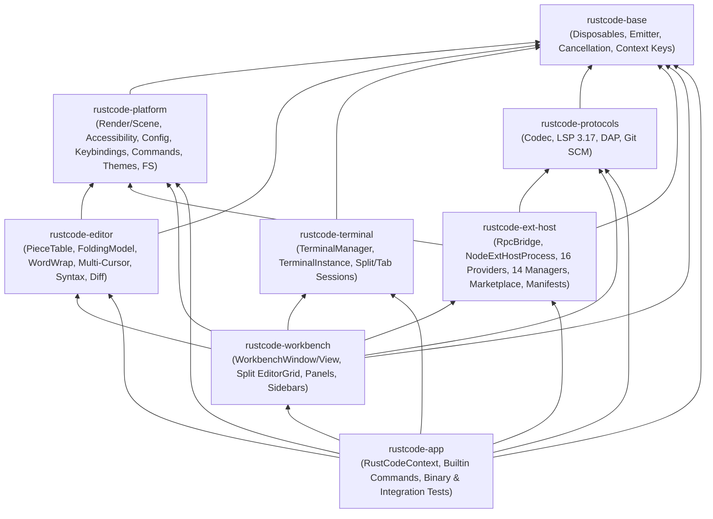

# RustCode Architecture

## Overview & Design Principles

RustCode is a pure-Rust, GPUI-style code editor and IDE workspace organized as an 8-crate Cargo workspace (`resolver = "2"`) plus a CommonJS extension host API layer (`ext-host-js/`, `vscode.version = '1.95.0'`). It targets both **Windows (`x86_64-pc-windows-gnu`)** and **Linux (`x86_64-unknown-linux-gnu`)** and decouples the editor core from Electron and Chromium with zero heavy native/C++ runtime dependencies:

- **GPUI Presentation & Scene Graph**: `rustcode-platform::render` provides `View`, `ViewContext`, `GpuiElement`, `Scene`, and `MockRenderSurface` (display-list quad/glyph/shadow layout with a mockable render backend; desktop `wgpu`/GPUI native windowing is a feature-gated desktop target).
- **Pure-Rust Extension Host RPC & Node.js Subprocess Transport**: `rustcode-ext-host` coordinates extension state via `RpcBridge` (`ContentLengthJson`, `ContentLengthMsgPack`, `NewlineJson`), `NodeExtHostProcess` (live framed stdio child-process runner + `from_io` async streams, `IncomingNotifWork::Barrier` causal fence, `JoinSet` half-close EOF draining, Windows `CREATE_NO_WINDOW`), and `LanguageFeatureBridge` (`handle_rpc_message_result` with structured `RpcError`), paired with `ext-host-js/rpc-bridge.js` (framed stdio transport, `globalThis` singleton, `installVscodeModuleHook`, and headless/Deno fallback).
- **Pure-Rust Terminal Execution**: `rustcode-terminal` executes commands via `std::process::Command` with concurrent stdout/stderr pipe reader threads, bounded timeouts, command history, and multi-tab/split session management—requiring no native PTY/C++ bindings (`cmd.exe`/PowerShell on Windows, `/bin/sh`/bash on POSIX).
- **Pure-Rust Marketplace & VSIX Installer**: `rustcode-ext-host::marketplace` queries Open VSX and unpacks `.vsix` archives using `zip` and `flate2`.

## Workspace Dependency Graph

The dependency edges below match `crates/*/Cargo.toml` directly:

*(Note: `rustcode-ext-host` also declares `[dev-dependencies]` on `rustcode-editor` and `rustcode-workbench` for `tests/compat_suite.rs`.)*

---

## Subsystem Breakdown (Phases 0–7)

### 1. `crates/rustcode-base` (Layer 0)
Shared foundational primitives with zero internal workspace dependencies:
- **`cancellation` (`src/cancellation.rs`)**: `CancellationToken`, `CancellationTokenSource`.
- **`context_key` (`src/context_key.rs`)**: `ContextKeyExpr`, `ContextKeyError`, `ContextKeyService` (VS Code `when` clause boolean expression parser & evaluator).
- **`disposable` (`src/disposable.rs`)**: `Disposable`, `DisposableStore`, `ActionDisposable`, `ArcDisposable`, `to_disposable`.
- **`event` (`src/event.rs`)**: Generic thread-safe `Emitter<T>` and `Event<T>`.

### 2. `crates/rustcode-platform` (Layer 1)
Core platform services, UI scene graph, and accessibility (`gpui` feature supported):
- **`accessibility` (`src/accessibility.rs`)**: `AccessibilityTree`, `AccessibleNode`, `AccessibleRole`, `AccessibleState`.
- **`commands` (`src/commands/mod.rs`)**: `CommandRegistry`, `CommandCallback`, token-checked `Disposable` entries, lock-free `execute()` invocation.
- **`configuration` (`src/configuration/mod.rs`)**: `ConfigurationService`, `ConfigurationInspection`, `ConfigurationChangeEvent`, `ConfigurationTarget` (defaults -> user -> workspace -> folder hierarchy, JSONC parsing, `inspect`, `get_for_resource`, `get_merged_for_resource`, `folder_settings_snapshot`, `affected_folders`, Windows `paths_equivalent` folder key resolution, live update/reset; includes `editor.wordWrap`, `editor.wordWrapColumn`, `editor.minimap.enabled`, `breadcrumbs.enabled`, `terminal.integrated.shell.{linux,windows}`, `files.autoSave`).
- **`fs` (`src/fs/mod.rs` & crate root)**: `FileSystemService`, `FileSystemWatcher` (powered by `notify`), `FileMetadata`, `FileChangeEvent`, `FileChangeType`, `FileConflict`, `FileSystemError`, `hash_content`, plus cross-platform URI/path helpers (`file_uri_to_path`, `path_to_file_uri`, `is_file_uri`, `path_starts_with`, `path_strip_prefix`, `paths_equivalent`, `strip_windows_verbatim_prefix`).
- **`keybindings` (`src/keybindings/mod.rs`)**: `KeybindingService`, `KeyChord`, `KeyCombo`, `Modifiers`, `ResolvedKeybinding` (multi-chord matching & `when` clause evaluation).
- **`render` (`src/render/{mod,color,event,font,geometry,scene,surface,theme_style,view}.rs`)**: `View`, `ViewContext`, `GpuiElement`, `Scene`, `SceneNode`, `Quad`, `GlyphRun`, `Shadow`, `RenderSurface`, `MockRenderSurface`, `FontMetrics`, `WorkbenchThemeStyles`, `InputEvent`, `KeyEvent`, `KeyCode`, `MouseEvent`, `MouseMoveEvent`, `MouseButton`, `ScrollEvent`, `EventResult`, `Rect`, `Point`, `Size`, `Edges`, `Corners`, `Rgba`, `Hsla`.
- **`theme` (`src/theme/mod.rs`)**: `ThemeService`, `ColorTheme`, `ThemeKind`, `TokenColorRule`.

### 3. `crates/rustcode-editor` (Layer 2)
Core text buffer, syntax, find/replace, folding, soft word-wrap, multi-cursor, and editor views:
- **`model` (`src/model/{mod,piece_table,undo_redo}.rs`)**: `PieceTable`, `Piece`, `PieceSource`, `TextEdit`, `UndoRedoStack`, `UndoElement`, UTF-16 alignment helpers (`byte_offset_to_utf16_col`, `utf16_col_to_byte_offset`).
- **`cursor` (`src/cursor/mod.rs`)**: `Position`, `Range`, `RangeEdit`, `Selection`, `CursorState` (`clear_secondary_cursors`, `normalize_and_merge`).
- **`document` (`src/document/{mod,auto_save}.rs`)**: `TextDocument`, `TextDocument::map_ext_to_lang_id` (resolving extensions across all 14 supported languages), `AutoSaveService`, `AutoSaveConfig`, `AutoSaveMode`.
- **`folding` (`src/folding/mod.rs`)**: `FoldingModel`, `FoldingRange`, `FoldingRangeKind` (`Region`, `Comment`, `Imports`, `Brace`, `Indentation`) for brace/indent range detection and collapsible ranges.
- **`find_replace` (`src/find_replace.rs`)**: `FindReplaceWidget`, `FindReplaceFocus`, `FindMatch`, `FindReplaceClickTarget`, `FindReplaceLayout` — floating in-editor Find (`Ctrl+F`) & Replace (`Ctrl+H`) overlay with case-sensitive (`Aa`), whole-word (`ab`), and regex (`.*`) toggles, zero-width regex guard, invalid regex safety, UTF-16/CRLF offset mapping, fold auto-unfolding, single-undo atomic Replace All, and tiny-viewport rect clamping.
- **`syntax` (`src/syntax/{mod,highlighter,registry,scope,rust,javascript,json,markdown,python,go,c,cpp,html,css,toml,yaml}.rs`)**: `SyntaxHighlighter`, `Grammar`, `GrammarRegistry`, `GrammarState` (including `RawString { delimiter }`, `HtmlInTag`, `HtmlScript`, `HtmlStyle`), `SyntaxScope`, `TokenMetadata`, `TokenSpan`, and **14** pure-Rust state-machine grammars registered in `GrammarRegistry::new()`:
  - `PlainTextGrammar` (`plaintext`: `.txt`, `.text`, `.log`)
  - `RustGrammar` (`rust`: `.rs`)
  - `JavaScriptGrammar` (`javascript`: `.js`, `.jsx`, `.mjs`, `.cjs`)
  - `TypeScriptGrammar` (`typescript`: `.ts`, `.tsx`, `.mts`, `.cts`)
  - `PythonGrammar` (`python`: `.py`, `.pyw`, `.pyi`)
  - `JsonGrammar` (`json`: `.json`, `.jsonc`)
  - `MarkdownGrammar` (`markdown`: `.md`, `.markdown`)
  - `GoGrammar` (`go`: `.go`)
  - `CGrammar` (`c`: `.c`, `.h`)
  - `CppGrammar` (`cpp` / C++: `.cpp`, `.cc`, `.cxx`, `.hpp`, `.hh`, `.hxx`)
  - `HtmlGrammar` (`html`: `.html`, `.htm`, with embedded `<script>`/`<style>` delegation)
  - `CssGrammar` (`css`: `.css`, `.scss`, `.less`)
  - `TomlGrammar` (`toml`: `.toml`)
  - `YamlGrammar` (`yaml`: `.yaml`, `.yml`)
- **`completion` (`src/completion/mod.rs`)**: `AutocompleteWidget`, `CompletionItem`, `CompletionItemKind`, `CompletionList`, `expand_snippet`, `fuzzy_match`.
- **`diff` (`src/diff/{mod,myers,view}.rs`)**: `DiffEditorView`, `DiffModel`, `DiffViewMode`, `DiffOpKind`, `DiffChange`, `InlineDiffRow`, `SideBySideDiffRow`, `DiffCell`, `EditOp`, `myers_diff`.
- **`viewmodel` (`src/viewmodel/mod.rs`)**: `DecorationModel`, `LineDecoration`, `DecorationKind`, `EditorDiagnostic`, `DiagnosticSeverity`.
- **`view` (`src/view/{mod,minimap}.rs`)**: `EditorView` (wiring `find_replace: FindReplaceWidget`, match highlights, and atomic `apply_offset_edits`), `WordWrapMode` (`Off`, `On`, `WordWrapColumn`, `Bounded`), `EditorGutterAction` (`BreakpointToggled`, `FoldToggled`), `MinimapState`, `MinimapLayout`, `get_builtin_completions`, plus crate-internal `VisualLayout` & `WrapSegment` mapping visual wrapped rows <-> buffer line/column while respecting folded lines.

### 4. `crates/rustcode-terminal` (Terminal Subsystem)
Pure-Rust terminal engine with zero native PTY dependencies (`src/lib.rs`):
- Constants: `DEFAULT_MAX_SCROLLBACK = 2000`, `DEFAULT_COMMAND_TIMEOUT_MS = 5000`.
- **`TerminalInstance`**: UTF-8 char-indexed `input_buffer` & `cursor_pos`, `command_history`, `env_vars`, pure-Rust `std::process::Command` execution with bounded timeout and concurrent stdout/stderr capture, and shell builtins (`cd`, `pwd`, `clear`, `exit`, `export`, `unset`).
- **`TerminalTab`** & **`TerminalManager`**: Multi-tab and split-pane session management (`create_terminal`, `close_terminal`, `split_active_terminal`, `set_active_tab`, `close_tab`, `set_active_pane`, `focus_next_pane`, `focus_prev_pane`, `close_active_terminal`) and `CommandExecutionResult`.

### 5. `crates/rustcode-protocols` (Layer 5)
Language, debug, and version-control protocol models (`Cargo.toml` depends only on `rustcode-base`):
- **`codec` (`src/codec.rs`)**: `CodecError`, `encode_framed_message`, `decode_framed_message`.
- **`lsp` (`src/lsp/{mod,client,codec,manager,types}.rs`)**: `LspClient`, `LspError`, `LspClientManager`, `LspServerConfig`, `LspCodecError`, `read_framed_message`, `write_framed_message`, and LSP 3.17 DTOs (`LspPosition`, `LspRange`, `LspLocation`, `LspDiagnostic`, `LspCompletionItem`, `Hover`, `DocumentSymbol`, `SymbolInformation`, `CodeAction`, `WorkspaceEdit`, `LspTextEdit`, `FormattingOptions`, etc.).
- **`dap` (`src/dap/{mod,client,types}.rs`)**: `DapClient`, `DapError`, `DapEventListener`, `DapMessage`, `InitializeRequestArguments`, `Capabilities`, `Source`, `SourceBreakpoint`, `Breakpoint`, `Thread`, `StackFrame`, `Scope`, `Variable`, `StoppedEventBody`, `OutputEventBody`, `ContinuedEventBody`, and request/response bodies.
- **`git` (`src/git/mod.rs`)**: `ScmRepository`, `GitStatusEntry`, `GitStatusKind`, `BranchInfo`, `CommitInfo`.

### 6. `crates/rustcode-ext-host` & `ext-host-js/` (Layer 4)
Extension runtime, manifest/marketplace services, and VS Code API shims:
- **`rpc` (`src/rpc/mod.rs`)**: `RpcBridge`, `RpcMessage` (`Request`, `Response`, `Notification`), `RpcError`, `RpcErrorPayload`, `RpcWireFormat` (`ContentLengthJson`, `ContentLengthMsgPack`, `NewlineJson`), `RpcRequestHandler`, `NodeExtHostConfig`, `NodeExtHostProcess` (`spawn`, `from_io`, `JoinSet` half-close EOF draining, Windows `CREATE_NO_WINDOW`, sequential FIFO incoming notification worker + `IncomingNotifWork::Barrier` causal fence, `reader_closed` fast-fail), `resolve_node_binary`, `resolve_ext_host_entry`, `PendingRequestGuard`, and linear O(N) `read_content_length_frame` (`64 KiB` header / `64 MiB` frame limits).
- **`manifest` (`src/manifest/mod.rs`)**: `ExtensionManifest`, `Contributions` (11 contribution fields including `customEditors` / `CustomEditorContribution::matches_path`), `CustomEditorSelector`, `DebuggerContribution`, `TaskDefinitionContribution`, `AuthenticationContribution`, `ViewContribution`, `GrammarContribution`, `ContributedCommand`, `LanguageContribution`, `ThemeContribution`, `KeybindingContribution`, `LoadedExtension`, `ExtensionLoader`, `ExtensionSnapshot`.
- **`marketplace` (`src/marketplace/{mod,catalog,client,downloader,installer,transport,types}.rs`)**: `MarketplaceClient`, `ExtensionDownloader` (pure-Rust VSIX unpacking via `zip`/`flate2` with path traversal protection), `ExtensionInstaller`, `HttpTransport`, `CurlHttpTransport`, `MockHttpTransport`, `curated_catalog` (8 extensions), `search_curated_catalog`.
- **`provider` (`src/provider/{mod,bridge}.rs`)**: `ProviderType` (16 variants; `TreeData` aliases `"TreeDataProvider"`), `ProviderRegistration`, `ProviderRegistry`, `TreeRefreshEvent`, `LanguageFeatureBridge`, `ExtWorkspaceFolder`, `OpenDocumentSnapshot`, `handle_rpc_message_result` (13+ namespaces including `process.*`), `command_mutation_lock`, `MAX_JS_COMMAND_DEPTH = 8`, sandboxed `handle_fs_rpc` (symlink limit 40, Win/Unix `map_io_error`, `EISDIR` checks), synchronous document lifecycle bridge (`did_{open,change,save,close}_document_sync`), `DiagnosticCollectionManager`, `ExtStatusBarManager` (with `revision()` tracking), `TreeItem`, `TreeItemCollapsibleState`.
- **`process` (`src/process/mod.rs`)**: Cross-platform `handle_process_rpc` & `map_process_io_error` implementing `process.exec`, `process.spawn`, and `process.spawnSync` with `cwd` resolution (`fs_root` default, `file://` URI decoding), `env` overrides, `stdin` input, `maxBuffer` enforcement, bounded `tokio::time::timeout` + process-tree termination (`taskkill /PID <pid> /T /F` + `CREATE_NO_WINDOW` on Windows, `/bin/sh -c` on Unix), and structured `RpcError` (`EINVAL`, `ENOENT`, `ENOTDIR`).
- **Domain Managers (14 total on `LanguageFeatureBridge`)**:
  - `DiagnosticCollectionManager` & `ExtStatusBarManager` (`src/provider/bridge.rs`)
  - `notebook` (`src/notebook/mod.rs`): `ExtHostNotebookManager`
  - `output` (`src/output/mod.rs`): `ExtHostOutputManager`
  - `terminal` (`src/terminal/mod.rs`): `ExtHostTerminalManager`
  - `scm` (`src/scm/mod.rs`): `ExtHostScmManager`
  - `debug` (`src/debug/mod.rs`): `ExtHostDebugManager`
  - `tasks` (`src/tasks/mod.rs`): `ExtHostTaskManager`
  - `testing` (`src/testing/mod.rs`): `ExtHostTestManager`
  - `auth` (`src/auth/mod.rs`): `ExtHostAuthManager`
  - `webview` (`src/webview/mod.rs`): `ExtHostWebviewManager` & `ExtHostCustomEditorManager`
  - `window` (`src/window/mod.rs`): `ExtHostWindowManager` (`NotificationResponder`, `PromptResponder`, `cancelPrompt` TOCTOU guard, `active_editor`, `visible_editors`, `showTextDocument`)
  - `env` (`src/env/mod.rs`): `ExtHostEnvManager` (`env.getOsInfo` / `ExtOsInfo` host metadata, `ClipboardBackend`: `OsClipboardBackend`/`InMemoryClipboardBackend`; `ExternalUriOpener`: `OsExternalUriOpener`/`RecordingExternalUriOpener`, `is_valid_external_uri`)
- **`ext-host-js/`**: `package.json`, `rpc-bridge.js` (framed stdio `content-length`/`newline-json`, `globalThis` singleton, `installVscodeModuleHook`, `createRpcError`, `registerInitHook`), **9** `node-compat/` modules (`events.js`, `fs.js`, `path.js`, `buffer.js`, `url.js`, `util.js`, `os.js`, `crypto.js`, `child_process.js` — pure-JS/RPC implementations with zero Node built-in dependencies for the 6 M5 modules), `vscode-api/index.js` (`version: '1.95.0'`) exporting 12 namespaces (`commands`, `window`, `workspace`, `languages`, `notebooks`, `scm`, `debug`, `tasks`, `tests`, `authentication`, `env`, `extensions`) + core types (`types.js`, including `EventEmitter`, `Uri`, `RelativePattern`, `FileSystemError`), and `test.js` (`31` `[Test]` sections / `404` `assert(...)` call sites).

### 7. `crates/rustcode-workbench` (Layer 3)
GPUI-style workbench shell, sidebars, editor grid, overlays, and panels (`src/lib.rs` exports 22 modules):
- **Core Shell & Window**: `layout` (`WorkbenchLayout`, `SharedWorkbenchLayout`, `LayoutHandle`), `workbench_view` (`WorkbenchView`, `WorkbenchRegions`, `FocusedRegion`, `WorkbenchAction`), `window` (`WorkbenchWindow`, `WindowCommandSink`, `SuppressCommandGuard`, document lifecycle forwarding & UI sync hooks `sync_status_bar`, `sync_window_manager`, `sync_test_manager`, `sync_tree_views`, `sync_contributed_views_state`, `sync_for_render` with `Escape`-sync safety), `workspace` (`Workspace`, `WorkspaceFolder`), `activitybar` (`ActivityBar`, `ActivityBarView` — 6 items with `workbench.view.extensions` at index `4` and `workbench.view.testing` at index `5` + failure badge), `statusbar` (`StatusBar`, `StatusBarView`), `breadcrumbs` (`BreadcrumbsBar`), `quickinput` (`CommandPalette`, `CommandPaletteView`, `QuickInputMode`, interactive `:line[:col]` [`Ctrl+G`, `workbench.action.gotoLine`] & `@symbol` [`Ctrl+Shift+O`, `workbench.action.gotoSymbol`] navigation, dynamic `Ctrl+P` prefix switching, `PaletteAction::{OpenFile, JumpToLine}`), and `notifications` (`NotificationsOverlay` non-blocking toast stack + `AccessibleRole::Dialog` modals with `detail`/actions/dismiss + tiny-viewport clamping, and `PromptOverlay` interactive `showQuickPick` / `showInputBox` with `validateInput`).
- **Editor Grid & Specialized Editors**:
  - `editor_area` (`src/editor_area/mod.rs`): `EditorArea`, `EditorAreaView` (`rename_tab`, `close_tabs_for_path`, `find_open_tab_uri_for_path`), `EditorGroup`, `EditorTab`, `EditorAreaAction`, `SplitDirection` (`Horizontal`, `Vertical`), `EditorGridNode` (`Leaf`, `Split`), `EditorSash` — recursive split editor grid and custom editor dispatch.
  - `webview` (`src/webview/mod.rs`): `WebviewEditorView`, `ParsedWebviewNode`, `WebviewElementKind`.
  - `notebook` (`src/notebook/mod.rs`): `NotebookEditorView`, `NotebookDocument`, `NotebookCell`, `NotebookKernel`, `KernelValue`, `CellKind`, `CellOutput`.
  - `settings_ui` (`src/settings_ui/mod.rs`): `SettingsUiView`, `SettingsUiState`, `SettingsCategory`, `SettingsItem`, `SettingsValueType`.
- **Sidebars**: `explorer` (`FileExplorer`, `FileExplorerView` — Windows drive-root / `/` `node_display_name` fallback, inline CRUD `"New File"`/`+F`, `"New Folder"`/`+D`, `F2` rename, confirmed `Delete`, `validate_entry_name`, keyboard navigation, and contributed `TreeDataProvider` views with `contributes.views`, `when`-clause evaluation, lazy `getChildren`, `onDidChangeTreeData` refresh, and command execution), `search` (`SearchView`, `SearchQuery`, `SearchResults`), `scm` (`ScmView`, `ScmAction`), `debug` (`DebugSidebarView`, `DebugToolbarView`, `DebugConsoleView`), `extensions_view` (`ExtensionsSidebarView`, `curated_marketplace_extensions`), `testing` (`TestingSidebarView`, `TestingAction`, `TestingTreeRow` — `workbench.view.testing`, disposed-controller filtering, durations/failures, `"Run All"` `tests.runTests` RPC dispatch, cross-platform `file://` URI click-to-open).
- **Bottom Panels**: `terminal_panel` (`TerminalPanelView`, `TerminalAction`, `TerminalClickTarget`), `output_panel` (`OutputPanelView`, `OutputChannelData`, `OutputAction`, `OutputClickTarget`), `problems` (`ProblemsPanel`, `ProblemEntry`, `ProblemsAction`).

### 8. `crates/rustcode-app` (Layer 6)
Application bootstrap and end-to-end verification:
- **`src/lib.rs`**: `RustCodeContext` (owns `ConfigurationService`, `CommandRegistry`, `KeybindingService`, `ContextKeyService`, `ThemeService`, `SharedWorkbenchLayout`, `EditorArea`, `FileExplorer`, `ExtensionLoader`, `Arc<FileSystemService>`, `Arc<LanguageFeatureBridge>`, `DisposableStore`, and `window_sinks`; `register_builtin_commands()` wires real immediate layout and `WindowCommandSink` effects without double-toggling; `create_window()` hydrates `language_bridge` from `ext_loader`, seeds workspace folders, attaches `file_system` and `language_bridge`, forwards `contribs.custom_editors` and `contribs.views`, and registers `WindowCommandSink`).
- **`src/main.rs`**: Binary entry point (`rustcode`), bootstraps `RustCodeContext`, creates `WorkbenchWindow`, and renders into `MockRenderSurface`.
- **`tests/integration_tests.rs`**: 24 end-to-end workspace integration tests (+ 3 unit tests in `src/lib.rs` = 27 crate tests).
- **`benches/`**: `startup_time.rs` and `memory_footprint.rs`.

---

## Key Cross-Cutting Flows

1. **Input & Command Dispatch**:
   `InputEvent` enters `WorkbenchWindow::dispatch_event` -> `KeybindingService::handle_key` resolves single- and multi-chord sequences against `ContextKeyService` `when` clauses -> matched command IDs invoke `CommandRegistry` and `WorkbenchWindow::handle_builtin_command_effects` -> unbound editor/panel key events route via `WorkbenchView` (`FocusedRegion::{Editor, Sidebar, Panel, CommandPalette}`) to `EditorAreaView`, `TerminalPanelView`, `OutputPanelView`, etc.

2. **Configuration & Live Sync**:
   `ConfigurationService` merges `defaults -> user -> workspace -> folder` layers (supporting JSONC, `inspect`, resource-scoped queries, `affected_folders`, Windows `paths_equivalent` folder keys, and live `update`/`reset`). `WorkbenchWindow::sync_configuration()` propagates live updates to all active editors and views (`editor.wordWrap`, `editor.wordWrapColumn`, `editor.minimap.enabled`, `breadcrumbs.enabled`, `terminal.integrated.shell.{windows,linux}`), including synchronization from `SettingsUiView`, and `LanguageFeatureBridge::attach_configuration_listener()` forwards `onDidChangeConfiguration` events to extensions.

3. **Extension Host RPC & Sync Loop**:
   - **Transport & Shims (`M1.1`, `M1.2`, `M5`):** `ext-host-js` (`rpc-bridge.js` + `vscode-api/*` + 9 `node-compat/{events,fs,path,buffer,url,util,os,crypto,child_process}.js` modules) communicates over `NodeExtHostProcess` framed stdio (`ContentLengthJson`, `ContentLengthMsgPack`, `NewlineJson`) and `RpcBridge` (`RpcMessage`, structured `RpcError`, sequential FIFO incoming notification worker + `IncomingNotifWork::Barrier` causal fence, `reader_closed` fast-fail) with `LanguageFeatureBridge` (`ProviderRegistry` + **14** managers + `LspClientManager` + `env.getOsInfo` / `process.{exec,spawn,spawnSync}` RPCs).
   - **Live App & Workbench Wiring (`M1.3`, `M3`, `M4`):** `RustCodeContext::create_window()` constructs and attaches a loader-hydrated `LanguageFeatureBridge` + shared `FileSystemService` + `WindowCommandSink` + `SharedWorkbenchLayout` to `WorkbenchWindow`, registers `contribs.custom_editors` and `contribs.views`, and wires builtin commands to immediate layout/window effects. `WorkbenchWindow` forwards document lifecycle (`did_{open,change,save,close}_document_sync`), drains output/terminal/custom-editor/webview updates, and runs `sync_status_bar()`, `sync_window_manager()` (`NotificationsOverlay` + `PromptOverlay` with `Escape`-sync safety), `sync_test_manager()` (`TestingSidebarView` + Activity Bar badge), and `sync_tree_views()` / `sync_contributed_views_state()` (contributed `TreeDataProvider` views).

4. **Split Editor & Shared Document Architecture**:
   `EditorArea` models splits as a recursive binary tree (`EditorGridNode::{Leaf(group_id), Split { direction, ratio, first, second }}` with `EditorSash` drag dividers). Multiple `EditorGroup` panes opening the same file share the underlying `Arc<RwLock<TextDocument>>` / `PieceTable` buffer while maintaining independent per-pane `EditorView` scroll/cursor/folding state or `WebviewEditorView` instances for custom editors.

---

## Phase 6 & Phase 7 Commands & Default Keybindings (`resources/default-keymaps/linux.json`)

| Milestone | Command ID | Default Keybinding | `when` Clause | Registered in `rustcode-app` | Handled in `WorkbenchWindow` |
|---|---|---|---|---|---|
| Phase 6 M1 (Terminal) | `workbench.action.terminal.toggleTerminal` | ``ctrl+` `` | — | Yes | Yes |
| Phase 6 M1 (Terminal) | `workbench.action.terminal.new` | ``ctrl+shift+` `` | — | Yes | Yes |
| Phase 6 M1 (Terminal) | `workbench.action.terminal.split` | `ctrl+shift+5` | `terminalFocus` | Yes | Yes |
| Phase 6 M1 (Terminal) | `workbench.action.terminal.kill` | *(none)* | — | Yes | Yes |
| Phase 6 M1 (Terminal) | `workbench.action.terminal.focus` | *(none)* | — | Yes | Yes |
| Phase 6 M1 (Output) | `workbench.action.output.toggleOutput` | `ctrl+shift+u` | — | Yes | Yes |
| Phase 6 M1 (Output) | `workbench.action.output.clearOutput` | *(none)* | — | Yes | Yes |
| Phase 6 M1 (Problems) | `workbench.action.problems.focus` | *(none)* | — | Yes | Yes |
| Phase 6 M3 (Multi-Cursor) | `editor.action.addSelectionToNextFindMatch` | `ctrl+d` | `editorTextFocus` | Yes | Yes |
| Phase 6 M3 (Multi-Cursor) | `editor.action.insertCursorAbove` | `ctrl+alt+up` | `editorTextFocus` | Yes | Yes |
| Phase 6 M3 (Multi-Cursor) | `editor.action.insertCursorBelow` | `ctrl+alt+down` | `editorTextFocus` | Yes | Yes |
| Phase 6 M3 (Multi-Cursor) | *(Escape collapse — direct key event)* | `Escape` | `has_multiple_cursors()` | N/A | Handled in `EditorView` (`clear_secondary_cursors()`) |
| Phase 6 M3 (Folding) | `editor.fold` | `ctrl+shift+[` | `editorTextFocus` | Yes | Yes |
| Phase 6 M3 (Folding) | `editor.unfold` | `ctrl+shift+]` | `editorTextFocus` | Yes | Yes |
| Phase 6 M3 (Folding) | `editor.foldAll` | `ctrl+k ctrl+0` | `editorTextFocus` | Yes | Yes |
| Phase 6 M3 (Folding) | `editor.unfoldAll` | `ctrl+k ctrl+j` | `editorTextFocus` | Yes | Yes |
| Phase 6 M4 (Split Grid) | `workbench.action.splitEditor` | `ctrl+\` | — | Yes | Yes |
| Phase 6 M4 (Split Grid) | `workbench.action.splitEditorDown` | `ctrl+k ctrl+\` | — | Yes | Yes |
| Phase 6 M4 (Split Grid) | `workbench.action.focusPreviousGroup` | `ctrl+k ctrl+left` | — | Yes | Yes |
| Phase 6 M4 (Split Grid) | `workbench.action.focusNextGroup` | `ctrl+k ctrl+right` | — | Yes | Yes |
| Phase 6 M4 (Split Grid) | `workbench.action.focusFirstEditorGroup` | `ctrl+1` | — | Yes | Yes |
| Phase 6 M4 (Split Grid) | `workbench.action.focusSecondEditorGroup` | `ctrl+2` | — | Yes | Yes |
| Phase 6 M4 (Split Grid) | `workbench.action.closeEditorsInGroup` | `ctrl+k w` | — | Yes | Yes |
| Phase 6 M4 (Custom Editor) | *(Manifest selector / `window.openCustomEditor` RPC)* | *(none)* | — | N/A | `find_matching_custom_editor`, `sync_custom_editors`, `sync_webviews` |
| Phase 7 M2 (Find) | `actions.find` | `ctrl+f` | — | Yes | Yes (`FindReplaceWidget`) |
| Phase 7 M2 (Find & Replace) | `editor.action.startFindReplaceAction` | `ctrl+h` | — | Yes | Yes (`FindReplaceWidget` replace mode) |
| Phase 7 M2 (QuickInput) | `workbench.action.gotoLine` | `ctrl+g` | — | Yes | Yes (`CommandPalette` `:line[:col]`) |
| Phase 7 M2 (QuickInput) | `workbench.action.gotoSymbol` | `ctrl+shift+o` | — | Yes | Yes (`CommandPalette` `@symbol`) |
| Phase 7 M3 (Testing) | `workbench.view.testing` | *(Activity Bar index 5)* | — | Yes | Yes (`TestingSidebarView`) |

*(Additional keybindings in `linux.json` such as `workbench.action.quickOpen` (`ctrl+p`), `workbench.action.closeActiveEditor` (`ctrl+w`), `undo` (`ctrl+z`), `redo` (`ctrl+y`), `workbench.action.files.save` (`ctrl+s`), and `editor.action.addCommentLine` (`ctrl+k ctrl+c`) are bound in `linux.json` and/or dispatched in `RustCodeContext` + `WorkbenchWindow::handle_builtin_command_effects`.)*

---

## Phase 7 Status & Verification

- **Implemented (`M1.1–M6`):**
  - **M1.1 & M1.2:** Live framed stdio RPC transport (`NodeExtHostProcess`), structured `RpcError` envelope, `node-compat/{fs,path}.js` parity, sequential FIFO incoming notification worker + `IncomingNotifWork::Barrier`, `command_mutation_lock`, Windows folder-config & `Uri` parity, `ExtHostWindowManager`/`ExtHostEnvManager`, and `TreeDataProvider`/`TreeData` synthetic handles.
  - **M1.3:** `RustCodeContext::create_window()` live `LanguageFeatureBridge` & `FileSystemService` wiring, `SharedWorkbenchLayout`/`LayoutHandle` & `WindowCommandSink`, real builtin command effects, synchronous document lifecycle forwarding, UI sync hooks (`Escape`-sync safety), and Windows drive-root / `/` Explorer name fallback.
  - **M2:** In-editor `FindReplaceWidget` (`Ctrl+F` / `Ctrl+H`), QuickInput `:line[:col]` (`Ctrl+G`) & `@symbol` (`Ctrl+Shift+O`) with dynamic `Ctrl+P` prefix switching, and `PaletteAction::OpenFile` cursor/URI preservation.
  - **M3:** `NotificationsOverlay` (toast stack + modal dialogs), `PromptOverlay` (`showQuickPick` / `showInputBox`), and `TestingSidebarView` (`workbench.view.testing` at Activity Bar index 5, failure badge, `"Run All"` RPC, `file://` click-to-open).
  - **M4:** Explorer inline CRUD (`"New File"`, `"New Folder"`, `F2` rename syncing open tabs, `Delete` confirm closing open tabs, cross-platform validation) and contributed `TreeDataProvider` views (`contributes.views`, `when`-clause evaluation, lazy `getChildren`, refresh & command dispatch).
  - **M5:** `env.getOsInfo` & `process.{exec,spawn,spawnSync}` RPCs, 6 new `ext-host-js/node-compat/{buffer,url,util,os,crypto,child_process}.js` modules (9 total), and 7 pure-Rust state-machine tokenizers (`go`, `c`, `cpp`, `html`, `css`, `toml`, `yaml` — 14 grammars total) + `TextDocument::map_ext_to_lang_id`.
  - **M6:** Documentation & trackers refreshed across `README.md`, `rustcode-implementation-plan.md`, `docs/architecture.md`, and `docs/extension-compat-matrix.md`.
  - **M7:** Full Stage 3 verification, Tier 5 adversarial hardening, and final doc count synchronization completed.
- **M7 Verified Totals:** **513/513** workspace tests passing across **8** crates (`rustcode-app` 27 [3 unit + 24 integration], `rustcode-base` 12, `rustcode-editor` 126, `rustcode-ext-host` 127 [86 unit + 41 `compat_suite`], `rustcode-platform` 40, `rustcode-protocols` 24, `rustcode-terminal` 9, `rustcode-workbench` 148), **31/31** `ext-host-js/test.js` sections (**404** `assert(...)` call sites), **8/8** `tests/phase7-e2e/runner.js --syntax-check`, **286/286** Windows (**287** Unix) `tests/phase7-e2e/runner.js --tier all` tests, **0** Windows & `x86_64-unknown-linux-gnu` `clippy` warnings (`-D warnings`), `cargo bench --workspace --no-run`, and `rustcode` startup smoke check.
