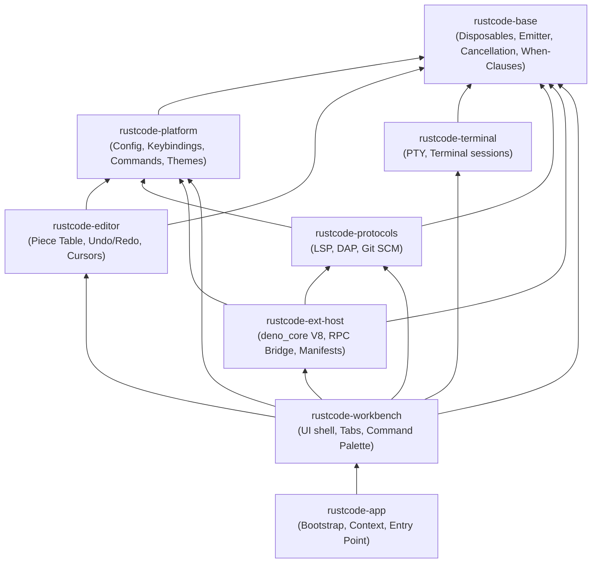

# RustCode Architecture

## Overview

RustCode is designed as an ultra-high-performance rewrite of VS Code. It decouples the editor core from Electron and Chromium, utilizing native Rust systems programming and embedded V8 execution.

## Core Subsystems

### 1. `rustcode-base`
- **Disposables**: VS Code's `IDisposable` pattern in Rust with `DisposableStore`.
- **Event Emitter**: Generic, thread-safe `Emitter<T>` and `Event<T>` with reverse cleanup.
- **Cancellation**: Cooperative `CancellationTokenSource` and `CancellationToken`.
- **When Clauses**: Complete evaluator for VS Code `when` clause boolean expressions with context key resolution.

### 2. `rustcode-editor`
- **Piece Table**: Balanced piece tree with immutable original buffer and append-only add buffer.
- **Undo/Redo**: Transactional edit stack with group coalescing.
- **Multi-Cursor Engine**: Independent selections with anchor and active positions.

### 3. `rustcode-platform`
- **Configuration**: Settings hierarchy (defaults -> user -> workspace), JSON with comments (JSONC), dot-separated queries.
- **Keybindings**: Multi-chord input matching (`Ctrl+K Ctrl+C`), modifier matching, conditional context evaluation.
- **Commands**: Central registry with disposable handler unregistration.
- **Themes**: VS Code theme JSON reader and TextMate token color parser.

### 4. `rustcode-ext-host` & `ext-host-js`
- **V8 / Extension Host**: Embedded JavaScript engine.
- **Binary RPC Bridge**: High-speed MessagePack RPC protocol.
- **API Shim**: Complete JavaScript `vscode.*` API proxy (`commands`, `window`, `workspace`, `languages`, `types`).
