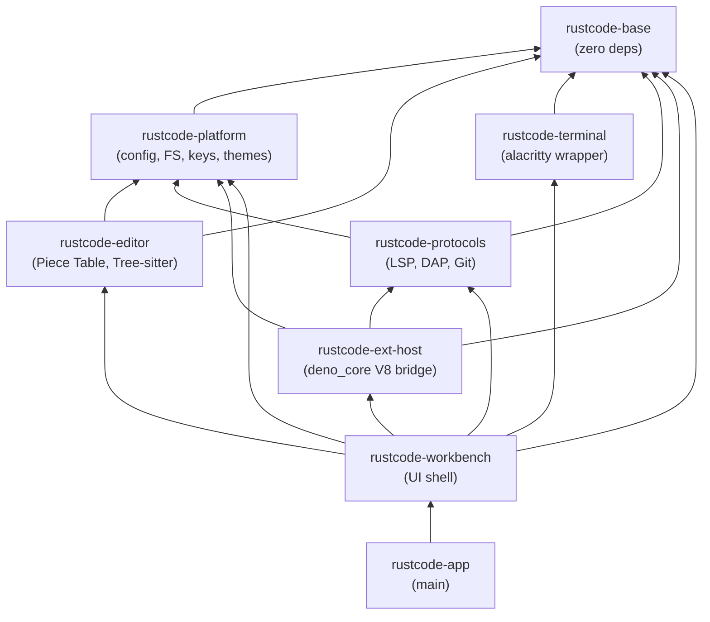

# RustCode — Implementation Plan

## 📌 Implementation Progress Tracker

> Live status of the RustCode implementation in `https://github.com/revelino01/vscode-in-rust.git`.

### Phase 0: Scaffold & Core Foundation
- [x] Cargo workspace setup with 8 modular crates (`rustcode-base`, `rustcode-platform`, `rustcode-editor`, `rustcode-terminal`, `rustcode-protocols`, `rustcode-ext-host`, `rustcode-workbench`, `rustcode-app`)
- [x] `rustcode-base`: `Disposable`, `DisposableStore`, typed `Emitter<T>` / `Event<T>`, `CancellationTokenSource`, `CancellationToken`
- [x] `rustcode-base`: VS Code `when` clause context-key expression parser & evaluator (`ContextKeyExpr`, `ContextKeyService`)
- [x] `rustcode-editor`: Piece Table text buffer with balanced tree, O(log n) inserts & deletes, line indexing, offset-to-position mapping
- [x] `rustcode-editor`: Transactional `UndoRedoStack` with edit grouping and multi-cursor support
- [x] `rustcode-editor`: `CursorState`, `Position`, `Range`, `Selection`, and `DecorationModel`
- [x] `rustcode-platform`: `ConfigurationService` with defaults -> user -> workspace hierarchy, JSONC comment stripping, dot-separated queries
- [x] `rustcode-platform`: `KeybindingService` with multi-chord support (`Ctrl+K Ctrl+C`), modifiers parsing, `when` clause evaluation
- [x] `rustcode-platform`: `CommandRegistry` with disposable registration and dispatch
- [x] `rustcode-platform`: `ThemeService` loading VS Code JSON themes and TextMate token color scopes
- [x] `rustcode-ext-host`: Extension manifest parser (`package.json`), activation events, and contribution points
- [x] `rustcode-ext-host`: MessagePack & JSON binary RPC bridge (`RpcBridge`, `RpcMessage`)
- [x] `rustcode-ext-host`: Provider callback registry (`Completion`, `Hover`, `Definition`, `Formatting`, `TreeData`)
- [x] `rustcode-workbench`: `WorkbenchLayout` shell state (sidebar, panel, status bar, activity bar toggles)
- [x] `rustcode-workbench`: `EditorArea` and `EditorGroup` with tabs, dirty tracking, and preview mode
- [x] `rustcode-workbench`: `CommandPalette` with fuzzy subsequence query search
- [x] `rustcode-workbench`: `StatusBar` with left/right alignment and priority sorting
- [x] `rustcode-terminal`: `TerminalManager` & `TerminalInstance` sessions
- [x] `rustcode-protocols`: LSP, DAP, and Git SCM protocol definitions
- [x] `rustcode-app`: `RustCodeContext` service container bootstrap and builtin command handlers
- [x] `ext-host-js`: JavaScript `vscode.*` API shim (`types.js`, `commands.js`, `window.js`, `workspace.js`, `languages.js`, `env.js`, `rpc-bridge.js`)
- [x] `ext-host-js`: Node.js compatibility layer (`events.js`, `path.js`, `fs.js`)
- [x] Resources: VS Code Dark+ & Light+ default themes, Linux keymaps, sample Hello World extension
- [x] Test Suite: 85 unit and integration tests passing (`cargo test --workspace`)
- [x] GPUI UI Presentation Layer: View abstractions, element rendering pipeline (scene graph display lists, quad/glyph layout, theme color mappings from `ThemeService` into GPUI styles), concrete component models (`EditorView`, `WorkbenchLayout`, `WorkbenchView`, `ActivityBarView`, `FileExplorerView`, `StatusBarView`, `CommandPaletteView`, `EditorAreaView`), and input event routing (GPUI keyboard chords, mouse clicks/scrolls to editor cursor/edits and platform keybindings/commands)
- [x] Robustness & Edge Cases: Fixed PieceTable multi-byte UTF-8 prev/next char boundary navigation & deletion, undo/redo cursor position restoration, selection replacement/deletion, Shift+Arrow selection expansion, Ctrl+A select all, CommandPalette space matching, Hsla negative hue wrapping, out-of-bounds mouse events, and keybinding display string badge resolution

### Phase 1: Minimal Editor & File Workflows
- [x] Configuration loading (`settings.json`)
- [x] Keybinding resolution (`keybindings.json`)
- [x] Theme engine (VS Code JSON theme loader)
- [x] Extension manifest discovery (`package.json`)
- [x] Tree-sitter syntax highlighting integration (dual Tree-sitter/tokenizer pipeline, grammar registry for Rust, JS, TS, Python, JSON, Markdown, packed TokenMetadata, TextMate scope color resolution from ThemeService, incremental line caching, and EditorView syntax colored rendering)
- [x] File I/O async disk save / auto-save service (async tokio::fs and sync atomic writes with temp-file rename, conflict detection with mtime and content hash checks, and AutoSaveService with afterDelay, onFocusChange, and onWindowChange)
- [x] File tree filesystem watcher (`notify` recommended watcher, granular create/change/delete event emitters, recursive and non-recursive watching with Disposable lifecycle)


### Phase 2: Language Intelligence & Marketplace
- [x] `languages.*` LSP client lifecycle (stdio JSON-RPC transport with framed message headers `Content-Length: ...\r\n\r\n`, full document lifecycle syncing `textDocument/didOpen`, `textDocument/didChange` with incremental & full edits, `textDocument/didClose`, request routing for completion, hover, and definition, LanguageFeatureBridge aggregating LSP and extension host providers)
- [x] Autocomplete UI widget (GPUI popover overlay anchored at active cursor position in `EditorView`, triggered automatically on trigger characters `.` / `:` / `/` or manually with `Ctrl+Space`, live fuzzy matching and prefix filtering, arrow key selection `Up`/`Down`, `Tab` / `Enter` commit with snippet tabstop expansion into PieceTable buffer, `Escape` dismiss, and detail / documentation preview panel)
- [x] Diagnostics squiggly underlines & Problems panel (ingest from LSP `textDocument/publishDiagnostics` and extension `vscode.languages.createDiagnosticCollection`, render squiggly wave underlines with red/yellow/blue/gray severity styling under editor spans, error hover tooltips showing source, code, and message on mouse move, dockable `Problems` tab in bottom panel grouping by file with collapse/expand and filter, status bar & tab badge counts, and jump-to-location on problem click)
- [x] Open VSX marketplace client & extension downloader (REST client querying `https://open-vsx.org/api/`, search extensions by keyword, fetch version metadata, download and unpack `.vsix` archives into `~/.rustcode/extensions/` with path traversal protections and standard `extension/` prefix stripping, and parse unpacked `package.json` to register contributed commands into `CommandRegistry`, themes into `ThemeService`, and grammars into the runtime)

### Phase 3: Full Parity
- [ ] DAP debug adapter integration
- [ ] Git / SCM sidebar diff viewer
- [ ] Webview host integration (`wry`)
- [x] GPU window rendering (GPUI presentation layer, mockable render surface, and scene graph pipeline)

---

## Goal

Build **RustCode**, a ground-up Rust rewrite of VS Code that:

- **Looks and feels identical** to VS Code (same layout, keybindings, theme format, settings schema)
- **Runs existing JS/TS extensions** unmodified (plug-and-play via embedded V8)
- Achieves **~3× less RAM** and **~2–5× faster startup** than Electron-based VS Code

### Locked-In Technology Choices

| Decision | Choice | Rationale |
|---|---|---|
| GUI Framework | **GPUI** (forked from Zed) | Only Rust GUI proven for IDE-level perf, 120 FPS, ~3× less RAM than Chromium |
| JS Runtime | **`deno_core`** (embedded V8) | Full JIT speed for extensions, ~50% less RAM than Node.js process |
| IPC Format | **MessagePack** (`rmp-serde`) | 40% smaller than JSON, fast (de)serialization |
| Text Buffer | **Custom Piece Table** | VS Code-compatible editing model, O(log n) operations |
| Syntax | **Tree-sitter** + TextMate compat | Incremental parsing, extension grammar support |
| Terminal | **`alacritty_terminal`** | Proven VT100/xterm emulator |
| GPU Backend | **`wgpu`** (via GPUI) | Vulkan/Metal/DX12, cross-platform |

---

## VS Code Behavioral Fidelity Requirements

> [!IMPORTANT]
> The goal is that a VS Code user can switch to RustCode and **not need to relearn anything**. Every behavior listed below must match VS Code exactly.

### Must Match Exactly
- **Keybindings**: Same default keymap. Read `keybindings.json` in the same format. Same `when` clause context-key expressions.
- **Settings**: Read `settings.json` in the same format. Same setting IDs (e.g., `editor.fontSize`, `workbench.colorTheme`). Same defaults.
- **Themes**: Load VS Code `.json` theme files unchanged. Same token color scoping rules.
- **Extensions**: Install from `.vsix` files. Same `package.json` contribution point schema. Same activation events.
- **Snippets**: Same snippet format and expansion behavior.
- **Command Palette**: Same `Ctrl+Shift+P` behavior, same command IDs.
- **File Explorer**: Same tree behavior (expand/collapse, rename inline, drag-and-drop, context menus).
- **Editor tabs**: Same tab behavior (dirty indicator, preview mode, tab overflow, close button).
- **Integrated Terminal**: Same split/tab terminal UX.
- **Search**: Same `Ctrl+Shift+F` behavior with regex, case, whole word toggles.
- **Git integration**: Same sidebar UX — staged/unstaged changes, inline diff, commit.
- **Minimap**: Same right-side minimap rendering.
- **Breadcrumbs**: Same breadcrumb bar above editor.

### Acceptable Differences
- **Pixel-perfect rendering**: CSS → GPU rendering means slightly different font metrics, anti-aliasing, and spacing. This is acceptable as long as the *layout* matches.
- **Animation timing**: GPU-rendered transitions may feel slightly different. Acceptable.
- **Webview rendering**: Extension webviews will use the system webview (WebKit/WebView2) instead of Chromium. Minor rendering differences are acceptable.
- **Settings UI**: Can be simplified initially (JSON-only editing is acceptable for v1).

---

## Project Structure

```
rustcode/
├── Cargo.toml                          # Workspace root
├── rust-toolchain.toml                 # Pin Rust nightly (for GPUI)
│
├── crates/
│   ├── rustcode-base/                  # Layer 0: Zero-dep utilities
│   ├── rustcode-platform/              # Layer 1: Platform services (config, FS, keys, themes)
│   ├── rustcode-editor/                # Layer 2: Text editor engine (Piece Table, Tree-sitter)
│   ├── rustcode-workbench/             # Layer 3: Workbench UI shell (sidebar, panels, tabs)
│   ├── rustcode-ext-host/              # Layer 4: Extension Host (deno_core V8 + vscode API bridge)
│   ├── rustcode-protocols/             # Layer 5: LSP, DAP, Git integration
│   ├── rustcode-terminal/              # Integrated terminal (alacritty_terminal wrapper)
│   └── rustcode-app/                   # Entry point, window bootstrap
│
├── ext-host-js/                        # JavaScript: vscode API shim + Node.js compat layer
│   ├── vscode-api/                     # The `require('vscode')` module
│   │   ├── index.js                    # Main entry — assembles all namespaces
│   │   ├── commands.js                 # vscode.commands.*
│   │   ├── window.js                   # vscode.window.*
│   │   ├── workspace.js               # vscode.workspace.*
│   │   ├── languages.js               # vscode.languages.*
│   │   ├── debug.js                    # vscode.debug.*
│   │   ├── env.js                      # vscode.env.*
│   │   ├── extensions.js              # vscode.extensions.*
│   │   ├── scm.js                     # vscode.scm.*
│   │   ├── tasks.js                   # vscode.tasks.*
│   │   ├── authentication.js          # vscode.authentication.*
│   │   ├── tests.js                   # vscode.tests.*
│   │   ├── notebooks.js              # vscode.notebooks.*
│   │   └── types.js                   # All VS Code types (Position, Range, Uri, etc.)
│   ├── rpc-bridge.js                   # MessagePack RPC client for Rust IPC
│   ├── node-compat/                    # Node.js API polyfills implemented via deno_core ops
│   │   ├── fs.js                       # fs/promises shimmed to Rust ops
│   │   ├── path.js                     # path module (pure JS, same as Node)
│   │   ├── child_process.js            # Shimmed to Rust process spawning
│   │   ├── os.js
│   │   ├── crypto.js
│   │   ├── buffer.js
│   │   ├── events.js                   # EventEmitter (pure JS)
│   │   ├── stream.js
│   │   ├── url.js
│   │   ├── util.js
│   │   └── net.js
│   └── package.json
│
├── resources/
│   ├── default-themes/                 # VS Code's default dark/light/hc themes (JSON)
│   ├── default-keymaps/                # Default keybindings (JSON, VS Code format)
│   ├── default-snippets/               # Built-in snippets
│   ├── icons/                          # App icons, file type icons (Seti/Codicon)
│   └── codicons/                       # VS Code's Codicon icon font
│
├── tests/
│   ├── extension-compat/               # Test harness: load real extensions, verify API calls
│   ├── editor-model/                   # Piece Table correctness tests
│   ├── benchmarks/                     # Criterion benchmarks (startup, memory, frame time)
│   └── integration/                    # End-to-end UI tests
│
└── docs/
    ├── architecture.md
    ├── extension-compat-matrix.md       # Tracks which APIs are implemented
    └── contributing.md
```

---

## Proposed Changes — Crate-by-Crate

### Dependency Graph



---

### `rustcode-base` — Layer 0: Core Utilities

**Purpose**: Zero-dependency foundation. Everything above imports this.

#### [NEW] `crates/rustcode-base/Cargo.toml`
```toml
[package]
name = "rustcode-base"
version = "0.1.0"
edition = "2021"

[dependencies]
parking_lot = "0.12"       # Fast mutexes/rwlocks
uuid = { version = "1", features = ["v4"] }
smallvec = "1.13"          # Stack-allocated small vectors
smol_str = "0.3"           # Inline small strings (avoid heap for short strings)
log = "0.4"
thiserror = "2"
```

#### [NEW] Key modules

**`disposable.rs`** — VS Code's `Disposable` pattern:
```rust
/// Mirrors VS Code's IDisposable. Resources that need cleanup implement this.
pub trait Disposable: Send + Sync {
    fn dispose(&mut self);
}

/// Collects multiple disposables, disposes all on drop.
pub struct DisposableStore {
    items: Vec<Box<dyn Disposable>>,
    is_disposed: bool,
}

impl Drop for DisposableStore {
    fn drop(&mut self) {
        if !self.is_disposed {
            for item in self.items.iter_mut().rev() {
                item.dispose();
            }
            self.is_disposed = true;
        }
    }
}
```

**`event.rs`** — Typed event emitter (mirrors VS Code's `Emitter<T>`):
```rust
use parking_lot::Mutex;
use std::sync::Arc;

type Listener<T> = Box<dyn Fn(&T) + Send + Sync>;

pub struct Emitter<T: Clone + Send + 'static> {
    listeners: Arc<Mutex<Vec<Listener<T>>>>,
}

impl<T: Clone + Send + 'static> Emitter<T> {
    pub fn new() -> Self { ... }

    /// Subscribe. Returns a disposable that unsubscribes.
    pub fn event(&self) -> Event<T> { ... }

    /// Fire the event to all listeners.
    pub fn fire(&self, value: T) { ... }
}

/// A subscribable event (mirrors VS Code's `Event<T>`).
pub struct Event<T: Clone + Send + 'static> { ... }
```

**`cancellation.rs`** — CancellationToken (mirrors VS Code's):
```rust
pub struct CancellationTokenSource {
    token: CancellationToken,
}

#[derive(Clone)]
pub struct CancellationToken {
    is_cancelled: Arc<AtomicBool>,
    on_cancelled: Event<()>,
}

impl CancellationToken {
    pub fn is_cancelled(&self) -> bool { ... }
    pub fn on_cancelled(&self) -> &Event<()> { ... }
}
```

**`context_key.rs`** — When-clause expression evaluator:
```rust
/// Evaluates VS Code `when` clause expressions like:
/// "editorTextFocus && !editorReadonly"
/// "resourceLangId == rust"
pub struct ContextKeyExpr { ... }

impl ContextKeyExpr {
    pub fn parse(expr: &str) -> Result<Self, ParseError> { ... }
    pub fn evaluate(&self, context: &ContextKeyService) -> bool { ... }
}
```

**Estimated**: ~3,000–5,000 lines.

---

### `rustcode-platform` — Layer 1: Platform Services

**Purpose**: Core services that the editor and workbench depend on. Each service is a trait + implementation, wired via a service container.

#### [NEW] `crates/rustcode-platform/Cargo.toml`
```toml
[package]
name = "rustcode-platform"
version = "0.1.0"
edition = "2021"

[dependencies]
rustcode-base = { path = "../rustcode-base" }
serde = { version = "1", features = ["derive"] }
serde_json = "1"
tokio = { version = "1", features = ["full"] }
notify = "7"                    # Cross-platform file watching
rusqlite = { version = "0.32", features = ["bundled"] }
arboard = "3"                   # Clipboard
rfd = "0.15"                    # Native file dialogs
dirs = "5"                      # XDG/AppData paths
tracing = "0.1"
tracing-subscriber = "0.3"
toml = "0.8"                    # For reading config files
jsonc-parser = "0.23"           # JSON with comments (VS Code settings format)
```

#### [NEW] Key services

**`configuration/service.rs`** — Settings system:
```rust
/// Reads settings.json (with comments), merges defaults → user → workspace.
/// Same setting IDs as VS Code (e.g., "editor.fontSize").
pub struct ConfigurationService {
    /// Default values for all known settings
    defaults: serde_json::Value,
    /// User settings (~/.config/rustcode/settings.json)
    user: serde_json::Value,
    /// Workspace settings (.rustcode/settings.json)
    workspace: Option<serde_json::Value>,
    /// Merged view (defaults ← user ← workspace)
    merged: serde_json::Value,
    /// Fires when any setting changes
    on_did_change: Emitter<ConfigurationChangeEvent>,
}

impl ConfigurationService {
    /// Get a setting value. Path is dot-separated: "editor.fontSize"
    pub fn get<T: serde::de::DeserializeOwned>(&self, section: &str) -> Option<T> { ... }

    /// Update a setting (writes to user or workspace settings.json)
    pub fn update(&mut self, section: &str, value: serde_json::Value, target: ConfigTarget) -> Result<()> { ... }
}
```

**`keybindings/service.rs`** — Keybinding resolver:
```rust
/// Resolves key presses to commands using VS Code's keybindings.json format.
/// Supports multi-chord keybindings (e.g., Ctrl+K Ctrl+C).
pub struct KeybindingService {
    /// Default keybindings (from resources/default-keymaps/)
    defaults: Vec<ResolvedKeybinding>,
    /// User overrides (from keybindings.json)
    user: Vec<ResolvedKeybinding>,
    /// Currently in a chord? (e.g., pressed Ctrl+K, waiting for second key)
    chord_state: Option<ChordPart>,
}

#[derive(Debug)]
pub struct ResolvedKeybinding {
    pub key: KeyCombo,
    pub command: String,           // e.g., "editor.action.commentLine"
    pub args: Option<serde_json::Value>,
    pub when: Option<ContextKeyExpr>, // Conditional activation
}
```

**`theme/service.rs`** — Theme engine:
```rust
/// Loads VS Code JSON theme files. Maps TextMate scopes → colors.
pub struct ThemeService {
    current_theme: ColorTheme,
    on_did_change: Emitter<ColorTheme>,
}

pub struct ColorTheme {
    pub name: String,
    pub kind: ThemeKind, // Light, Dark, HighContrast
    /// Workbench colors (sidebar, titlebar, statusbar, etc.)
    pub colors: HashMap<String, Color>,
    /// Token colors (syntax highlighting via TextMate scopes)
    pub token_colors: Vec<TokenColorRule>,
}

pub struct TokenColorRule {
    pub scopes: Vec<String>,       // e.g., ["comment", "punctuation.definition.comment"]
    pub foreground: Option<Color>,
    pub font_style: Option<FontStyle>, // bold, italic, underline
}
```

**`commands/registry.rs`** — Command registry:
```rust
pub type CommandHandler = Box<dyn Fn(Option<serde_json::Value>) -> BoxFuture<'static, Result<serde_json::Value>> + Send + Sync>;

/// Central command registry. Both Rust-native and extension commands register here.
pub struct CommandRegistry {
    commands: HashMap<String, CommandEntry>,
}

pub struct CommandEntry {
    pub id: String,
    pub handler: CommandHandler,
    pub source: CommandSource, // BuiltIn or Extension(id)
}

impl CommandRegistry {
    pub fn register(&mut self, id: String, handler: CommandHandler) -> impl Disposable { ... }
    pub async fn execute(&self, id: &str, args: Option<serde_json::Value>) -> Result<serde_json::Value> { ... }
}
```

**`filesystem/watcher.rs`** — File watching:
```rust
/// Wraps `notify` crate. Same event semantics as VS Code's FileSystemWatcher.
pub struct FileSystemWatcher {
    watcher: notify::RecommendedWatcher,
    on_did_create: Emitter<Uri>,
    on_did_change: Emitter<Uri>,
    on_did_delete: Emitter<Uri>,
}
```

**`storage/service.rs`** — Workspace state (SQLite):
```rust
/// Persists workspace state (recently opened, view states, extension data).
/// Uses SQLite, same as VS Code.
pub struct StorageService {
    global_db: rusqlite::Connection,   // ~/.config/rustcode/state.db
    workspace_db: Option<rusqlite::Connection>, // .rustcode/state.db
}
```

**Estimated**: ~15,000–25,000 lines.

---

### `rustcode-editor` — Layer 2: Editor Engine

**Purpose**: The core text editing engine. Replaces Monaco.

#### [NEW] `crates/rustcode-editor/Cargo.toml`
```toml
[package]
name = "rustcode-editor"
version = "0.1.0"
edition = "2021"

[dependencies]
rustcode-base = { path = "../rustcode-base" }
rustcode-platform = { path = "../rustcode-platform" }
tree-sitter = "0.24"
tree-sitter-highlight = "0.24"
regex = "1"
unicode-segmentation = "1"     # Grapheme cluster handling
unicode-width = "0.2"          # Display width
encoding_rs = "0.8"            # File encoding detection/conversion
```

#### [NEW] Core: Piece Table (`model/piece_table.rs`)

```rust
/// The core text buffer. Mirrors VS Code's Piece Table implementation.
/// Uses a red-black tree of pieces for O(log n) operations.
pub struct PieceTable {
    /// Original file content (immutable after load)
    original: String,
    /// Append-only buffer for all insertions
    add_buffer: String,
    /// Red-black tree of pieces (ordered by document position)
    tree: PieceTree,
    /// Cached line start offsets (rebuilt on structural changes)
    line_starts_original: Vec<u32>,
    line_starts_add: Vec<u32>,
    /// Total line count (cached)
    line_count: u32,
    /// Total character count
    length: u32,
    /// End-of-line sequence for this document
    eol: EndOfLine,
}

#[derive(Clone)]
struct PieceNode {
    source: PieceSource,     // Original or AddBuffer
    start: u32,              // Byte offset into source buffer
    length: u32,             // Byte length of this piece
    line_feeds: u32,         // Number of line feeds in this piece
    // Red-black tree fields
    left: Option<Box<PieceNode>>,
    right: Option<Box<PieceNode>>,
    color: NodeColor,
    // Subtree aggregates (for O(log n) offset → line lookups)
    subtree_length: u32,
    subtree_line_feeds: u32,
}

impl PieceTable {
    /// Create from file contents
    pub fn from_str(content: &str) -> Self { ... }

    /// Get text in range [start_offset, end_offset)
    pub fn get_text(&self, range: Range) -> String { ... }

    /// Get line content (0-indexed)
    pub fn get_line_content(&self, line: u32) -> String { ... }

    /// Insert text at offset. O(log n).
    pub fn insert(&mut self, offset: u32, text: &str) -> TextEditResult { ... }

    /// Delete text in range. O(log n).
    pub fn delete(&mut self, range: Range) -> TextEditResult { ... }

    /// Line count
    pub fn line_count(&self) -> u32 { self.line_count }

    /// Convert offset → (line, column)
    pub fn offset_to_position(&self, offset: u32) -> Position { ... }

    /// Convert (line, column) → offset
    pub fn position_to_offset(&self, pos: Position) -> u32 { ... }
}
```

#### [NEW] Undo/Redo (`model/undo_redo.rs`)
```rust
/// Undo/redo stack with edit grouping (VS Code groups rapid keystrokes).
pub struct UndoRedoStack {
    past: Vec<UndoElement>,
    future: Vec<UndoElement>,
}

pub enum UndoElement {
    SingleEdit(TextEditResult),
    GroupedEdits(Vec<TextEditResult>), // For multi-cursor edits
}
```

#### [NEW] Tokenization (`tokenization/mod.rs`)
```rust
/// Dual tokenization: Tree-sitter (primary) + TextMate (fallback for extension grammars).
pub struct TokenizationService {
    /// Tree-sitter parsers by language ID
    ts_parsers: HashMap<String, tree_sitter::Parser>,
    /// TextMate grammar registry (loaded from extensions)
    tm_registry: TextMateRegistry,
}

/// Token data packed into a u32 for memory efficiency (same as VS Code):
/// Bits 0-8:  language ID (256 languages)
/// Bits 9-13: token type (keyword, string, comment, etc.)
/// Bits 14-23: font style + foreground color index
/// Bits 24-31: background color index
pub type TokenMetadata = u32;
```

#### [NEW] Cursor & Selections (`cursor/mod.rs`)
```rust
/// Manages cursor state. Supports multi-cursor (same as VS Code).
pub struct CursorState {
    /// Primary cursor + all secondary cursors
    selections: Vec<Selection>,
}

#[derive(Clone, Debug)]
pub struct Selection {
    /// Where selection started (anchor)
    pub anchor: Position,
    /// Where cursor is (active end)
    pub active: Position,
}

/// All cursor movements VS Code supports
pub enum CursorMoveDirection {
    Left, Right, Up, Down,
    WordLeft, WordRight,
    Home, End,
    PageUp, PageDown,
    Top, Bottom,
    WrappedLineStart, WrappedLineEnd,
    // ... matches VS Code's full list
}
```

#### [NEW] View Model (`viewmodel/mod.rs`)
```rust
/// Maps model coordinates ↔ view coordinates.
/// Handles: word wrap, code folding, injected widgets.
pub struct ViewModel {
    model: Arc<RwLock<PieceTable>>,
    /// Word wrap state: which model lines are wrapped, and into how many view lines
    wrap_state: WrapState,
    /// Folded regions
    folding: FoldingModel,
    /// Line decorations (diagnostics, git blame, etc.)
    decorations: DecorationModel,
}
```

#### [NEW] Editor Widget (`view/editor_widget.rs`)
This is the GPUI component that renders the editor:
```rust
/// The main editor GPUI element. Renders text, cursors, selections, decorations.
/// Only renders visible lines + a buffer (virtualized scrolling).
pub struct EditorView {
    model: Arc<RwLock<PieceTable>>,
    view_model: ViewModel,
    /// Scroll position (in fractional lines)
    scroll_top: f32,
    /// Visible line range (start_line..end_line)
    visible_range: std::ops::Range<u32>,
    /// Font metrics (computed from settings)
    font_metrics: FontMetrics,
    /// Glyph cache for GPU text rendering
    glyph_cache: GlyphCache,
    /// Minimap state
    minimap: MinimapState,
    /// Line number gutter width
    gutter_width: f32,
}

struct FontMetrics {
    font_family: String,
    font_size: f32,
    line_height: f32,
    char_width: f32,       // For monospace
    ascent: f32,
    descent: f32,
}
```

**Estimated**: ~35,000–55,000 lines. **This is the hardest crate.**

---

### `rustcode-terminal` — Integrated Terminal

#### [NEW] `crates/rustcode-terminal/Cargo.toml`
```toml
[package]
name = "rustcode-terminal"
version = "0.1.0"
edition = "2021"

[dependencies]
rustcode-base = { path = "../rustcode-base" }
alacritty_terminal = "0.24"
```

#### [NEW] Terminal wrapper
```rust
/// Wraps alacritty_terminal for integrated terminal support.
/// Matches VS Code terminal behavior: split panes, tabs, shell integration.
pub struct TerminalInstance {
    term: alacritty_terminal::Term<EventListener>,
    pty: alacritty_terminal::tty::Pty,
    /// Shell (detected or from settings: terminal.integrated.shell.*)
    shell: String,
    /// Current working directory
    cwd: PathBuf,
    /// Terminal title (from escape sequences)
    title: String,
}
```

**Estimated**: ~3,000–5,000 lines.

---

### `rustcode-protocols` — Layer 5: LSP, DAP, Git

#### [NEW] `crates/rustcode-protocols/Cargo.toml`
```toml
[package]
name = "rustcode-protocols"
version = "0.1.0"
edition = "2021"

[dependencies]
rustcode-base = { path = "../rustcode-base" }
rustcode-platform = { path = "../rustcode-platform" }
lsp-types = "0.97"            # LSP type definitions
serde = { version = "1", features = ["derive"] }
serde_json = "1"
tokio = { version = "1", features = ["full"] }
git2 = "0.19"                 # libgit2 bindings
```

#### [NEW] LSP client manager
```rust
/// Manages LSP server processes. Extensions register language servers,
/// this module handles lifecycle, capabilities, and request routing.
pub struct LspClientManager {
    /// Active LSP servers by language ID
    servers: HashMap<String, LspServerConnection>,
}

pub struct LspServerConnection {
    process: tokio::process::Child,
    /// JSON-RPC transport over stdio
    transport: LspTransport,
    /// Server capabilities (negotiated during initialize)
    capabilities: lsp_types::ServerCapabilities,
}
```

#### [NEW] Git integration
```rust
/// Git operations for the SCM sidebar.
pub struct GitService {
    /// libgit2 repository handle
    repo: Option<git2::Repository>,
}

impl GitService {
    pub fn status(&self) -> Result<Vec<FileStatus>> { ... }
    pub fn diff(&self, path: &Path) -> Result<String> { ... }
    pub fn stage(&self, paths: &[&Path]) -> Result<()> { ... }
    pub fn commit(&self, message: &str) -> Result<git2::Oid> { ... }
    pub fn branches(&self) -> Result<Vec<BranchInfo>> { ... }
    pub fn current_branch(&self) -> Result<String> { ... }
}
```

**Estimated**: ~5,000–8,000 lines.

---

### `rustcode-ext-host` — Layer 4: Extension Host (THE KEY CRATE)

**Purpose**: Embeds V8 via `deno_core`, loads JS extensions, implements the `vscode.*` API as a bridge to the Rust core.

#### [NEW] `crates/rustcode-ext-host/Cargo.toml`
```toml
[package]
name = "rustcode-ext-host"
version = "0.1.0"
edition = "2021"

[dependencies]
rustcode-base = { path = "../rustcode-base" }
rustcode-platform = { path = "../rustcode-platform" }
rustcode-protocols = { path = "../rustcode-protocols" }
deno_core = "0.311"            # V8 embedding (check latest version)
tokio = { version = "1", features = ["full"] }
serde = { version = "1", features = ["derive"] }
rmp-serde = "1"                # MessagePack serialization
```

#### [NEW] V8 Runtime setup (`runtime/mod.rs`)

```rust
use deno_core::{JsRuntime, RuntimeOptions, Extension, op2};

/// Creates the V8 runtime for the Extension Host.
pub fn create_ext_host_runtime() -> JsRuntime {
    let ext = Extension {
        name: "rustcode",
        ops: vec![
            // Node.js compat ops
            op_fs_read_file::DECL,
            op_fs_write_file::DECL,
            op_fs_readdir::DECL,
            op_fs_stat::DECL,
            op_fs_mkdir::DECL,
            op_fs_remove::DECL,
            op_process_spawn::DECL,
            op_env_var::DECL,
            // RPC ops (Extension → Rust Core)
            op_rpc_call::DECL,
            op_rpc_notify::DECL,
            op_rpc_on_notification::DECL,
            // Provider callback ops (Rust Core → Extension)
            op_register_provider::DECL,
            op_provider_respond::DECL,
        ].into(),
        ..Default::default()
    };

    JsRuntime::new(RuntimeOptions {
        extensions: vec![ext],
        // Limit V8 heap to control RAM usage
        create_params: Some(
            v8::CreateParams::default()
                .heap_limits(0, 256 * 1024 * 1024) // 256 MB max heap
        ),
        ..Default::default()
    })
}
```

#### [NEW] Core RPC ops (`runtime/ops.rs`)

```rust
use deno_core::op2;

/// Extension calls vscode API → serialized RPC to Rust core
#[op2(async)]
#[serde]
async fn op_rpc_call(
    state: &mut OpState,
    #[string] method: String,
    #[serde] params: serde_json::Value,
) -> Result<serde_json::Value, deno_core::error::AnyError> {
    let bridge = state.borrow::<Arc<RpcBridge>>();
    let result = bridge.call(&method, params).await?;
    Ok(result)
}

/// Rust core sends notification to extension (for events like onDidChangeTextDocument)
#[op2(async)]
#[serde]
async fn op_rpc_on_notification(
    state: &mut OpState,
    #[string] channel: String,
) -> Result<serde_json::Value, deno_core::error::AnyError> {
    let bridge = state.borrow::<Arc<RpcBridge>>();
    // Blocks until the Rust core sends a notification on this channel
    let notification = bridge.wait_for_notification(&channel).await?;
    Ok(notification)
}

/// Register a provider (completion, hover, etc.) — Rust core will call back
#[op2]
#[string]
fn op_register_provider(
    state: &mut OpState,
    #[string] provider_type: String,
    #[string] provider_id: String,
) -> Result<String, deno_core::error::AnyError> {
    let registry = state.borrow_mut::<ProviderRegistry>();
    registry.register(&provider_type, &provider_id)?;
    Ok(provider_id)
}
```

#### [NEW] Node.js compat ops (`runtime/node_compat_ops.rs`)

```rust
/// fs.readFile shimmed to Rust
#[op2(async)]
#[buffer]
async fn op_fs_read_file(
    #[string] path: String,
) -> Result<Vec<u8>, deno_core::error::AnyError> {
    let contents = tokio::fs::read(&path).await?;
    Ok(contents)
}

/// fs.writeFile shimmed to Rust
#[op2(async)]
async fn op_fs_write_file(
    #[string] path: String,
    #[buffer] data: &[u8],
) -> Result<(), deno_core::error::AnyError> {
    tokio::fs::write(&path, data).await?;
    Ok(())
}

/// child_process.spawn shimmed to Rust
#[op2(async)]
#[serde]
async fn op_process_spawn(
    #[string] command: String,
    #[serde] args: Vec<String>,
    #[serde] options: SpawnOptions,
) -> Result<SpawnResult, deno_core::error::AnyError> {
    let output = tokio::process::Command::new(&command)
        .args(&args)
        .current_dir(options.cwd.as_deref().unwrap_or("."))
        .output()
        .await?;
    Ok(SpawnResult {
        stdout: String::from_utf8_lossy(&output.stdout).to_string(),
        stderr: String::from_utf8_lossy(&output.stderr).to_string(),
        exit_code: output.status.code().unwrap_or(-1),
    })
}
```

#### [NEW] Extension loader (`loader/mod.rs`)

```rust
/// Discovers, loads, and activates VS Code extensions.
pub struct ExtensionLoader {
    /// Extension search paths (~/.rustcode/extensions/, workspace .vscode/extensions/)
    search_paths: Vec<PathBuf>,
    /// Loaded extension manifests
    manifests: Vec<ExtensionManifest>,
    /// Activated extension IDs
    activated: HashSet<String>,
}

/// Parsed from extension's package.json
#[derive(Deserialize)]
pub struct ExtensionManifest {
    pub name: String,
    pub publisher: String,
    pub version: String,
    pub main: Option<String>,           // Entry script path
    #[serde(rename = "activationEvents")]
    pub activation_events: Vec<String>, // e.g., ["onLanguage:python", "onCommand:myext.run"]
    pub contributes: Option<Contributions>,
}

#[derive(Deserialize)]
pub struct Contributions {
    pub commands: Option<Vec<ContributedCommand>>,
    pub menus: Option<HashMap<String, Vec<MenuItem>>>,
    pub keybindings: Option<Vec<Keybinding>>,
    pub configuration: Option<serde_json::Value>,
    pub languages: Option<Vec<LanguageContribution>>,
    pub grammars: Option<Vec<GrammarContribution>>,
    pub themes: Option<Vec<ThemeContribution>>,
    pub views: Option<HashMap<String, Vec<ViewContribution>>>,
    pub snippets: Option<Vec<SnippetContribution>>,
    // ... all VS Code contribution points
}
```

#### [NEW] Provider bridge (`api/providers.rs`)

This handles the bidirectional callback pattern — when the Rust core needs to ask an extension for completions, hover info, etc.:

```rust
/// When user triggers autocomplete, Rust core asks Extension Host for completions.
/// The flow is:
///   1. Rust core sends "provideCompletionItems" request with document/position
///   2. Extension Host routes to registered JS CompletionItemProvider
///   3. JS provider calls back with completion items
///   4. Extension Host sends results back to Rust core
///   5. Rust core renders the completion widget
pub struct ProviderBridge {
    /// Pending requests waiting for JS provider responses
    pending: HashMap<RequestId, oneshot::Sender<serde_json::Value>>,
}

impl ProviderBridge {
    pub async fn request_completions(
        &self,
        provider_id: &str,
        document_uri: &str,
        position: Position,
        context: CompletionContext,
    ) -> Result<Vec<CompletionItem>> {
        let (tx, rx) = oneshot::channel();
        let request_id = self.next_id();
        self.pending.insert(request_id, tx);

        // Send request to JS runtime
        self.send_to_js("provideCompletionItems", json!({
            "requestId": request_id,
            "providerId": provider_id,
            "uri": document_uri,
            "position": position,
            "context": context,
        })).await?;

        // Wait for JS to respond
        let result = rx.await?;
        serde_json::from_value(result).map_err(Into::into)
    }
}
```

**Estimated**: ~25,000–40,000 lines Rust + ~10,000–15,000 lines JavaScript.

---

### `ext-host-js/` — JavaScript API Shim

**Purpose**: The JavaScript `require('vscode')` module that extensions import. Every method proxies to Rust via the RPC bridge.

#### [NEW] `ext-host-js/vscode-api/types.js`

All VS Code types (Position, Range, Uri, Selection, etc.) implemented in pure JS:

```javascript
// These are the types extensions instantiate directly.
// They must be identical to VS Code's types.

class Position {
    constructor(line, character) {
        this.line = line;
        this.character = character;
    }
    isAfter(other) { ... }
    isBefore(other) { ... }
    isEqual(other) { ... }
    translate(lineDelta, charDelta) { ... }
    with(line, character) { ... }
    compareTo(other) { ... }
}

class Range {
    constructor(startLineOrStart, startCharOrEnd, endLine, endChar) { ... }
    get start() { ... }
    get end() { ... }
    get isEmpty() { ... }
    get isSingleLine() { ... }
    contains(positionOrRange) { ... }
    isEqual(other) { ... }
    intersection(range) { ... }
    union(range) { ... }
    with(start, end) { ... }
}

class Uri {
    static parse(value) { ... }
    static file(path) { ... }
    static from(components) { ... }
    get scheme() { ... }
    get authority() { ... }
    get path() { ... }
    get query() { ... }
    get fragment() { ... }
    get fsPath() { ... }  // Platform-specific file path
    toString() { ... }
    toJSON() { ... }
}

// ... Selection, Location, Diagnostic, CompletionItem, TreeItem,
// MarkdownString, ThemeColor, ThemeIcon, CodeAction, CodeLens,
// DocumentLink, Hover, SignatureHelp, SymbolInformation,
// WorkspaceEdit, TextEdit, SnippetString, etc.
// (~200+ types total, matching vscode.d.ts exactly)
```

#### [NEW] `ext-host-js/vscode-api/window.js`

```javascript
const rpc = require('../rpc-bridge');

module.exports = {
    // --- Messages ---
    showInformationMessage(message, ...items) {
        return rpc.call('window.showInformationMessage', { message, items });
    },
    showWarningMessage(message, ...items) {
        return rpc.call('window.showWarningMessage', { message, items });
    },
    showErrorMessage(message, ...items) {
        return rpc.call('window.showErrorMessage', { message, items });
    },

    // --- Quick Input ---
    showQuickPick(items, options, token) {
        return rpc.call('window.showQuickPick', {
            items: items.map(i => typeof i === 'string' ? { label: i } : i),
            options,
        }, token);
    },
    showInputBox(options, token) {
        return rpc.call('window.showInputBox', { options }, token);
    },
    createQuickPick() {
        const id = rpc.callSync('window.createQuickPick');
        return new QuickPickProxy(id);
    },

    // --- Status Bar ---
    createStatusBarItem(alignmentOrId, priorityOrAlignment, priority) {
        // Overloaded: (id, alignment, priority) or (alignment, priority)
        const params = typeof alignmentOrId === 'string'
            ? { id: alignmentOrId, alignment: priorityOrAlignment, priority }
            : { alignment: alignmentOrId, priority: priorityOrAlignment };
        const itemId = rpc.callSync('window.createStatusBarItem', params);
        return new StatusBarItemProxy(itemId);
    },

    // --- Editors ---
    get activeTextEditor() {
        return rpc.callSync('window.getActiveTextEditor');
    },
    get visibleTextEditors() {
        return rpc.callSync('window.getVisibleTextEditors');
    },
    onDidChangeActiveTextEditor: rpc.createEvent('window.onDidChangeActiveTextEditor'),
    showTextDocument(uri, options) {
        return rpc.call('window.showTextDocument', { uri: uri.toString(), options });
    },

    // --- Tree Views ---
    registerTreeDataProvider(viewId, provider) {
        return rpc.registerObjectProxy('TreeDataProvider', viewId, provider, [
            'getTreeItem', 'getChildren', 'getParent', 'resolveTreeItem'
        ]);
    },
    createTreeView(viewId, options) {
        const id = rpc.callSync('window.createTreeView', { viewId, options });
        return new TreeViewProxy(id);
    },

    // --- WebView ---
    createWebviewPanel(viewType, title, showOptions, options) {
        const id = rpc.callSync('window.createWebviewPanel', {
            viewType, title, showOptions, options
        });
        return new WebviewPanelProxy(id);
    },

    // --- Terminal ---
    createTerminal(nameOrOptions) {
        const options = typeof nameOrOptions === 'string'
            ? { name: nameOrOptions } : nameOrOptions;
        const id = rpc.callSync('window.createTerminal', options);
        return new TerminalProxy(id);
    },
    get activeTerminal() { return rpc.callSync('window.getActiveTerminal'); },
    get terminals() { return rpc.callSync('window.getTerminals'); },

    // ... 40+ more methods
};
```

#### [NEW] `ext-host-js/rpc-bridge.js`

```javascript
const { ops } = Deno.core;

let nextId = 1;
const pendingCalls = new Map();
const eventListeners = new Map();
const objectProxies = new Map();

const rpc = {
    // Async RPC call to Rust core. Returns a Promise.
    async call(method, params, cancellationToken) {
        const result = await ops.op_rpc_call(method, JSON.stringify(params || {}));
        return JSON.parse(result);
    },

    // Sync RPC call (for property getters that must be synchronous)
    callSync(method, params) {
        const result = ops.op_rpc_call_sync(method, JSON.stringify(params || {}));
        return JSON.parse(result);
    },

    // Create a subscribable event that listens for Rust notifications
    createEvent(channel) {
        return function onEvent(listener, thisArgs, disposables) {
            const listenerId = `${channel}_${nextId++}`;
            const wrappedListener = thisArgs ? listener.bind(thisArgs) : listener;

            // Start listening for notifications from Rust
            (async () => {
                while (true) {
                    try {
                        const data = await ops.op_rpc_on_notification(channel);
                        wrappedListener(JSON.parse(data));
                    } catch (e) {
                        if (e.message === 'channel_closed') break;
                        console.error(`Event listener error on ${channel}:`, e);
                    }
                }
            })();

            const disposable = { dispose() { ops.op_rpc_unsubscribe(channel, listenerId); } };
            if (disposables) disposables.push(disposable);
            return disposable;
        };
    },

    // Register a JS object as a provider (Rust can call methods on it)
    registerObjectProxy(type, id, obj, methods) {
        objectProxies.set(`${type}:${id}`, obj);
        const methodNames = methods.filter(m => typeof obj[m] === 'function');
        return ops.op_register_provider(type, id, JSON.stringify(methodNames));
    },
};

// Provider callback loop: Rust calls JS providers
(async () => {
    while (true) {
        const request = await ops.op_provider_request();
        const { requestId, providerType, providerId, method, args } = JSON.parse(request);
        const proxy = objectProxies.get(`${providerType}:${providerId}`);
        if (proxy && typeof proxy[method] === 'function') {
            try {
                const result = await proxy[method](...args);
                ops.op_provider_respond(requestId, JSON.stringify(result), null);
            } catch (err) {
                ops.op_provider_respond(requestId, null, err.message);
            }
        }
    }
})();

module.exports = rpc;
```

**Estimated**: ~10,000–15,000 lines JavaScript.

---

### `rustcode-workbench` — Layer 3: Workbench UI

**Purpose**: The full GPUI workbench shell — activity bar, sidebars, editor area, panels, status bar.

#### [NEW] `crates/rustcode-workbench/Cargo.toml`
```toml
[package]
name = "rustcode-workbench"
version = "0.1.0"
edition = "2021"

[dependencies]
rustcode-base = { path = "../rustcode-base" }
rustcode-platform = { path = "../rustcode-platform" }
rustcode-editor = { path = "../rustcode-editor" }
rustcode-terminal = { path = "../rustcode-terminal" }
rustcode-protocols = { path = "../rustcode-protocols" }
rustcode-ext-host = { path = "../rustcode-ext-host" }
gpui = { git = "https://github.com/AliAbdElMonworker/gpui-fork", branch = "main" }
nucleo = "0.5"                  # Fuzzy matching (from Helix)
wry = "0.46"                    # System webview (for extension webview panels)
image = "0.25"                  # Icon loading
open = "5"                      # Open URLs/files with system default
```

#### [NEW] Layout system (`layout/mod.rs`)

```rust
/// Root workbench layout. Matches VS Code's structure exactly.
pub struct WorkbenchLayout {
    pub titlebar: TitleBar,
    pub activity_bar: ActivityBar,
    pub primary_sidebar: Sidebar,
    pub secondary_sidebar: Option<Sidebar>,
    pub editor_area: EditorArea,
    pub panel: Panel,
    pub status_bar: StatusBar,
    /// Sash positions (draggable dividers between regions)
    pub sidebar_width: f32,     // default: 300px equivalent
    pub panel_height: f32,      // default: 200px equivalent
    pub secondary_sidebar_width: f32,
    /// Which parts are visible
    pub sidebar_visible: bool,
    pub panel_visible: bool,
    pub secondary_sidebar_visible: bool,
    pub activity_bar_visible: bool,
    pub status_bar_visible: bool,
}
```

#### [NEW] Activity Bar (`activitybar/mod.rs`)
```rust
/// The icon strip on the far left. Each icon opens a view container in the sidebar.
pub struct ActivityBar {
    items: Vec<ActivityBarItem>,
    active_item: usize,
}

pub struct ActivityBarItem {
    pub id: String,               // e.g., "workbench.view.explorer"
    pub icon: Icon,               // Codicon name
    pub tooltip: String,
    pub badge: Option<Badge>,     // Number badge (e.g., git changes count)
    pub view_container_id: String,
}
```

#### [NEW] File Explorer (`explorer/mod.rs`)
```rust
/// File tree in the primary sidebar. Mirrors VS Code's Explorer behavior.
pub struct FileExplorer {
    root: FileTreeNode,
    /// Currently selected nodes
    selection: Vec<PathBuf>,
    /// Expanded directories
    expanded: HashSet<PathBuf>,
    /// File being renamed inline
    renaming: Option<PathBuf>,
    /// Files filtered by .gitignore, files.exclude setting
    excludes: GlobMatcher,
}

pub struct FileTreeNode {
    pub path: PathBuf,
    pub name: String,
    pub is_dir: bool,
    pub children: Option<Vec<FileTreeNode>>, // None if not loaded
    pub file_type_icon: Icon,                // Seti icon based on extension
    pub git_status: Option<GitFileStatus>,   // Modified, Added, etc.
}
```

#### [NEW] Editor Area (`editor_area/mod.rs`)
```rust
/// The central editor area with tab groups and split/grid layout.
pub struct EditorArea {
    /// Grid of editor groups (VS Code supports arbitrary splits)
    groups: Vec<EditorGroup>,
    /// Layout direction between groups
    layout: EditorGridLayout,
    /// Active group index
    active_group: usize,
}

pub struct EditorGroup {
    /// Tab strip
    tabs: Vec<EditorTab>,
    /// Active tab index
    active_tab: usize,
    /// The editor widget for the active tab
    editor: EditorView,
}

pub struct EditorTab {
    pub uri: Uri,
    pub label: String,           // Filename
    pub description: Option<String>, // Parent directory (shown when names clash)
    pub is_dirty: bool,
    pub is_preview: bool,        // Italic title = preview mode (single-click open)
    pub icon: Icon,
}
```

#### [NEW] Command Palette (`quickinput/command_palette.rs`)
```rust
/// The Ctrl+Shift+P command palette. Fuzzy-matches all registered commands.
pub struct CommandPalette {
    /// All commands (from Rust core + extensions)
    commands: Vec<PaletteItem>,
    /// Fuzzy matcher (nucleo)
    matcher: nucleo::Nucleo<PaletteItem>,
    /// Current input text
    query: String,
    /// Filtered results
    results: Vec<PaletteItem>,
    /// Selected index
    selected: usize,
}

pub struct PaletteItem {
    pub command_id: String,
    pub label: String,           // Display name
    pub keybinding: Option<String>, // Formatted keybinding (e.g., "Ctrl+Shift+P")
    pub category: Option<String>,   // e.g., "Git:", "File:"
}
```

#### [NEW] Status Bar (`statusbar/mod.rs`)
```rust
/// Bottom bar with left-aligned and right-aligned items.
pub struct StatusBar {
    left_items: Vec<StatusBarItem>,
    right_items: Vec<StatusBarItem>,
}

pub struct StatusBarItem {
    pub id: String,
    pub text: String,
    pub tooltip: Option<String>,
    pub command: Option<String>,    // Command to run on click
    pub color: Option<Color>,
    pub background_color: Option<Color>,
    pub alignment: StatusBarAlignment,
    pub priority: i32,              // Higher = closer to edge
    pub source: ItemSource,         // BuiltIn or Extension(id)
}
```

#### [NEW] Panel (`panel/mod.rs`)
```rust
/// Bottom panel containing Terminal, Problems, Output, Debug Console.
pub struct Panel {
    tabs: Vec<PanelTab>,
    active_tab: usize,
}

pub enum PanelTab {
    Terminal(TerminalPanel),
    Problems(ProblemsPanel),
    Output(OutputPanel),
    DebugConsole(DebugConsolePanel),
}

pub struct ProblemsPanel {
    /// Diagnostics grouped by file, from LSP
    diagnostics: BTreeMap<Uri, Vec<DiagnosticEntry>>,
    /// Filter text
    filter: String,
}
```

#### [NEW] Search (`search/mod.rs`)
```rust
/// Ctrl+Shift+F search across files. Uses ripgrep for speed.
pub struct SearchView {
    query: String,
    replace: Option<String>,
    is_regex: bool,
    is_case_sensitive: bool,
    is_whole_word: bool,
    include_pattern: String,
    exclude_pattern: String,
    /// Search results grouped by file
    results: Vec<FileSearchResult>,
}
```

#### [NEW] WebView host (`webview/mod.rs`)
```rust
/// Hosts extension webview panels using the system webview (via wry).
/// Extensions create webviews with vscode.window.createWebviewPanel().
pub struct WebviewHost {
    panels: HashMap<String, WebviewPanel>,
}

pub struct WebviewPanel {
    /// wry WebView instance
    webview: wry::WebView,
    /// Bidirectional message passing (extension ↔ webview)
    on_did_receive_message: Emitter<serde_json::Value>,
}
```

**Estimated**: ~30,000–50,000 lines.

---

### `rustcode-app` — Entry Point

#### [NEW] `crates/rustcode-app/src/main.rs`

```rust
use gpui::App;
use rustcode_workbench::WorkbenchWindow;
use rustcode_ext_host::ExtensionHostManager;
use rustcode_platform::services::ServiceContainer;

fn main() {
    // Initialize tracing
    tracing_subscriber::init();

    // Create GPUI app
    App::new().run(|cx| {
        // Initialize platform services
        let services = ServiceContainer::new(cx);
        services.register_all();

        // Start Extension Host (spawns V8 runtime on background thread)
        let ext_host = ExtensionHostManager::start(
            services.clone(),
            cx,
        );

        // Discover and load extensions
        ext_host.discover_extensions();
        ext_host.activate_startup_extensions();

        // Open main window
        WorkbenchWindow::open(services, ext_host, cx);
    });
}
```

---

## Workspace Root Cargo.toml

#### [NEW] `Cargo.toml`

```toml
[workspace]
resolver = "2"
members = [
    "crates/rustcode-base",
    "crates/rustcode-platform",
    "crates/rustcode-editor",
    "crates/rustcode-terminal",
    "crates/rustcode-protocols",
    "crates/rustcode-ext-host",
    "crates/rustcode-workbench",
    "crates/rustcode-app",
]

[workspace.dependencies]
serde = { version = "1", features = ["derive"] }
serde_json = "1"
tokio = { version = "1", features = ["full"] }
tracing = "0.1"
thiserror = "2"
anyhow = "1"
parking_lot = "0.12"

[profile.release]
lto = "thin"        # Link-time optimization
codegen-units = 1   # Maximum optimization
opt-level = 3
strip = "symbols"   # Smaller binary
```

---

## Implementation Phases (Detailed Timeline)


### Phase 0: Scaffold & Proof of Concept (Weeks 1–6)

| Week | Deliverable | Exit Criteria |
|---|---|---|
| 1 | Cargo workspace, all crates, CI (cargo build + test + clippy) | `cargo build` succeeds with stubs |
| 2 | GPUI window opens, renders "Hello World" with GPU text | Window shows styled text at 60+ FPS |
| 3 | Piece Table v1: insert, delete, get_line | Unit tests pass for basic editing |
| 4 | Editor widget: render lines from Piece Table, handle keyboard input | Can type and see text appear |
| 5 | deno_core runtime boots, loads a JS file, calls an `#[op2]` | JS code calls Rust op and gets response |
| 6 | Load a trivial extension, call `vscode.window.showInformationMessage` | Extension's message appears in UI |

### Phase 1: Minimal Editor (Weeks 7–20)

| Milestone | Deliverable |
|---|---|
| Full text buffer | Piece Table with red-black tree, undo/redo, all line operations, encoding detection |
| Syntax highlighting | Tree-sitter parsers for top 20 languages, TextMate grammar fallback |
| Workbench shell | Activity bar, file explorer sidebar, editor tabs, status bar |
| File operations | Open, save, save-as, auto-save, dirty tracking, hot-reload on external changes |
| Extension APIs (P0) | `commands.*`, `window.show*Message`, `window.showQuickPick`, `window.createStatusBarItem`, `workspace.getConfiguration`, `workspace.openTextDocument`, `workspace.onDidChangeTextDocument` |
| Configuration | Parse `settings.json` (JSONC), merge defaults→user→workspace |
| Keybindings | Parse `keybindings.json`, resolve with when-clauses, default keymap |
| Themes | Load VS Code JSON themes, apply workbench colors + token colors |

**Exit**: Open a Rust project, edit code with syntax highlighting, use 3+ extensions (theme, formatter, utility).

### Phase 2: Language Intelligence (Weeks 21–36)

| Milestone | Deliverable |
|---|---|
| `languages.*` API | Completion, diagnostic, hover, definition, references, rename, code action, formatting providers |
| LSP client | Full lifecycle: initialize, didOpen/didChange, request routing, shutdown |
| Diagnostics | Squiggly underlines, Problems panel, error/warning counts in status bar |
| Autocomplete | Completion widget with filtering, documentation preview, commit characters |
| Terminal | Integrated terminal with split/tabs, shell detection, working directory |
| Search | Ctrl+Shift+F across files, regex, replace, include/exclude globs |
| Command palette | Ctrl+Shift+P, fuzzy match, keybinding hints, recently used |
| Marketplace | Browse Open VSX, install .vsix, manage installed extensions |

**Exit**: Python + TypeScript + Rust development with full IntelliSense. 10+ extensions working.

### Phase 3: Full Workbench Parity (Weeks 37–56)

| Milestone | Deliverable |
|---|---|
| Debug UI | DAP integration, breakpoints, call stacks, variables, watch, debug console |
| Git/SCM | Source control sidebar, staged/unstaged, inline diff, commit, branch switching |
| Diff editor | Side-by-side and inline diff views |
| WebView | Extension webview panels via `wry` |
| Multi-cursor | All VS Code multi-cursor operations |
| Minimap | Right-side document overview |
| Breadcrumbs | File path breadcrumb bar above editor |
| Settings UI | Visual settings editor (vs JSON) |
| Extension mgmt | Enable/disable/uninstall from UI, extension recommendations |

**Exit**: 80%+ of top-100 VS Code extensions work. Daily-drivable for professional development.

---

## Performance Targets

| Metric | VS Code (Electron) | RustCode Target | Method |
|---|---|---|---|
| Cold start (to editable) | 2–5 seconds | **< 500 ms** | No Chromium boot, precompiled Rust |
| RAM (empty window) | 300–400 MB | **< 120 MB** | No Chromium, no Node.js main process |
| RAM (large project, 20 files) | 600–1200 MB | **< 350 MB** | Efficient Piece Table, no DOM |
| Keystroke latency | 5–20 ms | **< 3 ms** | Direct GPU render, no DOM reflow |
| File open (1 MB file) | 100–300 ms | **< 50 ms** | Piece Table O(n) init, no JS parsing |
| Search (100K files) | 2–10 sec | **< 1 sec** | ripgrep (same as VS Code, but no IPC overhead) |
| Extension load time | 50–200 ms | **~50–200 ms** | Same V8 JIT; no difference expected |
| Frame rate | 60 FPS (Chromium) | **120 FPS** | GPU scene graph, dirty-region only |
| Binary size | ~300 MB (with Chromium) | **< 80 MB** | No Chromium; V8 is ~15-20 MB |

---

## Verification Plan

### Automated Tests

```bash
# Unit tests for all crates
cargo test --workspace

# Piece Table stress tests (random edits, verify content integrity)
cargo test -p rustcode-editor -- piece_table --test-threads=1

# Extension compatibility suite
cargo test -p rustcode-ext-host -- compat_suite

# Performance benchmarks
cargo bench --bench startup_time
cargo bench --bench keystroke_latency
cargo bench --bench memory_usage
cargo bench --bench file_open
```

### Extension Compatibility Matrix

Maintain a living document tracking which extensions work:

| Extension | Status | Blocking API | Notes |
|---|---|---|---|
| One Dark Pro (theme) | ✅ | — | Theme loading |
| Prettier | ✅ | `languages.registerDocumentFormattingEditProvider` | |
| ESLint | ✅ | `languages.registerCodeActionsProvider`, `workspace.getConfiguration` | |
| Python (ms-python) | 🟡 | Full `languages.*`, `debug.*` | Complex LSP + DAP |
| GitLens | 🟡 | `scm.*`, `window.createWebviewPanel` | Needs webview |
| GitHub Copilot | 🔴 | `inlineCompletions`, auth, complex IPC | Very complex |

### Manual Verification

1. **Side-by-side UX audit**: Open same project in VS Code and RustCode, verify:
   - Same file explorer tree structure
   - Same syntax highlighting colors (with same theme)
   - Same keyboard shortcuts work
   - Same command palette commands available
   - Same status bar items
2. **Performance comparison**: Measure startup time, RAM, and keystroke latency on same machine
3. **Extension test**: Install and use top 20 VS Code extensions, report which work/fail
