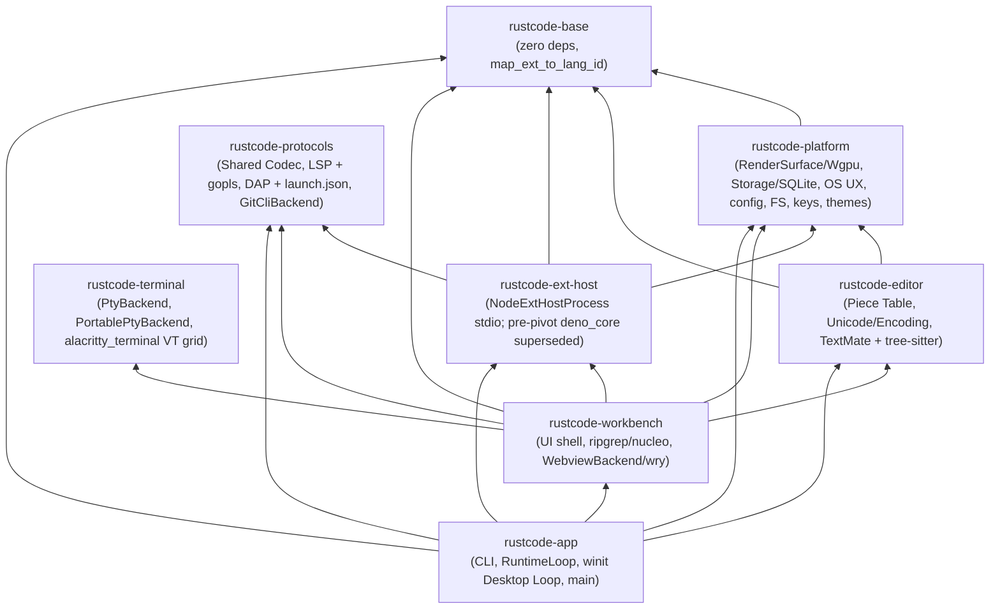
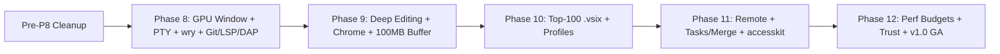

# RustCode — Implementation Plan

## 📌 Implementation Progress Tracker

> Live status of the RustCode implementation in `https://github.com/revelino01/vscode-in-rust.git`.

### Phase 0: Scaffold & Core Foundation
- [x] Cargo workspace setup with 8 modular crates (`rustcode-base`, `rustcode-platform`, `rustcode-editor`, `rustcode-terminal`, `rustcode-protocols`, `rustcode-ext-host`, `rustcode-workbench`, `rustcode-app`)
- [x] `rustcode-base`: `Disposable`, `DisposableStore`, typed `Emitter<T>` / `Event<T>`, `CancellationTokenSource`, `CancellationToken`
- [x] `rustcode-base`: VS Code `when` clause context-key expression parser & evaluator (`ContextKeyExpr`, `ContextKeyService`)
- [x] `rustcode-editor`: Piece Table text buffer with balanced tree, O(log n) inserts & deletes, line indexing, offset-to-position mapping
- [x] `rustcode-editor`: Transactional `UndoRedoStack` with edit grouping and multi-cursor support
- [x] `rustcode-editor`: `CursorState`, `Position`, `Range`, `Selection`, and `DecorationModel`
- [x] `rustcode-platform`: `ConfigurationService` with defaults -> user -> workspace hierarchy, JSONC comment stripping, dot-separated queries
- [x] `rustcode-platform`: `KeybindingService` with multi-chord support (`Ctrl+K Ctrl+C`), modifiers parsing, `when` clause evaluation
- [x] `rustcode-platform`: `CommandRegistry` with disposable registration and dispatch
- [x] `rustcode-platform`: `ThemeService` loading VS Code JSON themes and TextMate token color scopes
- [x] `rustcode-ext-host`: Extension manifest parser (`package.json`), activation events, and contribution points
- [x] `rustcode-ext-host`: MessagePack & JSON binary RPC bridge (`RpcBridge`, `RpcMessage`)
- [x] `rustcode-ext-host`: Provider callback registry (`Completion`, `Hover`, `Definition`, `Formatting`, `TreeData`)
- [x] `rustcode-workbench`: `WorkbenchLayout` shell state (sidebar, panel, status bar, activity bar toggles)
- [x] `rustcode-workbench`: `EditorArea` and `EditorGroup` with tabs, dirty tracking, and preview mode
- [x] `rustcode-workbench`: `CommandPalette` with fuzzy subsequence query search
- [x] `rustcode-workbench`: `StatusBar` with left/right alignment and priority sorting
- [x] `rustcode-terminal`: `TerminalManager` & `TerminalInstance` sessions
- [x] `rustcode-protocols`: LSP, DAP, and Git SCM protocol definitions
- [x] `rustcode-app`: `RustCodeContext` service container bootstrap and builtin command handlers
- [x] `ext-host-js`: JavaScript `vscode.*` API shim (`types.js`, `commands.js`, `window.js`, `workspace.js`, `languages.js`, `env.js`, `rpc-bridge.js`)
- [x] `ext-host-js`: Node.js compatibility layer (`events.js`, `path.js`, `fs.js`)
- [x] Resources: VS Code Dark+ & Light+ default themes, Linux keymaps, sample Hello World extension
- [x] Test Suite: 85 unit and integration tests passing (`cargo test --workspace`)
- [x] GPUI UI Presentation Layer: View abstractions, element rendering pipeline (scene graph display lists, quad/glyph layout, theme color mappings from `ThemeService` into GPUI styles), concrete component models (`EditorView`, `WorkbenchLayout`, `WorkbenchView`, `ActivityBarView`, `FileExplorerView`, `StatusBarView`, `CommandPaletteView`, `EditorAreaView`), and input event routing (GPUI keyboard chords, mouse clicks/scrolls to editor cursor/edits and platform keybindings/commands)
- [x] Robustness & Edge Cases: Fixed PieceTable multi-byte UTF-8 prev/next char boundary navigation & deletion, undo/redo cursor position restoration, selection replacement/deletion, Shift+Arrow selection expansion, Ctrl+A select all, CommandPalette space matching, Hsla negative hue wrapping, out-of-bounds mouse events, and keybinding display string badge resolution

### Phase 1: Minimal Editor & File Workflows
- [x] Configuration loading (`settings.json`)
- [x] Keybinding resolution (`keybindings.json`)
- [x] Theme engine (VS Code JSON theme loader)
- [x] Extension manifest discovery (`package.json`)
- [x] Tree-sitter syntax highlighting integration (dual Tree-sitter/tokenizer pipeline, grammar registry for Rust, JS, TS, Python, JSON, Markdown, packed TokenMetadata, TextMate scope color resolution from ThemeService, incremental line caching, and EditorView syntax colored rendering)
- [x] File I/O async disk save / auto-save service (async tokio::fs and sync atomic writes with temp-file rename, conflict detection with mtime and content hash checks, and AutoSaveService with afterDelay, onFocusChange, and onWindowChange)
- [x] File tree filesystem watcher (`notify` recommended watcher, granular create/change/delete event emitters, recursive and non-recursive watching with Disposable lifecycle)


### Phase 2: Language Intelligence & Marketplace
- [x] `languages.*` LSP client lifecycle (stdio JSON-RPC transport with framed message headers `Content-Length: ...\r\n\r\n`, full document lifecycle syncing `textDocument/didOpen`, `textDocument/didChange` with incremental & full edits, `textDocument/didClose`, request routing for completion, hover, and definition, LanguageFeatureBridge aggregating LSP and extension host providers)
- [x] Autocomplete UI widget (GPUI popover overlay anchored at active cursor position in `EditorView`, triggered automatically on trigger characters `.` / `:` / `/` or manually with `Ctrl+Space`, live fuzzy matching and prefix filtering, arrow key selection `Up`/`Down`, `Tab` / `Enter` commit with snippet tabstop expansion into PieceTable buffer, `Escape` dismiss, and detail / documentation preview panel)
- [x] Diagnostics squiggly underlines & Problems panel (ingest from LSP `textDocument/publishDiagnostics` and extension `vscode.languages.createDiagnosticCollection`, render squiggly wave underlines with red/yellow/blue/gray severity styling under editor spans, error hover tooltips showing source, code, and message on mouse move, dockable `Problems` tab in bottom panel grouping by file with collapse/expand and filter, status bar & tab badge counts, and jump-to-location on problem click)
- [x] Open VSX marketplace client & extension downloader (REST client querying `https://open-vsx.org/api/`, search extensions by keyword, fetch version metadata, download and unpack `.vsix` archives into `~/.rustcode/extensions/` with path traversal protections and standard `extension/` prefix stripping, and parse unpacked `package.json` to register contributed commands into `CommandRegistry`, themes into `ThemeService`, and grammars into the runtime)

### Phase 3: Full Parity
- [x] DAP debug adapter integration (DAP client over stdio framing, breakpoint management, stack frames, scopes, variables, floating debug toolbar with Continue/Step/Restart/Stop, and Call Stack / Variables / Breakpoints sidebar with Debug Console)
- [x] Git / SCM sidebar diff viewer (pure-Rust Eugene Myers O(ND) diff algorithm with inline & side-by-side DiffEditorView, SCM primary sidebar with Staged Changes, Changes, and Untracked trees, staging/unstaging actions, commit message input and execution)
- [x] Webview host integration (pure-Rust modular webview host with HTML parser & GPUI renderer, bidirectional MessagePort RPC bridge `postMessage` / `onDidReceiveMessage`, and `vscode.window.createWebviewPanel` extension host support)
- [x] GPU window rendering (GPUI presentation layer, mockable render surface, and scene graph pipeline)

### Phase 4: Polish & Ecosystem
- [x] Multi-root workspace support (`WorkspaceFolder` models, multi-root file explorer with depth-15 recursive traversal, resource-scoped per-folder configuration with hierarchical fallback `defaults <- user <- workspace <- folder`)
- [x] Cross-folder file & symbol search (`SearchEngine` with regex/glob/case/whole-word, `SymbolExtractor` for Rust/JS/TS/Python/Go, multi-mode `QuickInput`: `Ctrl+P` files, `>` commands, `#` workspace symbols)
- [x] Formatting & Code Actions provider integration (`languages.registerDocumentFormattingEditProvider`, `languages.registerCodeActionsProvider`, `languages.format`, `languages.codeAction`, transactional descending-offset PieceTable text edit application, atomic undo/redo, LSP 3.17 `WorkspaceEdit` and `CodeActionKind` DTOs, `editor.action.formatDocument` and `editor.action.quickFix` commands)
- [x] LSP UTF-16 coordinate alignment (`byte_offset_to_utf16_col`, `utf16_col_to_byte_offset`) for accurate non-ASCII position synchronization with language servers
- [x] Extension compatibility test suite (10/10 tests in `crates/rustcode-ext-host/tests/compat_suite.rs` covering manifest contributions, activation lifecycle, RPC command dispatch, formatting, diagnostics, code actions, workspace edits, theme loading, and tree views via synthetic extension fixtures; expanded to 26/26 in Phase 6)
- [x] Performance benchmarking suite (`crates/rustcode-app/benches/startup_time.rs`, `crates/rustcode-app/benches/memory_footprint.rs`, `crates/rustcode-editor/benches/editor_latency.rs`; measured baselines: startup ~134 µs < 500 ms target, keystroke latency ~425 µs < 3 ms target, empty window RSS ~5 MB < 120 MB target)
- [x] Packaging & release optimization (workspace `[profile.release]` with `lto="thin"`, `codegen-units=1`, `opt-level=3`, `strip="symbols"`, `panic="abort"`; `scripts/package.sh` and `scripts/package.ps1` distribution packaging scripts; `resources/rustcode.desktop` Linux desktop entry)
- [x] Documentation polish (README vibe-coded declaration preserved; `PROJECT.md` 20-feature roadmap; architecture documentation updated across all crates)

### Active Feature Milestones (R1–R4)
- [x] **M1 (R1) Visual Settings UI**: `ConfigurationService` (`Clone`, `update`/`reset`, all schema defaults), `SettingsUiView` GPUI `View` + category/search filtering + mouse/keyboard/scroll interaction + two-way config sync, `EditorAreaView`/`WorkbenchView`/`WorkbenchWindow`/`RustCodeContext` wiring, `ctrl+,` keymap & `workbench.action.openSettings`, and unit/E2E tests
- [x] **M2 (R2) Notebook Support**: `NotebookDocument` / `.ipynb` JSON parser & serializer / pure-Rust `NotebookKernel` / `NotebookEditorView` GPUI `View`, `EditorAreaView`/`WorkbenchView` `.ipynb` routing, `ext-host-js/vscode-api/notebooks.js` + `rustcode-ext-host` RPC bridge, and unit/E2E tests
- [x] **M3 (R3) Extension Marketplace Sidebar UI**: `rustcode-ext-host::marketplace` (`list_installed`, `uninstall`, `set_enabled`/`is_enabled`), `ExtensionsSidebarView` GPUI `View`, `WorkbenchView` sidebar routing (`"extensions"` / `"workbench.view.extensions"`), and unit/E2E tests
- [x] **M4 (R4) Breadcrumbs, Minimap & Accessibility Tree**: Editor minimap (`editor.minimap.enabled`), breadcrumbs bar (`breadcrumbs.enabled`), semantic accessibility node tree (`crates/rustcode-platform/src/accessibility.rs` + `WorkbenchWindow::accessibility_tree`), live config sync, and unit/E2E tests

### Phase 6: Interactive Panels, Full API Surface, Advanced Editor & Split Grid (Milestones M1–M5)
- [x] **M1 (`0487c0c`) — Interactive Terminal & Output Panel Views**: `rustcode-terminal` multi-tab/split sessions, command history & pure-Rust `std::process::Command` execution; `ExtHostOutputManager` & `ExtHostTerminalManager`; `window.createOutputChannel` (`OutputChannelProxy`) & `window.createTerminal`; interactive `TerminalPanelView` & `OutputPanelView`; `WorkbenchView`/`WorkbenchWindow` panel routing, keymaps & sync (`339` workspace tests, `16/16` `compat_suite`, `0` clippy warnings)
- [x] **M2 (`020b874`) — Remaining `vscode.*` Extension Host APIs**: `vscode.EventEmitter` in `types.js`; `ext-host-js/vscode-api/{scm,debug,tasks,tests,authentication}.js`, `index.js`, and `rpc-bridge.js`; `ProviderType` variants & 5 Rust managers (`ExtHostScmManager`, `ExtHostDebugManager`, `ExtHostTaskManager`, `ExtHostTestManager`, `ExtHostAuthManager`); `LanguageFeatureBridge` & `Contributions` updates; `compat_suite.rs` lifecycle & roundtrip tests (`362` workspace tests, `23/23` `compat_suite`, `0` clippy warnings)
- [x] **M3 (`45a5954`) — Code Folding, Soft Word-Wrap & Multi-Cursor Commands**: `FoldingModel` & gutter fold chevrons (`editor.fold`, `editor.unfold`, `editor.foldAll`, `editor.unfoldAll`); `WordWrapMode` & `VisualLayout` + `editor.wordWrap` / `editor.wordWrapColumn` (`80`) + `WorkbenchWindow::sync_configuration()`; atomic multi-cursor editing/movement & `Ctrl+D` (`addSelectionToNextFindMatch`), `Ctrl+Alt+Up/Down` (`insertCursorAbove`/`Below`), `Escape` collapse (`385` workspace tests, `23/23` `compat_suite`, `0` clippy warnings)
- [x] **M4 (`d048885`) — Split Editor Grid & Custom Editors**: Recursive `EditorGridNode` & `EditorSash` split grid with per-group tabs/breadcrumbs/shared `TextDocument` (`workbench.action.splitEditor`, `splitEditorDown`, `focusPreviousGroup`, `focusNextGroup`, `focusFirstEditorGroup`, `focusSecondEditorGroup`, `closeEditorsInGroup`); `window.registerCustomEditorProvider`, `ExtHostCustomEditorManager`, `CustomEditorContribution::matches_path`, `WorkbenchWindow` & `EditorAreaView` `WebviewEditorView` dispatch (`404` tests, `26/26` `compat_suite`, `0` clippy warnings)
- [x] **M5 (`6a736ba`) — Documentation & Compatibility Matrix Refresh**: Refreshed `docs/extension-compat-matrix.md`, `docs/architecture.md`, `README.md`, and `rustcode-implementation-plan.md` (+ brain sync), with final full workspace/compat_suite/clippy verification (`404` tests, `26/26` `compat_suite`, `0` clippy warnings)

### Phase 7: Full RPC Bridge Parity, In-Editor Widgets & Extended Ecosystem
- [x] **M1.1 — Live Framed Stdio RPC Transport, Structured Error Envelope & `node-compat/{fs,path}.js` Parity**: `NodeExtHostProcess` (`ContentLengthJson`, `ContentLengthMsgPack`, `NewlineJson`, `from_io`, `JoinSet` half-close EOF draining, Windows `CREATE_NO_WINDOW`), O(N) `read_content_length_frame` with 64 KiB header / 64 MiB frame limits, structured `{ error: { code, message } }` (`RpcError` / `RpcErrorPayload`) across 12+ namespaces via `handle_rpc_message_result`, `node-compat/fs.js` (`Dirent`, encodings, `mkdir` `firstCreated`, `promises.{access,rm,rename,copyFile}`, `constants`, `invokeCallback`, 11 `*Sync` methods throwing `ENOSYS` in live stdio except `existsSync`), OS-aware `node-compat/path.js` (`win32`/`posix`, `relative`, `parse`, `format`, UNC/drive-letter parity), and Windows/Linux `map_io_error` + `EISDIR` parity
- [x] **M1.2 — Extension Host VS Code API Parity (`commands`, `window`, `workspace`, `env`, `extensions`) & Live Fixture E2E**: Sequential FIFO incoming notification worker + `IncomingNotifWork::Barrier` causal fence; `reader_closed` fast-fail; `command_mutation_lock` + token-checked `CommandRegistry` disposal; Windows folder-config equivalence & `extract_scope_path` `Uri` normalization + `affectsConfiguration(section, scope)`; CRLF/UTF-16 `TextDocumentProxy`; pluggable `ClipboardBackend` (`OsClipboardBackend`/`InMemoryClipboardBackend`) & `ExternalUriOpener` (`OsExternalUriOpener`/`RecordingExternalUriOpener`); `TreeDataProvider`/`TreeData` synthetic handles & `onDidChangeTreeData`; `require('vscode')` resolution (`installVscodeModuleHook` + `globalThis` singleton); live fixture (`hello-world`, `treeview_ext`, `theme_ext`) & multi-threaded 4-worker stdio reverse-split stress tests (**457** baseline workspace tests, **41/41** `compat_suite`, **25/25** baseline `ext-host-js/test.js` sections, **0** Windows/Linux clippy warnings)
- [x] **M1.3 — `RustCodeContext` & `WorkbenchWindow` End-to-End Wiring**: Wired live `LanguageFeatureBridge` (hydrated from `ext_loader`) & shared `FileSystemService` in `RustCodeContext::create_window()`, `SharedWorkbenchLayout` / `LayoutHandle` & `WindowCommandSink` (`SuppressCommandGuard`) for immediate builtin command effects without double-toggling, synchronous document lifecycle forwarding (`did_{open,change,save,close}_document_sync`), UI sync hooks (`sync_status_bar`, `sync_window_manager`, `sync_test_manager`, `sync_tree_views`, `sync_for_render`) with `Escape`-sync safety, and Windows drive-root / `/` Explorer name fallback (`node_display_name`)
- [x] **M2 — In-Editor Find & Replace Widget (`Ctrl+F` / `Ctrl+H`) & QuickInput Navigation (`Ctrl+G` / `@`)**: Floating `FindReplaceWidget` (`crates/rustcode-editor/src/find_replace.rs`) wired into `EditorView` (`actions.find`, `editor.action.startFindReplaceAction`) with live match highlights, case/whole-word/regex toggles, zero-width regex guard, invalid regex safety, UTF-16/CRLF offset mapping, fold auto-unfolding, and atomic single-undo Replace All; plus `QuickInput` `:line[:col]` (`Ctrl+G`, `workbench.action.gotoLine`) & `@symbol` (`Ctrl+Shift+O`, `workbench.action.gotoSymbol`) with dynamic `Ctrl+P` prefix switching and `PaletteAction::{OpenFile, JumpToLine}` cursor/URI preservation
- [x] **M3 — Notifications, Interactive Prompts & Testing Sidebar (`workbench.view.testing`)**: Non-blocking bottom-right `NotificationsOverlay` toast stack (deduplicated by ID) + `AccessibleRole::Dialog` modal dialogs (`detail`, actions, dismiss, tiny-viewport clamping), interactive `PromptOverlay` (`showQuickPick` / `showInputBox` with `validateInput`, keyboard nav, `Escape` cancel), and `TestingSidebarView` (`crates/rustcode-workbench/src/testing/mod.rs`) at Activity Bar index 5 (`workbench.view.testing`) with failure badge, disposed-controller hiding, `"Run All"` (`tests.runTests`) RPC dispatch, and cross-platform `file://` URI click-to-open
- [x] **M4 — Interactive File Explorer CRUD & Contributed TreeViews**: Explorer `"New File"` (`+F`), `"New Folder"` (`+D`), inline `F2` rename (updating open tabs via `EditorAreaView::rename_tab`), confirmed `Delete` (closing open tabs via `EditorAreaView::close_tabs_for_path`), keyboard navigation, cross-platform filename validation (`validate_entry_name`), and contributed `TreeDataProvider` views (`contributes.views`, `evaluate_when_clause`, lazy `request_tree_children_result`, `onDidChangeTreeData` refresh events, command dispatch)
- [x] **M5 — Expanded `node-compat` (9 Modules), Process/OS RPCs & 14 Language Tokenizers**: Added `ext-host-js/node-compat/{buffer,url,util,os,crypto,child_process}.js` (9 modules total alongside `events`, `fs`, `path`) + Rust `env.getOsInfo` (`ExtOsInfo`) & `process.{exec,spawn,spawnSync}` RPCs (`crates/rustcode-ext-host/src/process/mod.rs`), and 7 pure-Rust state-machine syntax tokenizers (`go`, `c`, `cpp`, `html`, `css`, `toml`, `yaml` — **14** grammars total with `plaintext`, `rust`, `javascript`, `typescript`, `python`, `json`, `markdown`) + `GrammarState::{RawString, HtmlInTag, HtmlScript, HtmlStyle}` and `TextDocument::map_ext_to_lang_id`
- [x] **M6 — Documentation & Trackers Refresh**: Refreshed `README.md`, `rustcode-implementation-plan.md`, `docs/architecture.md`, and `docs/extension-compat-matrix.md` to reflect M1.1–M5 implementations
- [x] **M7 — Full Verification, Tier 5 Hardening & Final Counts**: Verified **513/513** workspace tests across **8** crates (**41/41** `compat_suite`), **31/31** `ext-host-js/test.js` sections (**404** `assert(...)` call sites), **8/8** `tests/phase7-e2e/runner.js --syntax-check` checks, **286/286** Windows (**287** Unix) `tests/phase7-e2e` tests across Tiers 1–4, Tier 5 adversarial hardening, **0** Windows & Linux (`x86_64-unknown-linux-gnu`) `cargo clippy` warnings, `cargo bench --workspace --no-run`, and `rustcode` startup smoke check

### Pre-Phase 8 Cleanup Checklist (Completed)

> Redundancies, duplicated helpers, dead code, and unused dependencies consolidated prior to Phase 8 M1–M6:

**Core & Codec Deduplication**
- [x] **Consolidate stdio `Content-Length` codecs**: Deleted `crates/rustcode-protocols/src/lsp/codec.rs` (`LspCodecError`); migrated `LspClient` & `DapClient` onto shared `crates/rustcode-protocols/src/codec.rs` (`64 KiB` header / `64 MiB` frame limits, linear O(N) scan) aligned with `crates/rustcode-ext-host/src/rpc/mod.rs`
- [x] **Unify `map_ext_to_lang_id`**: Centralized canonical extension-to-language mapper in `crates/rustcode-base/src/lib.rs`, called by both `crates/rustcode-editor/src/document/mod.rs` and `crates/rustcode-ext-host/src/provider/bridge.rs`
- [x] **Deduplicate `ext-host-js/node-compat/` Base64 & UTF-8 codecs**: Shared `ext-host-js/node-compat/buffer.js` Base64 and UTF-8 helpers (`base64ToBytes`, `bytesToBase64`, `utf8ToBytes`, `utf8EncodeInto`, `bytesToUtf8`) across `fs.js` and `util.js` (`TextEncoder`/`TextDecoder`)

**UI, Geometry & Search Helpers**
- [x] **Centralize `is_finite_rect` on `Rect`**: Removed 5 duplicate local copies and unified onto `Rect::{is_finite, is_finite_positive}` (`rustcode-platform::render::geometry`)
- [x] **Extract `push_finite_quad` & `push_finite_text`**: Centralized onto `Scene::{push_finite_quad, push_finite_text, push_finite_shadow}` (`rustcode-platform::render::scene`) with consistent `font_size >= 0.0` validation
- [x] **Unify `clamp_rect` / `clamp_rect_to_bounds`**: Consolidated onto `Rect::clamp_to_bounds` (`rustcode-platform::render::geometry`)
- [x] **Deduplicate `fuzzy_match` & `BenchmarkStats`**: Consolidated `rustcode_workbench::fuzzy_match` (`crates/rustcode-workbench/src/lib.rs`) and `rustcode_platform::bench_support::BenchmarkStats` across `crates/rustcode-app/benches/startup_time.rs` & `crates/rustcode-editor/benches/editor_latency.rs`

**Dead Code, Legacy State & Unused Cargo Dependencies**
- [x] **Remove dead AVL rotation methods in `PieceTable`**: Deleted unused `#[allow(dead_code)]` `balance_factor`, `rotate_right`, `rotate_left`, and `balance` in `crates/rustcode-editor/src/model/piece_table.rs`
- [x] **Remove unused `RustCodeContext::editor_area` field**: Dropped unused allocation in `crates/rustcode-app/src/lib.rs`
- [x] **Resolve no-op `gpui` Cargo feature**: Replaced unused `gpui = []` feature declarations in `crates/{rustcode-platform,rustcode-workbench,rustcode-app}/Cargo.toml` with real `desktop` feature gates
- [x] **Simplify `FileExplorer` dual `root`/`roots` state**: Unified onto `roots: Vec<FileTreeNode>` across `crates/rustcode-workbench/src/explorer/mod.rs` and `crates/rustcode-app/src/lib.rs`
- [x] **Prune unused `[dependencies]`**: Removed `smallvec` (`rustcode-base`), `thiserror` (`rustcode-editor`, `rustcode-workbench`), `serde` (`rustcode-app`), and moved `rustcode-terminal` in `crates/rustcode-app/Cargo.toml` to `[dev-dependencies]`

**Sync Wrappers & Documentation Hygiene**
- [x] **Share `WorkbenchWindow::sync_*` & `sync_for_render` mapping helpers & tidy `LanguageFeatureBridge` RPC/doc wrappers**: Extracted `sync_window_overlays` and `sync_testing_view_from_bridge` in `crates/rustcode-workbench/src/window.rs` and kept `LanguageFeatureBridge::handle_rpc_message` cleanly delegating to `handle_rpc_message_result` for `tests/phase7-e2e/` backwards compatibility
- [x] **Align superseded prototype notes**: Marked historical Phase 0–3 prototype code snippets below (`deno_core`, `#[op2]`, Zed `gpui-fork`, `git2`, `rust-toolchain.toml`) as superseded by the locked-in 1:1 VS Code Rust Hybrid stack

### Phase 8 (Completed & Stage 3 Verified): 1:1 VS Code Native Desktop & Runtime Parity (Rust Hybrid Stack)

> **Locked-In 1:1 VS Code Rust Hybrid Stack (Implemented in Phase 8):**
> - **GUI & Text Rendering:** `winit` + `wgpu` + `cosmic-text` behind `RenderSurface` (`#[cfg(feature = "desktop")] WgpuRenderSurface`, 120 FPS pipeline, ligatures, CJK/emoji/complex shaping, Codicons, HiDPI; preserving `MockRenderSurface` for headless tests)
> - **Extension Host Runtime:** Live Node.js `NodeExtHostProcess` (framed stdio + `require('vscode')` hook + `RuntimeLoop` auto-activation & crash recovery)
> - **Editor Text & Syntax:** Custom Piece Table + `unicode-segmentation` / `unicode-width` / `encoding_rs`; TextMate `.tmLanguage` grammar engine + `tree-sitter` (`desktop`) layered over the 14 built-in pure-Rust tokenizers
> - **Terminal & WebViews:** `alacritty_terminal` + real PTY (`portable-pty` / ConPTY / Unix PTY via `PtyBackend`) and `wry` (`#[cfg(feature = "desktop")] WryWebviewBackend` via `WebviewBackend`) with headless test fallbacks
> - **Git, Search & Native OS UX:** Real `git` CLI (`GitCliBackend` via `GitBackend`), `ignore` + `grep-regex` + `grep-searcher` (`ripgrep`), `nucleo-matcher`, `rusqlite` SQLite `StorageService` (`desktop`), `arboard`, `rfd` (`desktop`), `dirs`, auto-attached `LspClientManager` (incl. `gopls`), and `.vscode/launch.json` + `DapClient`

- [x] **Phase 8 M1 — Hardware GPU Desktop Window & Rich Text Rasterizer (`winit` + `wgpu` + `cosmic-text`)**: Implemented `#[cfg(feature = "desktop")] WgpuRenderSurface` (`wgpu` + `cosmic-text`) rendering `Scene::{Quad, GlyphRun, Shadow, PushClip, PopClip}` with rounded corners, borders, shadows, intersection `ClipStack`, `GlyphAtlasAllocator`, shaping (ligatures, emoji/CJK/fallback fonts, Codicons), HiDPI scaling, and `rustcode-app::desktop` `winit` keyboard/IME/mouse/click/scroll/resize/close event loop (preserving `MockRenderSurface` as default headless test backend)
- [x] **Phase 8 M2 — CLI, SQLite State Persistence (`rusqlite`), Native OS Integration (`rfd`/`arboard`/`dirs`) & Live Runtime Loop**: Implemented `rustcode-app::cli` (`[PATH...]`, `--headless`, `--gui`, `--goto file:line[:col]`, `--user-data-dir`, `--extensions-dir`, `--disable-extensions`, `--version`), `AppPaths` (`dirs`), disk loading of `~/.rustcode/` & `<workspace>/.vscode/` configs/keymaps/themes/extensions, `SqliteStorageService` (`rusqlite` bundled behind `desktop` + `InMemoryStorageBackend`), `RfdFileDialogBackend` (`rfd` behind `desktop` + `MockFileDialogBackend`), `ArboardClipboardBackend` (`arboard`), and `RuntimeLoop` Tokio runtime driving `FileSystemWatcher`, `AutoSaveService`, and live `NodeExtHostProcess` auto-activation/crash recovery
- [x] **Phase 8 M3 — Daily-Driver Editor, `ripgrep`/`nucleo` Search & TextMate + `tree-sitter` Syntax Engine**: Implemented editor clipboard shortcuts (`Ctrl+C`/`X`/`V` incl. empty-selection line copy/cut), mouse drag/double/triple-click selection, scrollbar/Minimap dragging, `Ctrl+/` comments (`view::comments`), `Alt+Up/Down` move & `Shift+Alt+Up/Down` duplicate lines, multi-line indent/outdent, bracket auto-close/overtype/matching, right-click `EditorContextMenu`; `unicode-segmentation`/`unicode-width`/`encoding_rs` (`TextEncoding`) in `rustcode-editor`; `ignore`/`grep-regex`/`grep-searcher` (`ripgrep`) multi-file search/replace (`Ctrl+Shift+F`/`Ctrl+Shift+H`) + `nucleo-matcher` fuzzy ranking in `CommandPalette`; and TextMate `.tmLanguage`/`.tmLanguage.json` grammar loader (`TextMateGrammar`) + `desktop` `tree-sitter` (`TreeSitterEngine`/`TreeSitterDocument`) layered over the 14 built-in grammars
- [x] **Phase 8 M4 — Real PTY Terminal (`alacritty_terminal`) & System WebViews (`wry`)**: Replaced one-shot `std::process::Command` runner with `PtyBackend` (`PortablePtyBackend` via `portable-pty` + `HeadlessPtyBackend`) and `TerminalCellGrid` (`alacritty_terminal` VT100/xterm emulation with ANSI/256/truecolor, alternate screen, signals, resize, scrollback) wired to `TerminalPanelView`/`TerminalAction`/`ExtHostTerminalManager`; implemented `WebviewBackend` (`#[cfg(feature = "desktop")] WryWebviewBackend` via `wry` + `HeadlessWebviewBackend` fallback) wired to `ExtHostWebviewManager` & `ExtHostCustomEditorManager` `postMessage` IPC channels
- [x] **Phase 8 M5 — Real `git` CLI SCM, Auto-Attached LSP Servers & Live DAP (`launch.json`)**: Implemented `GitBackend` / `GitCliBackend` (`git status --porcelain=v2 -b`, `diff`, `show HEAD:<path>`, `add`, `restore --staged`, `commit`, `log`, Status Bar branch readout) replacing `ScmRepository::sample_repository()` in default `WorkbenchView`; wired auto-attached `LspClientManager` servers (`rust-analyzer`, `typescript-language-server`, `pyright-langserver`, `vscode-json-language-server`, `gopls`) for hover/go-to-def (`F12`/`Ctrl+Click`)/completion/diagnostics/`editor.formatOnSave`; and added `.vscode/launch.json` JSONC parser (`load_launch_json`) + live `DapClient` sessions with `DebugToolbarView` hidden by default when idle
- [x] **Phase 8 M6 — Cross-Platform Hardening, Native Windows/Linux CI & 1:1 Extension Verification**: Implemented Unix `setsid`/`setpgid`/`killpg` process-group isolation in `crates/rustcode-ext-host/src/process/mod.rs`, fixed `util.isDeepStrictEqual` edge cases & `ContextKeyExpr` `[^]/]` regex char-class parsing, added `.github/workflows/ci.yml` (`windows-latest` + `ubuntu-latest`), updated `scripts/package.ps1`/`scripts/package.sh` (`-Desktop`/`--desktop`, `-Jobs`/`--jobs`), added `tests/phase8-e2e/`, and refreshed all 4 docs/trackers (**608/608** default & **617/617** `desktop` workspace tests, **41/41** `compat_suite`, **31/31** `ext-host-js/test.js`, **286/286** `tests/phase7-e2e/`, **30/30** `tests/phase8-e2e/`, **0** Win/Linux `clippy` warnings, `cargo bench --no-run`, default & desktop CLI smoke checks)

### Phase 9 (Completed — Stage 3 Verified): Deep Editing, Navigation & Language Intelligence Parity

- [x] **Phase 9 M1 — Advanced LSP & Multi-File Refactoring**: Rich Markdown hover popovers, Signature Help (`Ctrl+Shift+Space`), Peek References / Go to Implementation (`Ctrl+F12`) / Type Definition (`Shift+F12`), Rename Symbol (`F2`) with multi-file `RefactorPreviewOverlay` & atomic `WorkspaceEditUndoStack` undo, LSP Semantic Tokens layered over TextMate/`tree-sitter`, Inlay Hints, CodeLens, Document Links, and Call/Type Hierarchy views (`HierarchySidebarView`, `Shift+Alt+H`)
- [x] **Phase 9 M2 — Snippets Engine, Language Config & Large-File PieceTable**: Full VS Code TextMate snippet engine (nested tabstops, `${1|a,b,c|}` choices, regex transforms, linked mirrors, `$TM_*` variables), `contributes.snippets` & `language-configuration.json` loader (auto-indent, on-enter rules, surrounding pairs), Sticky Scroll, rainbow bracket-pair colorization & guides, and true O(log n) AVL-balanced piece-tree rebalancing + virtualized rendering & `benches/large_file.rs` for 100 MB+ files
- [x] **Phase 9 M3 — Full Workbench Chrome, Context Menus & Multi-Window**: Drag-and-drop tabs across split groups & Explorer files, Secondary Sidebar (right panel), Panel position toggle (bottom/left/right), draggable Sash resizing, custom Title Bar & Menu Bar, full `contributes.menus` right-click Context Menus with `when` clauses, Window Zoom (`Ctrl+=`/`-`/`0`), Zen Mode (`Ctrl+K Z`), and Multi-Window orchestration (`Ctrl+Shift+N`, `-n`/`-r` CLI flags, `WindowManager`, and cross-platform `SingleInstanceIpc` socket forwarding CLI files into active windows)
- [x] **Phase 9 M4 — Phase 9 E2E & Large-File Benchmarks (`tests/phase9-e2e/`)**: Automated verification of Rename Symbol, Peek References, Semantic Tokens, Snippets, Drag-and-Drop layout, Multi-Window IPC, and 100 MB file latency budgets (`5/5` E2E targets, `4/4` syntax/clippy checks, `111 ns` mid-file edit mean on 100.00 MiB)

### Phase 10 (Planned): Real-World Top-100 VS Code Extension Ecosystem & Marketplace Maturity

- [ ] **Phase 10 M1 — Remaining `vscode.*` APIs & Contribution Points**: `workspace.registerFileSystemProvider` (virtual/remote schemes), `TextDocumentContentProvider`, `WebviewViewProvider` (sidebar/panel webviews), `TreeView` drag-and-drop & checkboxes, `SecretStorage` (OS keyring), `LogOutputChannel`, `TerminalShellIntegration`, `CustomExecution` tasks + Problem Matchers, and `contributes.{menus,viewsContainers,viewsWelcome,submenus,jsonValidation,problemMatchers,iconThemes,productIconThemes}`
- [ ] **Phase 10 M2 — Extension Host Runtime Polish & Profiling**: Managed Node.js discovery/version check, per-extension activation & RPC profiling (`Developer: Show Running Extensions`), unresponsive extension host watchdog + restart banner, and transparent real-Node passthrough alongside `require('vscode')` hook for unmodified Open VSX `.vsix` bundles
- [ ] **Phase 10 M3 — Rich Marketplace UX & Profiles**: Full Open VSX detail view via `wry` (README, changelog, dependencies), extension packs, pre-release channel toggle, auto-updates, install-from-`.vsix`, `.vscode/extensions.json` workspace recommendations, and VS Code **Profiles** (settings/keybindings/extensions snapshots)
- [ ] **Phase 10 M4 — Automated Real-`.vsix` Compatibility Harness (`tests/phase10-ext-compat/`)**: Automated CI harness exercising real `.vsix` extensions (`One Dark Pro`, `Tokyo Night`, `Material Icon Theme`, `Prettier`, `ESLint`, `rust-analyzer`, `Python`, `GitLens`, `Tailwind CSS`, `Error Lens`, `Todo Tree`, `YAML`, `TOML`, `Markdown All in One`) and keeping `docs/extension-compat-matrix.md` scores verified

### Phase 11 (Planned): Remote Development, Tasks/Git Merge & Accessibility/I18n

- [ ] **Phase 11 M1 — Remote Development (`rustcode-remote` — SSH & Dev Containers)**: Headless `rustcode-server` binary over SSH (`vscode-remote://ssh-remote+...`) and `devcontainer.json` discovery/attach, multiplexing remote `FileSystemProvider`, remote `NodeExtHostProcess`, remote LSP/DAP, and remote PTY terminal over a single framed tunnel
- [ ] **Phase 11 M2 — `.vscode/tasks.json`, Git Blame/Branches & 3-Way Merge Editor**: Full `tasks.json` runner with Problem Matchers feeding the Problems panel, Git branch/stash/tag picker & inline blame/timeline annotations, and a 3-way visual Merge Conflict Editor (`Accept Current` / `Accept Incoming` / `Accept Both` / `Compare`)
- [ ] **Phase 11 M3 — Native OS Accessibility (`accesskit`), IME & Localization (i18n)**: Bridge `AccessibilityTree` (`crates/rustcode-platform/src/accessibility.rs`) to native OS screen readers via **`accesskit`** (Windows UIA, Linux AT-SPI, macOS NSAccessibility), full CJK/dead-key IME composition overlay in `winit` + `cosmic-text`, High Contrast themes, and VS Code `nls.json` localization packs
- [ ] **Phase 11 M4 — Phase 11 Verification (`tests/phase11-e2e/`)**: Loopback SSH/`rustcode-server` remote workspace E2E, `tasks.json` + 3-way merge conflict tests, and `accesskit` tree parity checks

### Phase 12 (Planned): v1.0 Production Hardening, Performance Budgets, Installers & Release Engineering

- [ ] **Phase 12 M1 — Performance Budget Enforcement & Soak Testing**: Enforce CI performance budgets against real desktop/headless workloads (`< 500 ms` cold start to interactive GPU window, `< 120 MB` idle RAM, `< 350 MB` 20-file RAM, `< 3 ms` keystroke latency, `< 50 ms` 1 MB file open, `< 1 s` 100K-file search, 120 FPS frame pacing, `< 80 MB` binary size) and long-session leak checks
- [ ] **Phase 12 M2 — Security Audit, Workspace Trust & Crash Recovery**: VS Code **Workspace Trust** (Restricted Mode gating untrusted workspace tasks/extensions/local settings), `.vsix` & path-sandbox security audit, OS keyring secret encryption, and crash-dump/panic recovery with dirty-buffer hot-exit restore
- [ ] **Phase 12 M3 — macOS Support, Native OS Installers & Signed Auto-Updater**: Add macOS (`aarch64-apple-darwin` & `x86_64-apple-darwin`) to CI; ship signed native installers (Windows MSI/Inno Setup + `winget` + *"Open with RustCode"* context menu, Linux `.deb`/`.rpm`/`AppImage`/`Flatpak`, macOS `.dmg`/`.app`) and delta auto-updater
- [ ] **Phase 12 M4 — v1.0 GA Audit & Release**: Side-by-side VS Code UX audit, VS Code migration wizard (`settings.json` / `keybindings.json` / extensions import), complete user & extension-author docs, and tagged `v1.0.0` GA release

---

## Goal

Build **RustCode**, a ground-up Rust rewrite of VS Code that:

- **Looks and feels identical** to VS Code (same layout, keybindings, theme format, settings schema)
- **Runs existing JS/TS extensions** unmodified via a live **Node.js Extension Host** (`NodeExtHostProcess` + `require('vscode')` hook) matching VS Code's real extension runtime without Chromium
- Achieves **~3× less RAM** and **~2–5× faster startup** than Electron-based VS Code

### Locked-In Technology Choices (1:1 VS Code Rust Hybrid Stack)

| Decision | Choice | Rationale |
|---|---|---|
| GUI & Text Rasterizer | **`winit` + `wgpu` + `cosmic-text`** behind `RenderSurface` *(replacing Zed `gpui-fork`)* | Preserves existing `Scene` UI views & headless `MockRenderSurface` tests while delivering 120 FPS GPU rendering, ligatures, emoji/CJK/complex shaping, Codicons, and HiDPI |
| Extension Host Runtime | **Node.js subprocess (`NodeExtHostProcess`)** *(replacing `deno_core`)* | Matches VS Code's own Node.js extension host for full compatibility with top-100 extensions (built-in Node stdlib, worker/network/native modules) without Chromium/Electron |
| IPC Format | **MessagePack & JSON** (`rmp-serde`, framed stdio `Content-Length`) | Compact, typed Rust ↔ Node extension host RPC bridge (`ContentLengthJson`, `ContentLengthMsgPack`, `NewlineJson`) |
| Text Buffer | **Custom Piece Table** + `unicode-segmentation` / `unicode-width` / `encoding_rs` | VS Code-compatible editing model with O(log n) ops, grapheme-aware cursoring, display width, and multi-encoding support |
| Syntax Highlighting | **TextMate `.tmLanguage` + `tree-sitter`** *(layered over 14 built-in grammars)* | Incremental parsing plus native support for extension-contributed VS Code TextMate grammars and themes |
| Terminal | **`alacritty_terminal` + real PTY** (`portable-pty` / ConPTY / Unix PTY) | Proven VT100/xterm emulation with interactive shells, ANSI colors, TUIs (`vim`, `htop`), signals, and resize |
| Extension WebViews | **`wry`** (WebView2 / WebKitGTK / WKWebView) | Real OS system webviews with bidirectional `postMessage` bridge for rich extensions & custom editors (retaining headless fallback for tests) |
| Git / SCM | **Real `git` CLI (`GitCliBackend`)** *(replacing `git2`)* | Matches VS Code's own Git integration — automatically inherits user SSH agents, GPG signing, credential helpers, `.gitconfig`, LFS, and Git hooks |
| Workspace Search & Fuzzy | **`ripgrep` (`ignore` + `grep-regex`) + `nucleo`** | `.gitignore`-aware fast multi-file search/replace and Helix/VS Code-grade fuzzy ranking |
| Storage & Native OS UX | **`rusqlite` + `arboard` + `rfd` + `dirs` + `accesskit`** | Persistent SQLite workspace/extension state, native OS clipboard, native file open/save dialogs, standard XDG/AppData paths, and OS screen-reader accessibility (`accesskit`) |
| Remote Architecture | **`rustcode-remote` + `rustcode-server`** (Phase 11) | Multiplexed remote FS, ext-host, LSP/DAP, and PTY over SSH and Dev Containers (`devcontainer.json`) |

### Anti-Drift Guardrails & Phase-Gate Protocol

1. **No Silent Stack Substitutions**: Once a subsystem engine is locked in the table above (`winit`/`wgpu`/`cosmic-text`, live Node.js `NodeExtHostProcess`, `alacritty_terminal` + real PTY, `wry`, TextMate `.tmLanguage` + `tree-sitter`, real `git` CLI, `ripgrep`/`nucleo`, `rusqlite`/`arboard`/`rfd`/`dirs`, `accesskit`, `rustcode-remote`), milestones MUST NOT silently swap it for a simplified stub or unapproved rewrite. Any technical blocker requires an explicit plan amendment before implementation.
2. **Trait & Feature-Gate Isolation**: Every native desktop/OS dependency sits behind an explicit Rust trait (`RenderSurface`, `PtyBackend`, `WebviewBackend`, `GitBackend`, `StorageBackend`, `ClipboardBackend`, `FileDialogBackend`, `AccessibilityBackend`) with a deterministic headless/`Mock*` fallback for CI tests, while the `desktop` binary wires the real engine without `sample_*()` placeholders.
3. **Mandatory Milestone Exit Gate**: Every milestone (`Pre-Phase 8` through `Phase 12`) must verify before completion:
   - Zero architecture drift against the locked-in stack table and active blueprint
   - Zero regressions across all prior verification gates (`cargo test --workspace`, `compat_suite`, `ext-host-js/test.js`, `tests/phase7-e2e/`, plus `tests/phase<N>-e2e/`)
   - `0` `cargo clippy --workspace --all-targets -- -D warnings` on both Windows (`x86_64-pc-windows-gnu`) and Linux (`x86_64-unknown-linux-gnu`) across default + `desktop` features
   - Immediate synchronization of `README.md`, `rustcode-implementation-plan.md`, `docs/architecture.md`, and `docs/extension-compat-matrix.md`

> [!NOTE]
> The detailed crate-by-crate design sketches further below retain some original Phase 0–3 prototype code snippets (`deno_core`, `#[op2]`, `gpui-fork`, `git2`, `lsp-types`, `toml`, `jsonc-parser`, `rust-toolchain.toml` nightly) as **historical pre-pivot references (superseded by the locked-in Phase 8 Rust Hybrid stack)**; Phases 8–12 evolve the active codebase strictly per the **Locked-In Technology Choices** table and **Anti-Drift Guardrails** above.

---

## VS Code Behavioral Fidelity Requirements

> [!IMPORTANT]
> The goal is that a VS Code user can switch to RustCode and **not need to relearn anything**. Every behavior listed below must match VS Code exactly.

### Must Match Exactly
- **Keybindings**: Same default keymap. Read `keybindings.json` in the same format. Same `when` clause context-key expressions.
- **Settings**: Read `settings.json` in the same format. Same setting IDs (e.g., `editor.fontSize`, `workbench.colorTheme`). Same defaults.
- **Themes**: Load VS Code `.json` theme files unchanged. Same token color scoping rules.
- **Extensions**: Install from `.vsix` files. Same `package.json` contribution point schema. Same activation events.
- **Snippets**: Same snippet format and expansion behavior.
- **Command Palette**: Same `Ctrl+Shift+P` behavior, same command IDs.
- **File Explorer**: Same tree behavior (expand/collapse, rename inline, drag-and-drop, context menus).
- **Editor tabs**: Same tab behavior (dirty indicator, preview mode, tab overflow, close button).
- **Integrated Terminal**: Same split/tab terminal UX.
- **Search**: Same `Ctrl+Shift+F` behavior with regex, case, whole word toggles.
- **Git integration**: Same sidebar UX — staged/unstaged changes, inline diff, commit.
- **Minimap**: Same right-side minimap rendering.
- **Breadcrumbs**: Same breadcrumb bar above editor.

### Acceptable Differences
- **Pixel-perfect rendering**: CSS → GPU rendering means slightly different font metrics, anti-aliasing, and spacing. This is acceptable as long as the *layout* matches.
- **Animation timing**: GPU-rendered transitions may feel slightly different. Acceptable.
- **Webview rendering**: Extension webviews will use the system webview (WebKit/WebView2) instead of Chromium. Minor rendering differences are acceptable.
- **Settings UI**: Interactive Visual Settings UI (`Ctrl+,` / `workbench.action.openSettings`, `rustcode://settings` tab) is implemented alongside `settings.json` support.

---

## Project Structure

```
rustcode/
├── Cargo.toml                          # Workspace root
├── rust-toolchain.toml                 # [Historical pre-pivot: nightly for GPUI; superseded by stable Rust + winit/wgpu/cosmic-text]
│
├── crates/
│   ├── rustcode-base/                  # Layer 0: Zero-dep utilities, context keys (`[^]/]` fix), canonical `map_ext_to_lang_id`
│   ├── rustcode-platform/              # Layer 1: Platform services (config, FS, keys, themes, RenderSurface/Wgpu, StorageBackend/SQLite, OS UX)
│   ├── rustcode-editor/                # Layer 2: Text editor engine (Piece Table, unicode-*/encoding_rs, daily ops, TextMate + tree-sitter, 14 grammars)
│   ├── rustcode-workbench/             # Layer 3: Workbench UI shell (SharedWorkbenchLayout, ripgrep/nucleo Search, WebviewBackend/wry, panels, tabs)
│   ├── rustcode-ext-host/              # Layer 4: Extension Host (NodeExtHostProcess framed stdio + vscode.* API bridge + env/process RPC w/ setsid/killpg)
│   ├── rustcode-protocols/             # Layer 5: Shared bounded codec, auto-LSP (incl. gopls), DAP + launch.json, GitBackend + GitCliBackend
│   ├── rustcode-terminal/              # Integrated terminal (PtyBackend/PortablePtyBackend + alacritty_terminal VT grid, split/tab sessions)
│   └── rustcode-app/                   # Entry point, CLI (`src/cli.rs`), Tokio `RuntimeLoop` (`src/runtime.rs`), `winit` desktop (`src/desktop.rs`)
│
├── ext-host-js/                        # JavaScript: vscode API shim + Node.js compat layer
│   ├── vscode-api/                     # The `require('vscode')` module (13 files, 12 namespaces + types)
│   │   ├── index.js                    # Main entry — assembles all namespaces
│   │   ├── commands.js                 # vscode.commands.*
│   │   ├── window.js                   # vscode.window.*
│   │   ├── workspace.js               # vscode.workspace.*
│   │   ├── languages.js               # vscode.languages.*
│   │   ├── debug.js                    # vscode.debug.*
│   │   ├── env.js                      # vscode.env.*
│   │   ├── extensions.js              # vscode.extensions.*
│   │   ├── scm.js                     # vscode.scm.*
│   │   ├── tasks.js                   # vscode.tasks.*
│   │   ├── authentication.js          # vscode.authentication.*
│   │   ├── tests.js                   # vscode.tests.*
│   │   ├── notebooks.js              # vscode.notebooks.*
│   │   └── types.js                   # All VS Code types (Position, Range, Uri, etc.)
│   ├── rpc-bridge.js                   # Framed stdio (`Content-Length` / newline-JSON) RPC client for Rust IPC
│   ├── node-compat/                    # 9 Node.js API polyfills implemented in pure JS + Rust RPCs
│   │   ├── events.js                   # EventEmitter (pure JS)
│   │   ├── fs.js                       # fs/promises & callbacks shimmed to Rust fs.* RPCs
│   │   ├── path.js                     # OS-aware path module (win32/posix, pure JS)
│   │   ├── buffer.js                   # Buffer (Uint8Array subclass, pure JS)
│   │   ├── url.js                      # WHATWG URL, URLSearchParams, Punycode, pathToFileURL/fileURLToPath
│   │   ├── util.js                     # format, inspect, promisify, isDeepStrictEqual, TextEncoder/Decoder
│   │   ├── os.js                       # os metadata hydrated via env.getOsInfo RPC + platform fallbacks
│   │   ├── crypto.js                   # Pure-JS MD5/SHA-1/224/256/384/512/HMAC/PBKDF2/random/timingSafeEqual
│   │   └── child_process.js            # ChildProcess/exec/spawn/spawnSync shimmed to Rust process.* RPCs
│   ├── test.js                         # JS extension host test suite
│   └── package.json
│
├── resources/
│   ├── default-themes/                 # VS Code's default dark/light/hc themes (JSON)
│   ├── default-keymaps/                # Default keybindings (JSON, VS Code format)
│   ├── default-snippets/               # Built-in snippets
│   ├── icons/                          # App icons, file type icons (Seti/Codicon)
│   └── codicons/                       # VS Code's Codicon icon font
│
├── tests/
│   ├── extension-compat/               # Test harness: load real extensions, verify API calls
│   ├── editor-model/                   # Piece Table correctness tests
│   ├── benchmarks/                     # Criterion benchmarks (startup, memory, frame time)
│   └── integration/                    # End-to-end UI tests
│
└── docs/
    ├── architecture.md
    ├── extension-compat-matrix.md       # Tracks which APIs are implemented
    └── contributing.md
```

---

## Proposed Changes — Crate-by-Crate

### Dependency Graph *(Current `crates/*/Cargo.toml`)*



---

### `rustcode-base` — Layer 0: Core Utilities

**Purpose**: Zero-dependency foundation. Everything above imports this.

#### [NEW] `crates/rustcode-base/Cargo.toml`
```toml
[package]
name = "rustcode-base"
version = "0.1.0"
edition = "2021"

[dependencies]
parking_lot = "0.12"       # Fast mutexes/rwlocks
uuid = { version = "1", features = ["v4"] }
smallvec = "1.13"          # Stack-allocated small vectors
smol_str = "0.3"           # Inline small strings (avoid heap for short strings)
log = "0.4"
thiserror = "2"
```

#### [NEW] Key modules

**`disposable.rs`** — VS Code's `Disposable` pattern:
```rust
/// Mirrors VS Code's IDisposable. Resources that need cleanup implement this.
pub trait Disposable: Send + Sync {
    fn dispose(&mut self);
}

/// Collects multiple disposables, disposes all on drop.
pub struct DisposableStore {
    items: Vec<Box<dyn Disposable>>,
    is_disposed: bool,
}

impl Drop for DisposableStore {
    fn drop(&mut self) {
        if !self.is_disposed {
            for item in self.items.iter_mut().rev() {
                item.dispose();
            }
            self.is_disposed = true;
        }
    }
}
```

**`event.rs`** — Typed event emitter (mirrors VS Code's `Emitter<T>`):
```rust
use parking_lot::Mutex;
use std::sync::Arc;

type Listener<T> = Box<dyn Fn(&T) + Send + Sync>;

pub struct Emitter<T: Clone + Send + 'static> {
    listeners: Arc<Mutex<Vec<Listener<T>>>>,
}

impl<T: Clone + Send + 'static> Emitter<T> {
    pub fn new() -> Self { ... }

    /// Subscribe. Returns a disposable that unsubscribes.
    pub fn event(&self) -> Event<T> { ... }

    /// Fire the event to all listeners.
    pub fn fire(&self, value: T) { ... }
}

/// A subscribable event (mirrors VS Code's `Event<T>`).
pub struct Event<T: Clone + Send + 'static> { ... }
```

**`cancellation.rs`** — CancellationToken (mirrors VS Code's):
```rust
pub struct CancellationTokenSource {
    token: CancellationToken,
}

#[derive(Clone)]
pub struct CancellationToken {
    is_cancelled: Arc<AtomicBool>,
    on_cancelled: Event<()>,
}

impl CancellationToken {
    pub fn is_cancelled(&self) -> bool { ... }
    pub fn on_cancelled(&self) -> &Event<()> { ... }
}
```

**`context_key.rs`** — When-clause expression evaluator:
```rust
/// Evaluates VS Code `when` clause expressions like:
/// "editorTextFocus && !editorReadonly"
/// "resourceLangId == rust"
pub struct ContextKeyExpr { ... }

impl ContextKeyExpr {
    pub fn parse(expr: &str) -> Result<Self, ParseError> { ... }
    pub fn evaluate(&self, context: &ContextKeyService) -> bool { ... }
}
```

**Estimated**: ~3,000–5,000 lines.

---

### `rustcode-platform` — Layer 1: Platform Services

**Purpose**: Core services that the editor and workbench depend on. Each service is a trait + implementation, wired via a service container.

#### [NEW] `crates/rustcode-platform/Cargo.toml`
```toml
[package]
name = "rustcode-platform"
version = "0.1.0"
edition = "2021"

[dependencies]
rustcode-base = { path = "../rustcode-base" }
serde = { version = "1", features = ["derive"] }
serde_json = "1"
tokio = { version = "1", features = ["full"] }
notify = "7"                    # Cross-platform file watching
rusqlite = { version = "0.32", features = ["bundled"] }
arboard = "3"                   # Clipboard
rfd = "0.15"                    # Native file dialogs
dirs = "5"                      # XDG/AppData paths
tracing = "0.1"
tracing-subscriber = "0.3"
toml = "0.8"                    # [Historical pre-pivot; superseded — active config uses pure-Rust JSON/JSONC]
jsonc-parser = "0.23"           # [Historical pre-pivot; superseded by built-in pure-Rust JSONC stripper]
```

#### [NEW] Key services

**`configuration/service.rs`** — Settings system:
```rust
/// Reads settings.json (with comments), merges defaults → user → workspace.
/// Same setting IDs as VS Code (e.g., "editor.fontSize").
pub struct ConfigurationService {
    /// Default values for all known settings
    defaults: serde_json::Value,
    /// User settings (~/.config/rustcode/settings.json)
    user: serde_json::Value,
    /// Workspace settings (.rustcode/settings.json)
    workspace: Option<serde_json::Value>,
    /// Merged view (defaults ← user ← workspace)
    merged: serde_json::Value,
    /// Fires when any setting changes
    on_did_change: Emitter<ConfigurationChangeEvent>,
}

impl ConfigurationService {
    /// Get a setting value. Path is dot-separated: "editor.fontSize"
    pub fn get<T: serde::de::DeserializeOwned>(&self, section: &str) -> Option<T> { ... }

    /// Update a setting (writes to user or workspace settings.json)
    pub fn update(&mut self, section: &str, value: serde_json::Value, target: ConfigTarget) -> Result<()> { ... }
}
```

**`keybindings/service.rs`** — Keybinding resolver:
```rust
/// Resolves key presses to commands using VS Code's keybindings.json format.
/// Supports multi-chord keybindings (e.g., Ctrl+K Ctrl+C).
pub struct KeybindingService {
    /// Default keybindings (from resources/default-keymaps/)
    defaults: Vec<ResolvedKeybinding>,
    /// User overrides (from keybindings.json)
    user: Vec<ResolvedKeybinding>,
    /// Currently in a chord? (e.g., pressed Ctrl+K, waiting for second key)
    chord_state: Option<ChordPart>,
}

#[derive(Debug)]
pub struct ResolvedKeybinding {
    pub key: KeyCombo,
    pub command: String,           // e.g., "editor.action.commentLine"
    pub args: Option<serde_json::Value>,
    pub when: Option<ContextKeyExpr>, // Conditional activation
}
```

**`theme/service.rs`** — Theme engine:
```rust
/// Loads VS Code JSON theme files. Maps TextMate scopes → colors.
pub struct ThemeService {
    current_theme: ColorTheme,
    on_did_change: Emitter<ColorTheme>,
}

pub struct ColorTheme {
    pub name: String,
    pub kind: ThemeKind, // Light, Dark, HighContrast
    /// Workbench colors (sidebar, titlebar, statusbar, etc.)
    pub colors: HashMap<String, Color>,
    /// Token colors (syntax highlighting via TextMate scopes)
    pub token_colors: Vec<TokenColorRule>,
}

pub struct TokenColorRule {
    pub scopes: Vec<String>,       // e.g., ["comment", "punctuation.definition.comment"]
    pub foreground: Option<Color>,
    pub font_style: Option<FontStyle>, // bold, italic, underline
}
```

**`commands/registry.rs`** — Command registry:
```rust
pub type CommandHandler = Box<dyn Fn(Option<serde_json::Value>) -> BoxFuture<'static, Result<serde_json::Value>> + Send + Sync>;

/// Central command registry. Both Rust-native and extension commands register here.
pub struct CommandRegistry {
    commands: HashMap<String, CommandEntry>,
}

pub struct CommandEntry {
    pub id: String,
    pub handler: CommandHandler,
    pub source: CommandSource, // BuiltIn or Extension(id)
}

impl CommandRegistry {
    pub fn register(&mut self, id: String, handler: CommandHandler) -> impl Disposable { ... }
    pub async fn execute(&self, id: &str, args: Option<serde_json::Value>) -> Result<serde_json::Value> { ... }
}
```

**`filesystem/watcher.rs`** — File watching:
```rust
/// Wraps `notify` crate. Same event semantics as VS Code's FileSystemWatcher.
pub struct FileSystemWatcher {
    watcher: notify::RecommendedWatcher,
    on_did_create: Emitter<Uri>,
    on_did_change: Emitter<Uri>,
    on_did_delete: Emitter<Uri>,
}
```

**`storage/service.rs`** — Workspace state (SQLite):
```rust
/// Persists workspace state (recently opened, view states, extension data).
/// Uses SQLite, same as VS Code.
pub struct StorageService {
    global_db: rusqlite::Connection,   // ~/.config/rustcode/state.db
    workspace_db: Option<rusqlite::Connection>, // .rustcode/state.db
}
```

**Estimated**: ~15,000–25,000 lines.

---

### `rustcode-editor` — Layer 2: Editor Engine

**Purpose**: The core text editing engine. Replaces Monaco.

#### [NEW] `crates/rustcode-editor/Cargo.toml`
```toml
[package]
name = "rustcode-editor"
version = "0.1.0"
edition = "2021"

[dependencies]
rustcode-base = { path = "../rustcode-base" }
rustcode-platform = { path = "../rustcode-platform" }
tree-sitter = "0.24"
tree-sitter-highlight = "0.24"
regex = "1"
unicode-segmentation = "1"     # Grapheme cluster handling
unicode-width = "0.2"          # Display width
encoding_rs = "0.8"            # File encoding detection/conversion
```

#### [NEW] Core: Piece Table (`model/piece_table.rs`)

```rust
/// The core text buffer. Mirrors VS Code's Piece Table implementation.
/// Uses a red-black tree of pieces for O(log n) operations.
pub struct PieceTable {
    /// Original file content (immutable after load)
    original: String,
    /// Append-only buffer for all insertions
    add_buffer: String,
    /// Red-black tree of pieces (ordered by document position)
    tree: PieceTree,
    /// Cached line start offsets (rebuilt on structural changes)
    line_starts_original: Vec<u32>,
    line_starts_add: Vec<u32>,
    /// Total line count (cached)
    line_count: u32,
    /// Total character count
    length: u32,
    /// End-of-line sequence for this document
    eol: EndOfLine,
}

#[derive(Clone)]
struct PieceNode {
    source: PieceSource,     // Original or AddBuffer
    start: u32,              // Byte offset into source buffer
    length: u32,             // Byte length of this piece
    line_feeds: u32,         // Number of line feeds in this piece
    // Red-black tree fields
    left: Option<Box<PieceNode>>,
    right: Option<Box<PieceNode>>,
    color: NodeColor,
    // Subtree aggregates (for O(log n) offset → line lookups)
    subtree_length: u32,
    subtree_line_feeds: u32,
}

impl PieceTable {
    /// Create from file contents
    pub fn from_str(content: &str) -> Self { ... }

    /// Get text in range [start_offset, end_offset)
    pub fn get_text(&self, range: Range) -> String { ... }

    /// Get line content (0-indexed)
    pub fn get_line_content(&self, line: u32) -> String { ... }

    /// Insert text at offset. O(log n).
    pub fn insert(&mut self, offset: u32, text: &str) -> TextEditResult { ... }

    /// Delete text in range. O(log n).
    pub fn delete(&mut self, range: Range) -> TextEditResult { ... }

    /// Line count
    pub fn line_count(&self) -> u32 { self.line_count }

    /// Convert offset → (line, column)
    pub fn offset_to_position(&self, offset: u32) -> Position { ... }

    /// Convert (line, column) → offset
    pub fn position_to_offset(&self, pos: Position) -> u32 { ... }
}
```

#### [NEW] Undo/Redo (`model/undo_redo.rs`)
```rust
/// Undo/redo stack with edit grouping (VS Code groups rapid keystrokes).
pub struct UndoRedoStack {
    past: Vec<UndoElement>,
    future: Vec<UndoElement>,
}

pub enum UndoElement {
    SingleEdit(TextEditResult),
    GroupedEdits(Vec<TextEditResult>), // For multi-cursor edits
}
```

#### [NEW] Tokenization (`tokenization/mod.rs`)
```rust
/// Dual tokenization: Tree-sitter (primary) + TextMate (fallback for extension grammars).
pub struct TokenizationService {
    /// Tree-sitter parsers by language ID
    ts_parsers: HashMap<String, tree_sitter::Parser>,
    /// TextMate grammar registry (loaded from extensions)
    tm_registry: TextMateRegistry,
}

/// Token data packed into a u32 for memory efficiency (same as VS Code):
/// Bits 0-8:  language ID (256 languages)
/// Bits 9-13: token type (keyword, string, comment, etc.)
/// Bits 14-23: font style + foreground color index
/// Bits 24-31: background color index
pub type TokenMetadata = u32;
```

#### [NEW] Cursor & Selections (`cursor/mod.rs`)
```rust
/// Manages cursor state. Supports multi-cursor (same as VS Code).
pub struct CursorState {
    /// Primary cursor + all secondary cursors
    selections: Vec<Selection>,
}

#[derive(Clone, Debug)]
pub struct Selection {
    /// Where selection started (anchor)
    pub anchor: Position,
    /// Where cursor is (active end)
    pub active: Position,
}

/// All cursor movements VS Code supports
pub enum CursorMoveDirection {
    Left, Right, Up, Down,
    WordLeft, WordRight,
    Home, End,
    PageUp, PageDown,
    Top, Bottom,
    WrappedLineStart, WrappedLineEnd,
    // ... matches VS Code's full list
}
```

#### [NEW] View Model (`viewmodel/mod.rs`)
```rust
/// Maps model coordinates ↔ view coordinates.
/// Handles: word wrap, code folding, injected widgets.
pub struct ViewModel {
    model: Arc<RwLock<PieceTable>>,
    /// Word wrap state: which model lines are wrapped, and into how many view lines
    wrap_state: WrapState,
    /// Folded regions
    folding: FoldingModel,
    /// Line decorations (diagnostics, git blame, etc.)
    decorations: DecorationModel,
}
```

#### [NEW] Editor Widget (`view/editor_widget.rs`)
This is the GPUI component that renders the editor:
```rust
/// The main editor GPUI element. Renders text, cursors, selections, decorations.
/// Only renders visible lines + a buffer (virtualized scrolling).
pub struct EditorView {
    model: Arc<RwLock<PieceTable>>,
    view_model: ViewModel,
    /// Scroll position (in fractional lines)
    scroll_top: f32,
    /// Visible line range (start_line..end_line)
    visible_range: std::ops::Range<u32>,
    /// Font metrics (computed from settings)
    font_metrics: FontMetrics,
    /// Glyph cache for GPU text rendering
    glyph_cache: GlyphCache,
    /// Minimap state
    minimap: MinimapState,
    /// Line number gutter width
    gutter_width: f32,
}

struct FontMetrics {
    font_family: String,
    font_size: f32,
    line_height: f32,
    char_width: f32,       // For monospace
    ascent: f32,
    descent: f32,
}
```

**Estimated**: ~35,000–55,000 lines. **This is the hardest crate.**

---

### `rustcode-terminal` — Integrated Terminal

#### [NEW] `crates/rustcode-terminal/Cargo.toml`
```toml
[package]
name = "rustcode-terminal"
version = "0.1.0"
edition = "2021"

[dependencies]
rustcode-base = { path = "../rustcode-base" }
alacritty_terminal = "0.24"
```

#### [NEW] Terminal wrapper
```rust
/// Wraps alacritty_terminal for integrated terminal support.
/// Matches VS Code terminal behavior: split panes, tabs, shell integration.
pub struct TerminalInstance {
    term: alacritty_terminal::Term<EventListener>,
    pty: alacritty_terminal::tty::Pty,
    /// Shell (detected or from settings: terminal.integrated.shell.*)
    shell: String,
    /// Current working directory
    cwd: PathBuf,
    /// Terminal title (from escape sequences)
    title: String,
}
```

**Estimated**: ~3,000–5,000 lines.

---

### `rustcode-protocols` — Layer 5: LSP, DAP, Git

#### [NEW] `crates/rustcode-protocols/Cargo.toml`
```toml
[package]
name = "rustcode-protocols"
version = "0.1.0"
edition = "2021"

[dependencies]
rustcode-base = { path = "../rustcode-base" }
rustcode-platform = { path = "../rustcode-platform" }
lsp-types = "0.97"            # [Historical pre-pivot; superseded by rustcode-protocols::lsp::types]
serde = { version = "1", features = ["derive"] }
serde_json = "1"
tokio = { version = "1", features = ["full"] }
git2 = "0.19"                 # [Historical pre-pivot; superseded by Phase 8 GitCliBackend (real git CLI)]
```

#### [NEW] LSP client manager
```rust
/// Manages LSP server processes. Extensions register language servers,
/// this module handles lifecycle, capabilities, and request routing.
pub struct LspClientManager {
    /// Active LSP servers by language ID
    servers: HashMap<String, LspServerConnection>,
}

pub struct LspServerConnection {
    process: tokio::process::Child,
    /// JSON-RPC transport over stdio
    transport: LspTransport,
    /// Server capabilities (negotiated during initialize)
    capabilities: lsp_types::ServerCapabilities,
}
```

#### [NEW] Git integration
> *Historical pre-pivot sketch (`git2`): superseded in Phase 8 by `GitBackend` / `GitCliBackend` invoking the real `git` CLI.*
```rust
/// Git operations for the SCM sidebar.
pub struct GitService {
    /// libgit2 repository handle
    repo: Option<git2::Repository>,
}

impl GitService {
    pub fn status(&self) -> Result<Vec<FileStatus>> { ... }
    pub fn diff(&self, path: &Path) -> Result<String> { ... }
    pub fn stage(&self, paths: &[&Path]) -> Result<()> { ... }
    pub fn commit(&self, message: &str) -> Result<git2::Oid> { ... }
    pub fn branches(&self) -> Result<Vec<BranchInfo>> { ... }
    pub fn current_branch(&self) -> Result<String> { ... }
}
```

**Estimated**: ~5,000–8,000 lines.

---

### `rustcode-ext-host` — Layer 4: Extension Host (THE KEY CRATE)

> [!NOTE]
> **Historical Pre-Pivot Reference:** The original Phase 0 sketch below used embedded V8 (`deno_core` / `#[op2]`). It has been **superseded by the locked-in Phase 8 stack**: live Node.js subprocess **`NodeExtHostProcess`** communicating over framed stdio (`ContentLengthJson` / `ContentLengthMsgPack` / `NewlineJson`) with `ext-host-js/` and the `require('vscode')` hook.

**Purpose**: *(Pre-pivot sketch)* Embeds V8 via `deno_core`, loads JS extensions, implements the `vscode.*` API as a bridge to the Rust core.

#### [NEW] `crates/rustcode-ext-host/Cargo.toml`
```toml
[package]
name = "rustcode-ext-host"
version = "0.1.0"
edition = "2021"

[dependencies]
rustcode-base = { path = "../rustcode-base" }
rustcode-platform = { path = "../rustcode-platform" }
rustcode-protocols = { path = "../rustcode-protocols" }
deno_core = "0.311"            # [Historical pre-pivot; superseded by NodeExtHostProcess]
tokio = { version = "1", features = ["full"] }
serde = { version = "1", features = ["derive"] }
rmp-serde = "1"                # MessagePack serialization
```

#### [NEW] V8 Runtime setup (`runtime/mod.rs`)

```rust
use deno_core::{JsRuntime, RuntimeOptions, Extension, op2};

/// Creates the V8 runtime for the Extension Host.
pub fn create_ext_host_runtime() -> JsRuntime {
    let ext = Extension {
        name: "rustcode",
        ops: vec![
            // Node.js compat ops
            op_fs_read_file::DECL,
            op_fs_write_file::DECL,
            op_fs_readdir::DECL,
            op_fs_stat::DECL,
            op_fs_mkdir::DECL,
            op_fs_remove::DECL,
            op_process_spawn::DECL,
            op_env_var::DECL,
            // RPC ops (Extension → Rust Core)
            op_rpc_call::DECL,
            op_rpc_notify::DECL,
            op_rpc_on_notification::DECL,
            // Provider callback ops (Rust Core → Extension)
            op_register_provider::DECL,
            op_provider_respond::DECL,
        ].into(),
        ..Default::default()
    };

    JsRuntime::new(RuntimeOptions {
        extensions: vec![ext],
        // Limit V8 heap to control RAM usage
        create_params: Some(
            v8::CreateParams::default()
                .heap_limits(0, 256 * 1024 * 1024) // 256 MB max heap
        ),
        ..Default::default()
    })
}
```

#### [NEW] Core RPC ops (`runtime/ops.rs`)

```rust
use deno_core::op2;

/// Extension calls vscode API → serialized RPC to Rust core
#[op2(async)]
#[serde]
async fn op_rpc_call(
    state: &mut OpState,
    #[string] method: String,
    #[serde] params: serde_json::Value,
) -> Result<serde_json::Value, deno_core::error::AnyError> {
    let bridge = state.borrow::<Arc<RpcBridge>>();
    let result = bridge.call(&method, params).await?;
    Ok(result)
}

/// Rust core sends notification to extension (for events like onDidChangeTextDocument)
#[op2(async)]
#[serde]
async fn op_rpc_on_notification(
    state: &mut OpState,
    #[string] channel: String,
) -> Result<serde_json::Value, deno_core::error::AnyError> {
    let bridge = state.borrow::<Arc<RpcBridge>>();
    // Blocks until the Rust core sends a notification on this channel
    let notification = bridge.wait_for_notification(&channel).await?;
    Ok(notification)
}

/// Register a provider (completion, hover, etc.) — Rust core will call back
#[op2]
#[string]
fn op_register_provider(
    state: &mut OpState,
    #[string] provider_type: String,
    #[string] provider_id: String,
) -> Result<String, deno_core::error::AnyError> {
    let registry = state.borrow_mut::<ProviderRegistry>();
    registry.register(&provider_type, &provider_id)?;
    Ok(provider_id)
}
```

#### [NEW] Node.js compat ops (`runtime/node_compat_ops.rs`)

```rust
/// fs.readFile shimmed to Rust
#[op2(async)]
#[buffer]
async fn op_fs_read_file(
    #[string] path: String,
) -> Result<Vec<u8>, deno_core::error::AnyError> {
    let contents = tokio::fs::read(&path).await?;
    Ok(contents)
}

/// fs.writeFile shimmed to Rust
#[op2(async)]
async fn op_fs_write_file(
    #[string] path: String,
    #[buffer] data: &[u8],
) -> Result<(), deno_core::error::AnyError> {
    tokio::fs::write(&path, data).await?;
    Ok(())
}

/// child_process.spawn shimmed to Rust
#[op2(async)]
#[serde]
async fn op_process_spawn(
    #[string] command: String,
    #[serde] args: Vec<String>,
    #[serde] options: SpawnOptions,
) -> Result<SpawnResult, deno_core::error::AnyError> {
    let output = tokio::process::Command::new(&command)
        .args(&args)
        .current_dir(options.cwd.as_deref().unwrap_or("."))
        .output()
        .await?;
    Ok(SpawnResult {
        stdout: String::from_utf8_lossy(&output.stdout).to_string(),
        stderr: String::from_utf8_lossy(&output.stderr).to_string(),
        exit_code: output.status.code().unwrap_or(-1),
    })
}
```

#### [NEW] Extension loader (`loader/mod.rs`)

```rust
/// Discovers, loads, and activates VS Code extensions.
pub struct ExtensionLoader {
    /// Extension search paths (~/.rustcode/extensions/, workspace .vscode/extensions/)
    search_paths: Vec<PathBuf>,
    /// Loaded extension manifests
    manifests: Vec<ExtensionManifest>,
    /// Activated extension IDs
    activated: HashSet<String>,
}

/// Parsed from extension's package.json
#[derive(Deserialize)]
pub struct ExtensionManifest {
    pub name: String,
    pub publisher: String,
    pub version: String,
    pub main: Option<String>,           // Entry script path
    #[serde(rename = "activationEvents")]
    pub activation_events: Vec<String>, // e.g., ["onLanguage:python", "onCommand:myext.run"]
    pub contributes: Option<Contributions>,
}

#[derive(Deserialize)]
pub struct Contributions {
    pub commands: Option<Vec<ContributedCommand>>,
    pub menus: Option<HashMap<String, Vec<MenuItem>>>,
    pub keybindings: Option<Vec<Keybinding>>,
    pub configuration: Option<serde_json::Value>,
    pub languages: Option<Vec<LanguageContribution>>,
    pub grammars: Option<Vec<GrammarContribution>>,
    pub themes: Option<Vec<ThemeContribution>>,
    pub views: Option<HashMap<String, Vec<ViewContribution>>>,
    pub snippets: Option<Vec<SnippetContribution>>,
    // ... all VS Code contribution points
}
```

#### [NEW] Provider bridge (`api/providers.rs`)

This handles the bidirectional callback pattern — when the Rust core needs to ask an extension for completions, hover info, etc.:

```rust
/// When user triggers autocomplete, Rust core asks Extension Host for completions.
/// The flow is:
///   1. Rust core sends "provideCompletionItems" request with document/position
///   2. Extension Host routes to registered JS CompletionItemProvider
///   3. JS provider calls back with completion items
///   4. Extension Host sends results back to Rust core
///   5. Rust core renders the completion widget
pub struct ProviderBridge {
    /// Pending requests waiting for JS provider responses
    pending: HashMap<RequestId, oneshot::Sender<serde_json::Value>>,
}

impl ProviderBridge {
    pub async fn request_completions(
        &self,
        provider_id: &str,
        document_uri: &str,
        position: Position,
        context: CompletionContext,
    ) -> Result<Vec<CompletionItem>> {
        let (tx, rx) = oneshot::channel();
        let request_id = self.next_id();
        self.pending.insert(request_id, tx);

        // Send request to JS runtime
        self.send_to_js("provideCompletionItems", json!({
            "requestId": request_id,
            "providerId": provider_id,
            "uri": document_uri,
            "position": position,
            "context": context,
        })).await?;

        // Wait for JS to respond
        let result = rx.await?;
        serde_json::from_value(result).map_err(Into::into)
    }
}
```

**Estimated**: ~25,000–40,000 lines Rust + ~10,000–15,000 lines JavaScript.

---

### `ext-host-js/` — JavaScript API Shim

**Purpose**: The JavaScript `require('vscode')` module that extensions import. Every method proxies to Rust via the RPC bridge.

#### [NEW] `ext-host-js/vscode-api/types.js`

All VS Code types (Position, Range, Uri, Selection, etc.) implemented in pure JS:

```javascript
// These are the types extensions instantiate directly.
// They must be identical to VS Code's types.

class Position {
    constructor(line, character) {
        this.line = line;
        this.character = character;
    }
    isAfter(other) { ... }
    isBefore(other) { ... }
    isEqual(other) { ... }
    translate(lineDelta, charDelta) { ... }
    with(line, character) { ... }
    compareTo(other) { ... }
}

class Range {
    constructor(startLineOrStart, startCharOrEnd, endLine, endChar) { ... }
    get start() { ... }
    get end() { ... }
    get isEmpty() { ... }
    get isSingleLine() { ... }
    contains(positionOrRange) { ... }
    isEqual(other) { ... }
    intersection(range) { ... }
    union(range) { ... }
    with(start, end) { ... }
}

class Uri {
    static parse(value) { ... }
    static file(path) { ... }
    static from(components) { ... }
    get scheme() { ... }
    get authority() { ... }
    get path() { ... }
    get query() { ... }
    get fragment() { ... }
    get fsPath() { ... }  // Platform-specific file path
    toString() { ... }
    toJSON() { ... }
}

// ... Selection, Location, Diagnostic, CompletionItem, TreeItem,
// MarkdownString, ThemeColor, ThemeIcon, CodeAction, CodeLens,
// DocumentLink, Hover, SignatureHelp, SymbolInformation,
// WorkspaceEdit, TextEdit, SnippetString, etc.
// (~200+ types total, matching vscode.d.ts exactly)
```

#### [NEW] `ext-host-js/vscode-api/window.js`

```javascript
const rpc = require('../rpc-bridge');

module.exports = {
    // --- Messages ---
    showInformationMessage(message, ...items) {
        return rpc.call('window.showInformationMessage', { message, items });
    },
    showWarningMessage(message, ...items) {
        return rpc.call('window.showWarningMessage', { message, items });
    },
    showErrorMessage(message, ...items) {
        return rpc.call('window.showErrorMessage', { message, items });
    },

    // --- Quick Input ---
    showQuickPick(items, options, token) {
        return rpc.call('window.showQuickPick', {
            items: items.map(i => typeof i === 'string' ? { label: i } : i),
            options,
        }, token);
    },
    showInputBox(options, token) {
        return rpc.call('window.showInputBox', { options }, token);
    },
    createQuickPick() {
        const id = rpc.callSync('window.createQuickPick');
        return new QuickPickProxy(id);
    },

    // --- Status Bar ---
    createStatusBarItem(alignmentOrId, priorityOrAlignment, priority) {
        // Overloaded: (id, alignment, priority) or (alignment, priority)
        const params = typeof alignmentOrId === 'string'
            ? { id: alignmentOrId, alignment: priorityOrAlignment, priority }
            : { alignment: alignmentOrId, priority: priorityOrAlignment };
        const itemId = rpc.callSync('window.createStatusBarItem', params);
        return new StatusBarItemProxy(itemId);
    },

    // --- Editors ---
    get activeTextEditor() {
        return rpc.callSync('window.getActiveTextEditor');
    },
    get visibleTextEditors() {
        return rpc.callSync('window.getVisibleTextEditors');
    },
    onDidChangeActiveTextEditor: rpc.createEvent('window.onDidChangeActiveTextEditor'),
    showTextDocument(uri, options) {
        return rpc.call('window.showTextDocument', { uri: uri.toString(), options });
    },

    // --- Tree Views ---
    registerTreeDataProvider(viewId, provider) {
        return rpc.registerObjectProxy('TreeDataProvider', viewId, provider, [
            'getTreeItem', 'getChildren', 'getParent', 'resolveTreeItem'
        ]);
    },
    createTreeView(viewId, options) {
        const id = rpc.callSync('window.createTreeView', { viewId, options });
        return new TreeViewProxy(id);
    },

    // --- WebView ---
    createWebviewPanel(viewType, title, showOptions, options) {
        const id = rpc.callSync('window.createWebviewPanel', {
            viewType, title, showOptions, options
        });
        return new WebviewPanelProxy(id);
    },

    // --- Terminal ---
    createTerminal(nameOrOptions) {
        const options = typeof nameOrOptions === 'string'
            ? { name: nameOrOptions } : nameOrOptions;
        const id = rpc.callSync('window.createTerminal', options);
        return new TerminalProxy(id);
    },
    get activeTerminal() { return rpc.callSync('window.getActiveTerminal'); },
    get terminals() { return rpc.callSync('window.getTerminals'); },

    // ... 40+ more methods
};
```

#### [NEW] `ext-host-js/rpc-bridge.js`
> *Historical pre-pivot `Deno.core` ops sketch: superseded by the active framed stdio (`Content-Length` / newline-JSON) Node.js RPC client in `ext-host-js/rpc-bridge.js`.*

```javascript
const { ops } = Deno.core;

let nextId = 1;
const pendingCalls = new Map();
const eventListeners = new Map();
const objectProxies = new Map();

const rpc = {
    // Async RPC call to Rust core. Returns a Promise.
    async call(method, params, cancellationToken) {
        const result = await ops.op_rpc_call(method, JSON.stringify(params || {}));
        return JSON.parse(result);
    },

    // Sync RPC call (for property getters that must be synchronous)
    callSync(method, params) {
        const result = ops.op_rpc_call_sync(method, JSON.stringify(params || {}));
        return JSON.parse(result);
    },

    // Create a subscribable event that listens for Rust notifications
    createEvent(channel) {
        return function onEvent(listener, thisArgs, disposables) {
            const listenerId = `${channel}_${nextId++}`;
            const wrappedListener = thisArgs ? listener.bind(thisArgs) : listener;

            // Start listening for notifications from Rust
            (async () => {
                while (true) {
                    try {
                        const data = await ops.op_rpc_on_notification(channel);
                        wrappedListener(JSON.parse(data));
                    } catch (e) {
                        if (e.message === 'channel_closed') break;
                        console.error(`Event listener error on ${channel}:`, e);
                    }
                }
            })();

            const disposable = { dispose() { ops.op_rpc_unsubscribe(channel, listenerId); } };
            if (disposables) disposables.push(disposable);
            return disposable;
        };
    },

    // Register a JS object as a provider (Rust can call methods on it)
    registerObjectProxy(type, id, obj, methods) {
        objectProxies.set(`${type}:${id}`, obj);
        const methodNames = methods.filter(m => typeof obj[m] === 'function');
        return ops.op_register_provider(type, id, JSON.stringify(methodNames));
    },
};

// Provider callback loop: Rust calls JS providers
(async () => {
    while (true) {
        const request = await ops.op_provider_request();
        const { requestId, providerType, providerId, method, args } = JSON.parse(request);
        const proxy = objectProxies.get(`${providerType}:${providerId}`);
        if (proxy && typeof proxy[method] === 'function') {
            try {
                const result = await proxy[method](...args);
                ops.op_provider_respond(requestId, JSON.stringify(result), null);
            } catch (err) {
                ops.op_provider_respond(requestId, null, err.message);
            }
        }
    }
})();

module.exports = rpc;
```

**Estimated**: ~10,000–15,000 lines JavaScript.

---

### `rustcode-workbench` — Layer 3: Workbench UI

> [!NOTE]
> **Historical Pre-Pivot Reference:** The `gpui-fork` dependency and `gpui::App` entry snippet below are **superseded by the locked-in Phase 8 stack** (`RenderSurface` + `Scene` graph rendered via `winit` + `wgpu` + `cosmic-text` behind `--features desktop`, keeping `MockRenderSurface` for headless tests).

**Purpose**: The full GPUI workbench shell — activity bar, sidebars, editor area, panels, status bar.

#### [NEW] `crates/rustcode-workbench/Cargo.toml`
```toml
[package]
name = "rustcode-workbench"
version = "0.1.0"
edition = "2021"

[dependencies]
rustcode-base = { path = "../rustcode-base" }
rustcode-platform = { path = "../rustcode-platform" }
rustcode-editor = { path = "../rustcode-editor" }
rustcode-terminal = { path = "../rustcode-terminal" }
rustcode-protocols = { path = "../rustcode-protocols" }
rustcode-ext-host = { path = "../rustcode-ext-host" }
gpui = { git = "https://github.com/AliAbdElMonworker/gpui-fork", branch = "main" } # [Historical pre-pivot; superseded by RenderSurface (winit + wgpu + cosmic-text)]
nucleo = "0.5"                  # Fuzzy matching (from Helix)
wry = "0.46"                    # System webview (for extension webview panels)
image = "0.25"                  # Icon loading
open = "5"                      # Open URLs/files with system default
```

#### [NEW] Layout system (`layout/mod.rs`)

```rust
/// Root workbench layout. Matches VS Code's structure exactly.
pub struct WorkbenchLayout {
    pub titlebar: TitleBar,
    pub activity_bar: ActivityBar,
    pub primary_sidebar: Sidebar,
    pub secondary_sidebar: Option<Sidebar>,
    pub editor_area: EditorArea,
    pub panel: Panel,
    pub status_bar: StatusBar,
    /// Sash positions (draggable dividers between regions)
    pub sidebar_width: f32,     // default: 300px equivalent
    pub panel_height: f32,      // default: 200px equivalent
    pub secondary_sidebar_width: f32,
    /// Which parts are visible
    pub sidebar_visible: bool,
    pub panel_visible: bool,
    pub secondary_sidebar_visible: bool,
    pub activity_bar_visible: bool,
    pub status_bar_visible: bool,
}
```

#### [NEW] Activity Bar (`activitybar/mod.rs`)
```rust
/// The icon strip on the far left. Each icon opens a view container in the sidebar.
pub struct ActivityBar {
    items: Vec<ActivityBarItem>,
    active_item: usize,
}

pub struct ActivityBarItem {
    pub id: String,               // e.g., "workbench.view.explorer"
    pub icon: Icon,               // Codicon name
    pub tooltip: String,
    pub badge: Option<Badge>,     // Number badge (e.g., git changes count)
    pub view_container_id: String,
}
```

#### [NEW] File Explorer (`explorer/mod.rs`)
```rust
/// File tree in the primary sidebar. Mirrors VS Code's Explorer behavior.
pub struct FileExplorer {
    root: FileTreeNode,
    /// Currently selected nodes
    selection: Vec<PathBuf>,
    /// Expanded directories
    expanded: HashSet<PathBuf>,
    /// File being renamed inline
    renaming: Option<PathBuf>,
    /// Files filtered by .gitignore, files.exclude setting
    excludes: GlobMatcher,
}

pub struct FileTreeNode {
    pub path: PathBuf,
    pub name: String,
    pub is_dir: bool,
    pub children: Option<Vec<FileTreeNode>>, // None if not loaded
    pub file_type_icon: Icon,                // Seti icon based on extension
    pub git_status: Option<GitFileStatus>,   // Modified, Added, etc.
}
```

#### [NEW] Editor Area (`editor_area/mod.rs`)
```rust
/// The central editor area with tab groups and split/grid layout.
pub struct EditorArea {
    /// Grid of editor groups (VS Code supports arbitrary splits)
    groups: Vec<EditorGroup>,
    /// Layout direction between groups
    layout: EditorGridLayout,
    /// Active group index
    active_group: usize,
}

pub struct EditorGroup {
    /// Tab strip
    tabs: Vec<EditorTab>,
    /// Active tab index
    active_tab: usize,
    /// The editor widget for the active tab
    editor: EditorView,
}

pub struct EditorTab {
    pub uri: Uri,
    pub label: String,           // Filename
    pub description: Option<String>, // Parent directory (shown when names clash)
    pub is_dirty: bool,
    pub is_preview: bool,        // Italic title = preview mode (single-click open)
    pub icon: Icon,
}
```

#### [NEW] Command Palette (`quickinput/command_palette.rs`)
```rust
/// The Ctrl+Shift+P command palette. Fuzzy-matches all registered commands.
pub struct CommandPalette {
    /// All commands (from Rust core + extensions)
    commands: Vec<PaletteItem>,
    /// Fuzzy matcher (nucleo)
    matcher: nucleo::Nucleo<PaletteItem>,
    /// Current input text
    query: String,
    /// Filtered results
    results: Vec<PaletteItem>,
    /// Selected index
    selected: usize,
}

pub struct PaletteItem {
    pub command_id: String,
    pub label: String,           // Display name
    pub keybinding: Option<String>, // Formatted keybinding (e.g., "Ctrl+Shift+P")
    pub category: Option<String>,   // e.g., "Git:", "File:"
}
```

#### [NEW] Status Bar (`statusbar/mod.rs`)
```rust
/// Bottom bar with left-aligned and right-aligned items.
pub struct StatusBar {
    left_items: Vec<StatusBarItem>,
    right_items: Vec<StatusBarItem>,
}

pub struct StatusBarItem {
    pub id: String,
    pub text: String,
    pub tooltip: Option<String>,
    pub command: Option<String>,    // Command to run on click
    pub color: Option<Color>,
    pub background_color: Option<Color>,
    pub alignment: StatusBarAlignment,
    pub priority: i32,              // Higher = closer to edge
    pub source: ItemSource,         // BuiltIn or Extension(id)
}
```

#### [NEW] Panel (`panel/mod.rs`)
```rust
/// Bottom panel containing Terminal, Problems, Output, Debug Console.
pub struct Panel {
    tabs: Vec<PanelTab>,
    active_tab: usize,
}

pub enum PanelTab {
    Terminal(TerminalPanel),
    Problems(ProblemsPanel),
    Output(OutputPanel),
    DebugConsole(DebugConsolePanel),
}

pub struct ProblemsPanel {
    /// Diagnostics grouped by file, from LSP
    diagnostics: BTreeMap<Uri, Vec<DiagnosticEntry>>,
    /// Filter text
    filter: String,
}
```

#### [NEW] Search (`search/mod.rs`)
```rust
/// Ctrl+Shift+F search across files. Uses ripgrep for speed.
pub struct SearchView {
    query: String,
    replace: Option<String>,
    is_regex: bool,
    is_case_sensitive: bool,
    is_whole_word: bool,
    include_pattern: String,
    exclude_pattern: String,
    /// Search results grouped by file
    results: Vec<FileSearchResult>,
}
```

#### [NEW] WebView host (`webview/mod.rs`)
```rust
/// Hosts extension webview panels using the system webview (via wry).
/// Extensions create webviews with vscode.window.createWebviewPanel().
pub struct WebviewHost {
    panels: HashMap<String, WebviewPanel>,
}

pub struct WebviewPanel {
    /// wry WebView instance
    webview: wry::WebView,
    /// Bidirectional message passing (extension ↔ webview)
    on_did_receive_message: Emitter<serde_json::Value>,
}
```

**Estimated**: ~30,000–50,000 lines.

---

### `rustcode-app` — Entry Point

> *Historical pre-pivot `gpui::App` sketch: superseded by `RustCodeContext` + `WorkbenchWindow` + `RenderSurface` (`MockRenderSurface` headless / `winit` + `wgpu` `desktop` feature).*

#### [NEW] `crates/rustcode-app/src/main.rs`

```rust
use gpui::App;
use rustcode_workbench::WorkbenchWindow;
use rustcode_ext_host::ExtensionHostManager;
use rustcode_platform::services::ServiceContainer;

fn main() {
    // Initialize tracing
    tracing_subscriber::init();

    // Create GPUI app
    App::new().run(|cx| {
        // Initialize platform services
        let services = ServiceContainer::new(cx);
        services.register_all();

        // Start Extension Host (spawns V8 runtime on background thread)
        let ext_host = ExtensionHostManager::start(
            services.clone(),
            cx,
        );

        // Discover and load extensions
        ext_host.discover_extensions();
        ext_host.activate_startup_extensions();

        // Open main window
        WorkbenchWindow::open(services, ext_host, cx);
    });
}
```

---

## Workspace Root Cargo.toml

#### [NEW] `Cargo.toml`

```toml
[workspace]
resolver = "2"
members = [
    "crates/rustcode-base",
    "crates/rustcode-platform",
    "crates/rustcode-editor",
    "crates/rustcode-terminal",
    "crates/rustcode-protocols",
    "crates/rustcode-ext-host",
    "crates/rustcode-workbench",
    "crates/rustcode-app",
]

[workspace.dependencies]
serde = { version = "1", features = ["derive"] }
serde_json = "1"
tokio = { version = "1", features = ["full"] }
tracing = "0.1"
thiserror = "2"
anyhow = "1"
parking_lot = "0.12"

[profile.release]
lto = "thin"        # Link-time optimization
codegen-units = 1   # Maximum optimization
opt-level = 3
strip = "symbols"   # Smaller binary
```

---

## Implementation Phases (Detailed Timeline)


### Phase 0: Scaffold & Proof of Concept (Weeks 1–6)

| Week | Deliverable | Exit Criteria |
|---|---|---|
| 1 | Cargo workspace, all crates, CI (cargo build + test + clippy) | `cargo build` succeeds with stubs |
| 2 | GPUI window opens, renders "Hello World" with GPU text | Window shows styled text at 60+ FPS |
| 3 | Piece Table v1: insert, delete, get_line | Unit tests pass for basic editing |
| 4 | Editor widget: render lines from Piece Table, handle keyboard input | Can type and see text appear |
| 5 | *(Pre-pivot)* deno_core runtime boots, loads a JS file, calls an `#[op2]` *(superseded by `NodeExtHostProcess` framed stdio)* | JS code calls Rust op and gets response |
| 6 | Load a trivial extension, call `vscode.window.showInformationMessage` | Extension's message appears in UI |

### Phase 1: Minimal Editor (Weeks 7–20)

| Milestone | Deliverable |
|---|---|
| Full text buffer | Piece Table with red-black tree, undo/redo, all line operations, encoding detection |
| Syntax highlighting | Tree-sitter parsers for top 20 languages, TextMate grammar fallback |
| Workbench shell | Activity bar, file explorer sidebar, editor tabs, status bar |
| File operations | Open, save, save-as, auto-save, dirty tracking, hot-reload on external changes |
| Extension APIs (P0) | `commands.*`, `window.show*Message`, `window.showQuickPick`, `window.createStatusBarItem`, `workspace.getConfiguration`, `workspace.openTextDocument`, `workspace.onDidChangeTextDocument` |
| Configuration | Parse `settings.json` (JSONC), merge defaults→user→workspace |
| Keybindings | Parse `keybindings.json`, resolve with when-clauses, default keymap |
| Themes | Load VS Code JSON themes, apply workbench colors + token colors |

**Exit**: Open a Rust project, edit code with syntax highlighting, use 3+ extensions (theme, formatter, utility).

### Phase 2: Language Intelligence (Weeks 21–36)

| Milestone | Deliverable |
|---|---|
| `languages.*` API | Completion, diagnostic, hover, definition, references, rename, code action, formatting providers |
| LSP client | Full lifecycle: initialize, didOpen/didChange, request routing, shutdown |
| Diagnostics | Squiggly underlines, Problems panel, error/warning counts in status bar |
| Autocomplete | Completion widget with filtering, documentation preview, commit characters |
| Terminal | Integrated terminal with split/tabs, shell detection, working directory |
| Search | Ctrl+Shift+F across files, regex, replace, include/exclude globs |
| Command palette | Ctrl+Shift+P, fuzzy match, keybinding hints, recently used |
| Marketplace | Browse Open VSX, install .vsix, manage installed extensions |

**Exit**: Python + TypeScript + Rust development with full IntelliSense. 10+ extensions working.

### Phase 3: Full Workbench Parity (Weeks 37–56)

| Milestone | Deliverable |
|---|---|
| Debug UI | DAP integration, breakpoints, call stacks, variables, watch, debug console |
| Git/SCM | Source control sidebar, staged/unstaged, inline diff, commit, branch switching |
| Diff editor | Side-by-side and inline diff views |
| WebView | Extension webview panels via `wry` |
| Multi-cursor | All VS Code multi-cursor operations |
| Minimap | Right-side document overview |
| Breadcrumbs | File path breadcrumb bar above editor |
| Settings UI | Visual settings editor (vs JSON) |
| Extension mgmt | Enable/disable/uninstall from UI, extension recommendations |

**Exit**: 80%+ of top-100 VS Code extensions work. Daily-drivable for professional development.

### Phase 8: 1:1 VS Code Native Desktop & Runtime Parity (Completed & Stage 3 Verified)

| Milestone | Target Crates / Paths | Deliverable |
|---|---|---|
| **M1 — Hardware GPU Desktop Window & Rich Text Rasterizer** | `rustcode-platform::render`, `rustcode-app::desktop` | Feature-gated `desktop` `RenderSurface` backend (`WgpuRenderSurface` via `winit` + `wgpu` + `cosmic-text`) rendering `Scene::{Quad, GlyphRun, Shadow, PushClip, PopClip}` with rounded corners, borders, shadows, intersection `ClipStack`, `GlyphAtlasAllocator`, ligatures, emoji/CJK/complex shaping, Codicons, HiDPI scaling, and live OS input/IME/resize/close event loop (keeping `MockRenderSurface` default for headless tests) |
| **M2 — CLI, SQLite State Persistence, Native OS Integration & Live Runtime Loop** | `rustcode-app::{cli,runtime}`, `rustcode-platform::{storage,os_ux}`, `rustcode-ext-host` | CLI parser (`rustcode [path...]`, `--headless`, `--gui`, `--version`, `--goto file:line[:col]`, `--user-data-dir`, `--extensions-dir`, `--disable-extensions`), disk config/keymap/theme/extension loading (`~/.rustcode/`, `.vscode/`), `SqliteStorageService` (`rusqlite`, `desktop`), `RfdFileDialogBackend` (`rfd`, `desktop`), `ArboardClipboardBackend` (`arboard`), `AppPaths` (`dirs`), and `RuntimeLoop` Tokio loop driving `FileSystemWatcher`, `AutoSaveService`, and live `NodeExtHostProcess` auto-activation/crash recovery |
| **M3 — Daily-Driver Editor, `ripgrep`/`nucleo` Search & TextMate + `tree-sitter` Syntax Engine** | `rustcode-editor`, `rustcode-workbench` | Editor clipboard (`Ctrl+C`/`X`/`V` incl. empty-selection line copy/cut), mouse drag/double/triple-click selection & scrollbar/Minimap dragging, `Ctrl+/` comments, line move/duplicate/indent, bracket auto-close/matching, right-click `EditorContextMenu`; `unicode-segmentation`/`unicode-width`/`encoding_rs`; `ignore`/`grep-regex`/`grep-searcher` (`ripgrep`) multi-file search/replace + `nucleo-matcher` ranking; and TextMate `.tmLanguage`/`.tmLanguage.json` extension grammar loader + `desktop` `tree-sitter` incremental highlighting layered over the 14 built-in grammars |
| **M4 — Real PTY Terminal (`alacritty_terminal`) & System WebViews (`wry`)** | `rustcode-terminal`, `rustcode-workbench::webview` | `PtyBackend` (`PortablePtyBackend` via `portable-pty` + `HeadlessPtyBackend`) and `TerminalCellGrid` (`alacritty_terminal` VT100/xterm emulation) for interactive shells, ANSI colors, signals & resize; `WebviewBackend` (`WryWebviewBackend` via `wry` behind `desktop` + `HeadlessWebviewBackend` fallback) wired to `ExtHostWebviewManager`/`ExtHostCustomEditorManager` `postMessage` channels |
| **M5 — Real `git` CLI SCM, Auto-Attached LSP Servers & Live DAP** | `rustcode-protocols`, `rustcode-workbench`, `rustcode-app` | `GitBackend` / `GitCliBackend` (`git status --porcelain=v2 -b`, `diff`, `show`, `add`, `restore`, `commit`, `log`, Status Bar branch) replacing `ScmRepository::sample_repository()` in default `WorkbenchView`; auto-attached `LspClientManager` servers (`rust-analyzer`, `typescript-language-server`, `pyright-langserver`, `vscode-json-language-server`, `gopls`) for hover/go-to-def/completion/diagnostics/`editor.formatOnSave`; and `.vscode/launch.json` + `DapClient` replacing `DebugSessionState::sample_session()` with `DebugToolbarView` hidden when idle |
| **M6 — Cross-Platform Hardening, Native Windows/Linux CI & 1:1 Extension Verification** | `rustcode-ext-host`, `rustcode-base`, `ext-host-js`, `.github/workflows/ci.yml`, `tests/phase8-e2e/` | Unix `setsid`/`setpgid`/`killpg` process-group termination in `process/mod.rs`, `util.isDeepStrictEqual` & `ContextKeyExpr` `[^]/]` edge-case fixes, `.github/workflows/ci.yml` (`windows-latest` + `ubuntu-latest`), `scripts/package.ps1`/`package.sh` updates, `tests/phase8-e2e/` suite (**8/8** targets, **30/30** tests), and 4-doc tracker refresh (Stage 3 verified across all 15 verification gates) |

**Exit**: Launchable, 120 FPS GPU-rendered Windows & Linux desktop IDE with real PTY terminal, WebView2/WebKit webviews, TextMate/`tree-sitter` highlighting, `ripgrep`/`git` CLI/LSP/DAP integrations, and high top-100 VS Code extension compatibility, verified across native Windows & Linux CI.



### Phase 9: Deep Editing, Navigation & Language Intelligence Parity (Completed — Stage 3 Verified)

| Milestone | Target Crates / Paths | Deliverable |
|---|---|---|
| **M1 — Advanced LSP & Multi-File Refactoring** | `rustcode-protocols`, `rustcode-editor`, `rustcode-workbench` | Rich Markdown hover popovers, Signature Help (`Ctrl+Shift+Space`), Peek References / Go to Implementation / TypeDef (`Shift+F12`), Rename Symbol (`F2`) with multi-file `WorkspaceEdit` preview & undo, LSP Semantic Tokens layered over TextMate/`tree-sitter`, Inlay Hints, CodeLens, Document Links, and Call/Type Hierarchy |
| **M2 — Snippets Engine, Language Config & Large-File PieceTable** | `rustcode-editor`, `rustcode-ext-host` | TextMate snippet engine (nested tabstops, `${1\|a,b,c\|}` choices, regex transforms, `$TM_*`), `contributes.snippets` & `language-configuration.json` loader, Sticky Scroll, bracket-pair colorization, and O(log n) balanced piece-tree rebalancing + virtualized rendering for 100 MB+ files |
| **M3 — Full Workbench Chrome, Context Menus & Multi-Window** | `rustcode-workbench`, `rustcode-app` | Drag-and-drop tabs & Explorer files, Secondary Sidebar, Panel placement (bottom/left/right), draggable Sashes, custom Title/Menu Bar, `contributes.menus` right-click Context Menus with `when` clauses, Window Zoom (`Ctrl+=`/`-`/`0`), Zen Mode (`Ctrl+K Z`), and Multi-Window + `SingleInstanceIpc` |
| **M4 — Phase 9 Verification & Benchmarks** | `tests/phase9-e2e/` | End-to-end E2E suite covering Rename Symbol, Peek References, Semantic Tokens, Snippets, Drag-and-Drop layout, Multi-Window IPC, and 100 MB file latency budgets |

**Exit**: Full daily-driver IDE navigation, refactoring, snippets, drag-and-drop workbench layout, and multi-window ergonomics at 100 MB+ scale.

### Phase 10: Real-World Top-100 VS Code Extension Ecosystem & Marketplace Maturity (Planned)

| Milestone | Target Crates / Paths | Deliverable |
|---|---|---|
| **M1 — Remaining `vscode.*` APIs & Contribution Points** | `rustcode-ext-host`, `ext-host-js/`, `rustcode-workbench` | `workspace.registerFileSystemProvider`, `TextDocumentContentProvider`, `WebviewViewProvider` (sidebar/panel webviews via `wry`), `TreeView` D&D/checkboxes, `SecretStorage` (OS keyring), `LogOutputChannel`, `TerminalShellIntegration`, `CustomExecution` tasks, and `contributes.{menus,viewsContainers,viewsWelcome,submenus,jsonValidation,problemMatchers,iconThemes,productIconThemes}` |
| **M2 — Extension Host Runtime Polish & Profiling** | `rustcode-ext-host`, `ext-host-js/` | Managed Node.js discovery/version checks, per-extension activation & RPC profiling (`Developer: Show Running Extensions`), unresponsive extension host watchdog + restart banner, and transparent Node.js passthrough alongside `require('vscode')` hook |
| **M3 — Rich Marketplace UX & Profiles** | `rustcode-workbench`, `rustcode-ext-host` | Rich Open VSX detail panels (`wry`), extension packs, pre-release toggles, auto-updates, install-from-`.vsix`, `.vscode/extensions.json` recommendations, and VS Code **Profiles** |
| **M4 — Automated Real-`.vsix` Compatibility Harness** | `tests/phase10-ext-compat/`, `docs/extension-compat-matrix.md` | CI harness running real Open VSX `.vsix` extensions (`One Dark Pro`, `Tokyo Night`, `Material Icon Theme`, `Prettier`, `ESLint`, `rust-analyzer`, `Python`, `GitLens`, `Tailwind CSS`, `Error Lens`, `Todo Tree`, `YAML`, `TOML`, `Markdown All in One`) and updating compat scores |

**Exit**: 80%+ of top-100 Open VSX / VS Code extensions install and run cleanly with verified compat-matrix coverage.

### Phase 11: Remote Development, Tasks/Git Merge & Accessibility/I18n (Planned)

| Milestone | Target Crates / Paths | Deliverable |
|---|---|---|
| **M1 — Remote Development (`rustcode-remote`)** | `crates/rustcode-remote/`, `rustcode-ext-host`, `rustcode-terminal` | Headless `rustcode-server` over SSH (`vscode-remote://ssh-remote+...`) & Dev Containers (`devcontainer.json`), multiplexing remote `FileSystemProvider`, `NodeExtHostProcess`, LSP/DAP, and PTY terminal over a single framed tunnel |
| **M2 — `.vscode/tasks.json`, Git Blame/Branches & 3-Way Merge Editor** | `rustcode-workbench`, `rustcode-protocols` | Full `tasks.json` runner with Problem Matchers feeding Problems panel, Git branch/stash/tag picker & inline blame/timeline, and visual 3-way Merge Conflict Editor (`Accept Current`/`Incoming`/`Both`/`Compare`) |
| **M3 — Native OS Accessibility (`accesskit`), IME & Localization (i18n)** | `rustcode-platform`, `rustcode-workbench` | `AccessibilityTree` bridged to OS screen readers via **`accesskit`** (Windows UIA, Linux AT-SPI, macOS NSAccessibility), full CJK/dead-key IME overlay, High Contrast themes, and `nls.json` localization packs |
| **M4 — Phase 11 Verification** | `tests/phase11-e2e/` | Loopback `rustcode-server` remote workspace E2E, `tasks.json` + 3-way merge conflict tests, and `accesskit` tree parity suites |

**Exit**: Remote SSH / Dev Container development, task runners, visual merge resolution, and native OS screen-reader/IME parity across supported platforms.

### Phase 12: v1.0 Production Hardening, Performance Budgets, Installers & Release Engineering (Planned)

| Milestone | Target Crates / Paths | Deliverable |
|---|---|---|
| **M1 — Performance Budget Enforcement & Soak Testing** | `crates/rustcode-app/benches/`, `.github/workflows/ci.yml` | Enforce CI budgets on real desktop/headless workloads (`< 500 ms` cold start to interactive GPU window, `< 120 MB` idle RAM, `< 350 MB` 20-file RAM, `< 3 ms` keystroke, `< 50 ms` 1 MB open, `< 1 s` 100K search, 120 FPS pacing, `< 80 MB` binary) plus soak/leak checks |
| **M2 — Security Audit, Workspace Trust & Crash Recovery** | `rustcode-platform`, `rustcode-ext-host`, `rustcode-app` | VS Code **Workspace Trust** (Restricted Mode gating untrusted tasks/extensions/settings), `.vsix` & path-sandbox audit, OS keyring secret encryption, and crash-dump/panic recovery with dirty-buffer hot-exit restore |
| **M3 — macOS Support, Native OS Installers & Signed Auto-Updater** | `.github/workflows/ci.yml`, `scripts/` | Add macOS (`aarch64-apple-darwin`, `x86_64-apple-darwin`) to CI; ship signed native installers (Windows MSI/Inno Setup/`winget` + context menu, Linux `.deb`/`.rpm`/AppImage/Flatpak, macOS `.dmg`/`.app`) + delta auto-updater |
| **M4 — v1.0 GA Audit & Release** | Workspace-wide, `docs/` | Final side-by-side VS Code UX audit, VS Code migration wizard (`settings.json` / `keybindings.json` / extensions import), full user & extension-author documentation, and tagged `v1.0.0` GA release |

**Exit**: Production-ready **`v1.0.0` GA** cross-platform IDE with enforced performance/security gates, installers, and full 1:1 VS Code fidelity.

---

## Performance Targets

| Metric | VS Code (Electron) | RustCode Target | Method |
|---|---|---|---|
| Cold start (to editable) | 2–5 seconds | **< 500 ms** | No Chromium boot, precompiled Rust |
| RAM (empty window) | 300–400 MB | **< 120 MB** | No Chromium, no Node.js main process |
| RAM (large project, 20 files) | 600–1200 MB | **< 350 MB** | Efficient Piece Table, no DOM |
| Keystroke latency | 5–20 ms | **< 3 ms** | Direct GPU render, no DOM reflow |
| File open (1 MB file) | 100–300 ms | **< 50 ms** | Piece Table O(n) init, no JS parsing |
| Search (100K files) | 2–10 sec | **< 1 sec** | ripgrep (same as VS Code, but no IPC overhead) |
| Extension load time | 50–200 ms | **~50–200 ms** | Same V8 JIT; no difference expected |
| Frame rate | 60 FPS (Chromium) | **120 FPS** | GPU scene graph, dirty-region only |
| Binary size | ~300 MB (with Chromium) | **< 80 MB** | No Chromium; V8 is ~15-20 MB |

---

## Verification Plan

### Automated Tests

Phase 9 Stage 3 verified results: **637/637** default (**646/646** `--features desktop`) workspace tests across **8** crates (`rustcode-app` 41 [17 lib + 24 integration] / 43 desktop, `rustcode-base` 14, `rustcode-editor` 156 / 158 desktop, `rustcode-ext-host` 130 [89 lib + 41 `compat_suite`], `rustcode-platform` 60 / 64 desktop, `rustcode-protocols` 39, `rustcode-terminal` 14, `rustcode-workbench` 183 / 184 desktop), **32/32** `ext-host-js/test.js` `[Test]` sections, **286/286** Windows (`10/10` targets) `tests/phase7-e2e` regression tests, **30/30** (`8/8` targets, `5/5` syntax checks) `tests/phase8-e2e` tests, **12** (`5/5` targets [1 JS + 11 Rust], `4/4` syntax checks) `tests/phase9-e2e` tests, **0 `clippy` warnings** (`-D warnings`) on **Windows (`x86_64-pc-windows-gnu`, default + `--features desktop`)** and **Linux (`x86_64-unknown-linux-gnu`)** cross-target clippy, passing `editor_latency` (**36 ns** typing mean) & `large_file` (**43.75 ms** 100.00 MiB load, **1.49 µs** pos query, **111 ns** mid-file edit mean, **4.59 ms** virtualized viewport render) benchmarks, and standalone `rustcode` CLI smoke checks (`--help`, `--version`, `--headless`, zero-arg) *(runtime tests executed on Windows 11 x64; Linux verified via cross-target `cargo clippy`)*.

```bash
# Unit and integration tests for all crates (default headless + desktop feature; use -j 2 on Windows)
cargo test -j 2 --workspace
cargo test -j 2 --workspace --features desktop

# Piece Table stress tests (random edits, verify content integrity)
cargo test -j 2 -p rustcode-editor -- piece_table --test-threads=1

# Extension compatibility suite
cargo test -j 2 -p rustcode-ext-host --test compat_suite

# JavaScript extension host suite (9 node-compat modules + 12 vscode.* namespaces)
node ext-host-js/test.js

# Standalone E2E suites (Phase 7 regression + Phase 8 native/runtime parity + Phase 9 deep editing & multi-window)
node tests/phase7-e2e/runner.js --syntax-check
node tests/phase7-e2e/runner.js --tier all
node tests/phase8-e2e/runner.js --syntax-check
node tests/phase8-e2e/runner.js --tier all
node tests/phase9-e2e/runner.js --syntax-check
node tests/phase9-e2e/runner.js --tier all

# Workspace lint check on host (default + desktop) and Linux cross-target (warnings treated as errors)
cargo clippy -j 2 --workspace --all-targets -- -D warnings
cargo clippy -j 2 --workspace --all-targets --features desktop -- -D warnings
cargo clippy -j 2 --target x86_64-unknown-linux-gnu --workspace --all-targets -- -D warnings

# Performance benchmarks (editor keystroke latency + 100 MiB large-file bench)
cargo bench -j 2 -p rustcode-editor --bench editor_latency
cargo bench -j 2 -p rustcode-editor --bench large_file
cargo bench --workspace --no-run -j 2
```

> **Standalone E2E Suites (`tests/phase7-e2e/`, `tests/phase8-e2e/`, `tests/phase9-e2e/`):** All three live in isolated standalone Cargo `[workspace]` manifests outside root `Cargo.toml`. `tests/phase7-e2e/` passes **286/286** Windows (`10/10` targets) with zero regressions; `tests/phase8-e2e/` passes **30/30** tests across **8/8** Tier 1–4 + JS targets (`--syntax-check` `5/5`, `--tier all` `8/8`); and `tests/phase9-e2e/` passes **12** checks (`5/5` targets, `--syntax-check` `4/4`), executed together in `.github/workflows/ci.yml`.

### Extension Compatibility Matrix

See the living compatibility matrix in [docs/extension-compat-matrix.md](docs/extension-compat-matrix.md) for the complete breakdown of all 12 `vscode.*` namespaces (`commands`, `window`, `workspace`, `languages`, `notebooks`, `scm`, `debug`, `tasks`, `tests`, `authentication`, `env`, `extensions`), all **9** `node-compat/` modules (`events`, `fs`, `path`, `buffer`, `url`, `util`, `os`, `crypto`, `child_process`), **14** pure-Rust syntax grammars (`plaintext`, `rust`, `javascript`, `typescript`, `python`, `json`, `markdown`, `go`, `c`, `cpp`, `html`, `css`, `toml`, `yaml`), **26** `ProviderType` variants, **14** Rust extension host managers on `LanguageFeatureBridge` (including `ExtHostWindowManager` and `ExtHostEnvManager`), **13** manifest contribution types (incl. `snippets`, `menus`), 1 sample extension (`hello-world`), 6 synthetic fixture extensions, and the 8-item Open VSX curated catalog.

| Extension | Status | Blocking / Key API | Notes |
|---|---|---|---|
| One Dark Pro (theme + TextMate) | ✅ | — | JSON theme loader & TextMate `.tmLanguage` scopes |
| Monokai Pro (theme) | ✅ | — | Color and token scopes load via `ThemeService` |
| Prettier (`prettier-vscode`) | ✅ | `languages.registerDocumentFormattingEditProvider` | Formatting + `NodeExtHostProcess` + `editor.formatOnSave` + `PieceTable` |
| ESLint (`vscode-eslint`) | ✅ | `DiagnosticCollection`, `languages.registerCodeActionsProvider` | Diagnostics -> Problems panel + `WorkspaceEdit` quick-fixes |
| Rust-Analyzer (`rust-analyzer`) | ✅ | LSP 3.17 JSON-RPC + UTF-16 alignment | Auto-attached `LspClientManager` + `LanguageFeatureBridge` |
| GitLens (`eamodio.gitlens`) | ✅ | `vscode.scm` + `WebviewPanel` | `GitCliBackend` + `WryWebviewBackend` (`desktop`) `postMessage` |

### Manual Verification

1. **Side-by-side UX audit**: Open same project in VS Code and RustCode, verify:
   - Same file explorer tree structure
   - Same syntax highlighting colors (with same theme)
   - Same keyboard shortcuts work
   - Same command palette commands available
   - Same status bar items
2. **Performance comparison**: Measure startup time, RAM, and keystroke latency on same machine
3. **Extension test**: Install and use top 20 VS Code extensions, report which work/fail
